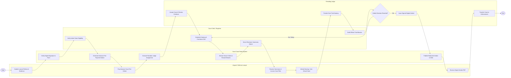

# Swimlane Diagram — Court Case Management System

## Mermaid Code

## Flow Description | Mô tả luồng

| Lane | Actor | Role in Flow |
|------|-------|-------------|
| 1 | Litigant / Defense Lawyer | Nộp đơn khởi kiện và chứng cứ điện tử, nộp tiền tạm ứng án phí, nhận giấy triệu tập, tham gia phiên tòa trực tiếp/trực tuyến và nhận bản án. |
| 2 | Court Case Portal System | Kiểm tra định dạng và chữ ký số, tính tạm ứng án phí, phân công Thẩm phán ngẫu nhiên, truyền luồng video phiên tòa trực tuyến và công khai bản án. |
| 3 | Court Clerk / Registrar | Kiểm tra tính hợp lệ của đơn, xếp lịch phiên tòa và phòng xử án, tống đạt giấy triệu tập và lập biên bản phiên tòa điện tử. |
| 4 | Presiding Judge | Thụ lý vụ án, điều hành phiên tòa xét xử, thảo luận tuyên án, ký số bản án chính thức và chuyển bản án sang cơ quan thi hành án. |
