# Action Tree — Court Case Management System

## Mermaid Code

```mermaid
graph TD
    Root["Court Case Management System"]

    Root --> M1["Lawsuit Filing & Intake"]
    Root --> M2["Case Assignment & Scheduling"]
    Root --> M3["Evidence & Dossier Management"]
    Root --> M4["Trial Proceedings & Virtual Court"]
    Root --> M5["Verdict & Appeal Processing"]
    Root --> M6["Judgment Publication & Enforcement"]

    M1 --> A11["Submit Online Lawsuit Petition"]
    M1 --> A12["Calculate Advance Court Fee"]
    M1 --> A13["Process Online Court Fee Payment"]
    M1 --> A14["Issue Formal Case Acceptance Notice"]

    M2 --> A21["Execute Random Judge Assignment Algorithm"]
    M2 --> A22["Schedule Courtroom Slot & Hearing Date"]
    M2 --> A23["Issue Electronic Court Summons Notice"]
    M2 --> A24["Track Procedural SLA Timelines"]

    M3 --> A31["Upload Encrypted Evidence Files"]
    M3 --> A32["Verify Digital Hash Integrity Evidence"]
    M3 --> A33["Manage Legal Brief Submissions"]
    M3 --> A34["Manage Digital Judicial Case File"]

    M4 --> A41["Host Secure Virtual Court Streaming"]
    M4 --> A42["Record Digital Voice Trial Minutes"]
    M4 --> A43["Manage Witness Interrogation Queue"]
    M4 --> A44["Log In-Court Motions & Rulings"]

    M5 --> A51["Draft Official Court Verdict Document"]
    M5 --> A52["Apply Judge PKI Digital Signature"]
    M5 --> A53["File Appeal Petition Submissions"]
    M5 --> A54["Process Procuracy Appeal Protests"]

    M6 --> A61["Redact Personal PII Data Judgments"]
    M6 --> A62["Publish Verdicts to Portal Search"]
    M6 --> A63["Transfer Enforceable Case to Enforcement"]
    M6 --> A64["Export Judicial Performance Metrics"]
```

## Module Description | Mô tả Module

| # | Module | Description | Actions |
|---|--------|-------------|---------|
| 1 | Lawsuit Filing & Intake | Tiếp nhận đơn khởi kiện trực tuyến, tự động tính toán và thu tiền tạm ứng án phí, phát hành thông báo thụ lý | Submit Online Lawsuit Petition, Calculate Advance Court Fee, Process Online Court Fee Payment, Issue Formal Case Acceptance Notice |
| 2 | Case Assignment & Scheduling | Phân công Thẩm phán ngẫu nhiên minh bạch, xếp lịch phòng xử án, tống đạt giấy triệu tập và theo dõi hạn tố tụng | Execute Random Judge Assignment Algorithm, Schedule Courtroom Slot & Hearing Date, Issue Electronic Court Summons Notice, Track Procedural SLA Timelines |
| 3 | Evidence & Dossier Management | Quản lý tải lên và xác thực mã băm tài liệu chứng cứ số hóa, văn bản tranh tụng của các bên | Upload Encrypted Evidence Files, Verify Digital Hash Integrity Evidence, Manage Legal Brief Submissions, Manage Digital Judicial Case File |
| 4 | Trial Proceedings & Virtual Court | Tổ chức phiên tòa trực tuyến video bảo mật, tự động ghi nhận và trích xuất biên bản phiên tòa điện tử | Host Secure Virtual Court Streaming, Record Digital Voice Trial Minutes, Manage Witness Interrogation Queue, Log In-Court Motions & Rulings |
| 5 | Verdict & Appeal Processing | Soạn thảo bản án, Thẩm phán ký số điện tử ban hành bản án và xử lý đơn kháng cáo/kháng nghị | Draft Official Court Verdict Document, Apply Judge PKI Digital Signature, File Appeal Petition Submissions, Process Procuracy Appeal Protests |
| 6 | Judgment Publication & Enforcement | Tự động ẩn danh thông tin cá nhân PII, công khai bản án trên Cổng Tòa án và chuyển thi hành án dân sự | Redact Personal PII Data Judgments, Publish Verdicts to Portal Search, Transfer Enforceable Case to Enforcement, Export Judicial Performance Metrics |
