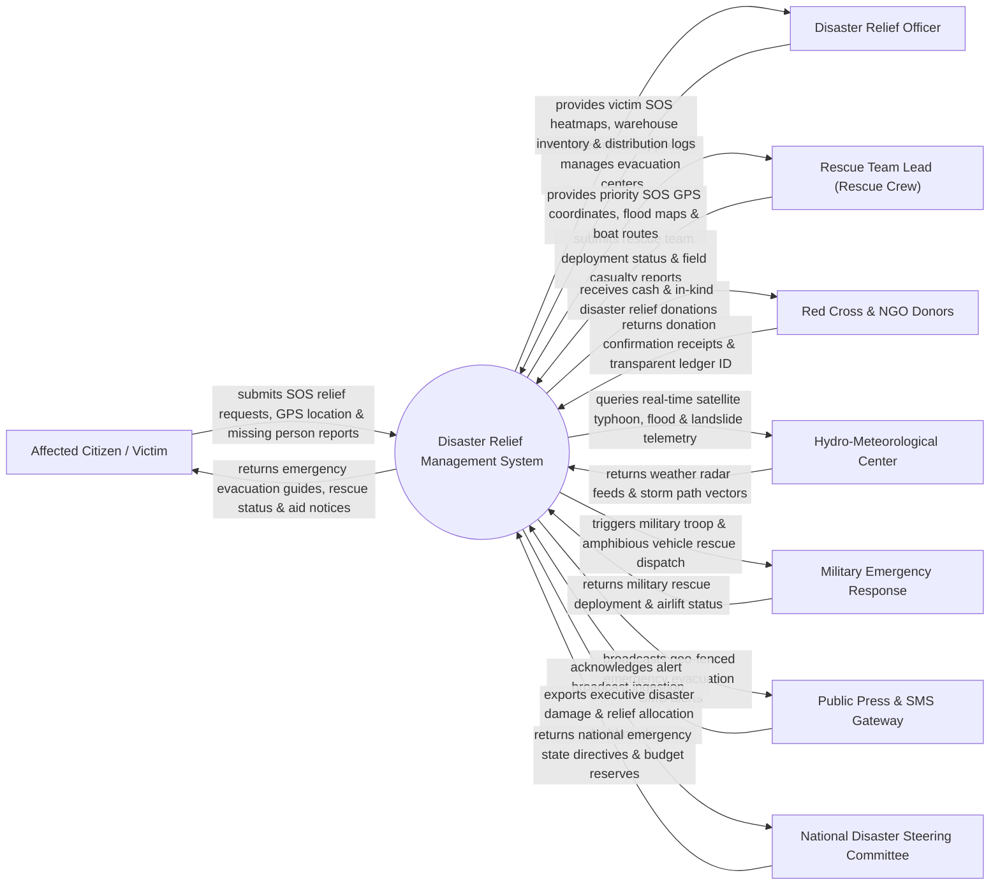

# Context Diagram — Disaster Relief Management System

## Mermaid Code

## Actor & Interaction Table | Bảng Actor & Tương tác

| # | Actor | Actor Type | Data Sent TO System | Data Received FROM System | Notes |
|---|-------|------------|---------------------|---------------------------|-------|
| 1 | Affected Citizen / Victim | Primary | SOS emergency requests, GPS location coordinates, missing person files | Evacuation center locations, rescue team status, safety advice | Nạn nhân bão lụt/thiên tai phát tín hiệu SOS cứu hộ khẩn cấp |
| 2 | Disaster Relief Officer | Primary | Relief supply allocations, warehouse dispatches, shelter logs | Victim SOS heatmaps, supply inventory levels, distribution manifests | Cán bộ Ban Chỉ huy Phòng chống Thiên tai & TKCN địa phương |
| 3 | Rescue Team Lead (Rescue Crew) | Primary | Field rescue status, casualty counts, water level updates | Priority SOS GPS targets, flooded boat navigation routes | Đội trưởng lực lượng Cứu hộ cứu nạn chuyên nghiệp |
| 4 | Red Cross & NGO Donors | Supporting | Cash donation transfers, relief goods manifests (rice, water, medicine) | Donation receipts, transparent blockchain allocation ledgers | Hội Chữ thập đỏ, các tổ chức từ thiện và nhà hảo tâm |
| 5 | Hydro-Meteorological Center | Supporting | Typhoon trajectory vectors, rainfall intensity, river water levels | Weather telemetry query requests | Trung tâm Dự báo Khí tượng Thủy văn Quốc gia cấp dữ liệu bão |
| 6 | Military Emergency Response | Supporting | Troop deployment counts, helicopter/amphibious vehicle status | Heavy rescue dispatch requests, airlift target coordinates | Lực lượng Quân đội / Quân khu điều động trực thuẫn & xe lội nước |
| 7 | Public Press & SMS Gateway | Supporting | Public broadcast acknowledgement | Geo-fenced emergency evacuation SMS alerts, safety warning bulletins | Các nhà mạng viễn thông phát tin nhắn SMS cảnh báo bão lụt |
| 8 | National Disaster Steering Committee | Regulatory | National emergency state declarations, emergency fund reserves | Executive disaster damage BI dashboards, relief allocation stats | Ban Chỉ đạo Quốc gia về Phòng chống Thiên tai chỉ đạo cấp cao |

## System Boundary Description | Mô tả Phạm vi Hệ thống

Hệ thống Disaster Relief Management System (Hệ thống Quản lý Cứu trợ và Phản ứng Khẩn cấp Thiên tai) chịu trách nhiệm tự động hóa toàn bộ công tác ứng phó bão lụt, thiên tai: Tiếp nhận tín hiệu SOS khẩn cấp kèm tọa độ GPS từ nạn nhân, tích hợp bản đồ radar khí tượng theo dõi bão/lũ quét thời gian thực, điều động lực lượng cứu hộ (canô, máy bay trực thăng quân đội), quản lý kho nhu yếu phẩm cứu trợ (gạo, nước sạch, thuốc men), minh bạch nguồn tiền tài trợ của các nhà hảo tâm và quản lý các điểm sơ tán tạm thời. Tuy nhiên, hệ thống KHÔNG trực tiếp vận hành canô/trực thăng cứu hộ và KHÔNG thay thế công tác tìm kiếm cứu nạn trực tiếp của chiến sĩ tại hiện trường.
