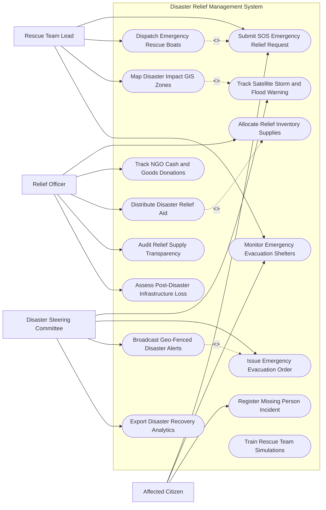

# Use Case Diagram — Disaster Relief Management System

## Mermaid Code

## Actor Table | Bảng Actor

| # | Actor | Actor Type | Role Description | Related Use Cases |
|---|-------|------------|------------------|-------------------|
| 1 | Affected Citizen | Primary | Nạn nhân bão lụt bấm tín hiệu SOS cứu hộ, tìm điểm sơ tán và báo tin người mất tích | UC01, UC07, UC09 |
| 2 | Rescue Team Lead | Primary | Đội trưởng đội cứu hộ nhận vị trí SOS GPS, điều động canô và di chuyển cứu người | UC01, UC03, UC06, UC07 |
| 3 | Relief Officer | Primary | Cán bộ cứu trợ điều phối kho hàng nhu yếu phẩm, công khai tiền từ thiện và phát hàng cứu trợ | UC04, UC05, UC08, UC11, UC12 |
| 4 | Disaster Steering Committee | Regulatory | Ban chỉ đạo quốc gia theo dõi đường đi bão radar, ra lệnh sơ tán khẩn cấp và chỉ đạo vĩ mô | UC02, UC10, UC14, UC15 |

## Use Case Table | Bảng Use Case

| # | UC ID | Use Case Name | Primary Actor | Secondary Actor | Description | Priority |
|---|-------|---------------|---------------|-----------------|-------------|----------|
| 1 | UC01 | Submit SOS Emergency Relief Request | Victim | Rescue | Nạn nhân bấm nút SOS khẩn cấp tự động phát tọa độ GPS vị trí đang bị mắc kẹt | High |
| 2 | UC02 | Track Satellite Storm and Flood Warning | Steering | MetCenter | Theo dõi thời gian thực quỹ đạo bão, lượng mưa radar và mực nước lũ trên bản đồ | High |
| 3 | UC03 | Dispatch Emergency Rescue Boats | Rescue | Military | Điều động lực lượng canô, trực thăng cứu hộ đến các điểm có tín hiệu SOS khẩn | High |
| 4 | UC04 | Allocate Relief Inventory Supplies | Officer | Warehouse | Quản lý xuất nhập tồn kho lương thực, nước sạch, thuốc men và áo phao cứu trợ | High |
| 5 | UC05 | Track NGO Cash and Goods Donations | Officer | Donors | Tiếp nhận và công khai minh bạch danh sách các khoản tiền và hàng hóa tài trợ | High |
| 6 | UC06 | Map Disaster Impact GIS Zones | Rescue | GIS Engine | Phân tích bản đồ nhiệt các vùng ngập sâu, sạt lở đất và khu vực cô lập | High |
| 7 | UC07 | Monitor Emergency Evacuation Shelters | Victim, Rescue | LocalGov | Quản lý danh sách, sức chứa và vị trí các điểm sơ tán tập trung an toàn | High |
| 8 | UC08 | Distribute Disaster Relief Aid | Officer | Victim | Phát hàng cứu trợ (gạo, mì gói, tiền mặt) cho dân và quét mã nhận hàng | High |
| 9 | UC09 | Register Missing Person Incident | Victim | Police | Tiếp nhận báo tin người thân bị thất lạc/mất tích trong thiên tai để tìm kiếm | High |
| 10 | UC10 | Issue Emergency Evacuation Order | Steering | SMS Gateway | Ban hành lệnh sơ tán khẩn cấp cho cư dân các vùng nguy hiểm bão lũ | High |
| 11 | UC11 | Audit Relief Supply Transparency | Officer | StateAudit | Kiểm toán tính công khai minh bạch, chống thất thoát hàng cứu trợ từ thiện | High |
| 12 | UC12 | Assess Post-Disaster Infrastructure Loss | Officer | MOC | Thống kê thiệt hại về nhà cửa, đường xá, cầu cống sau khi thiên tai đi qua | Medium |
| 13 | UC13 | Train Rescue Team Simulations | Rescue | VR Engine | Diễn tập các kịch bản cứu hộ bão lũ trên mô phỏng thực tế ảo | Low |
| 14 | UC14 | Broadcast Geo-Fenced Disaster Alerts | Steering | Telecom | Phát tin nhắn SMS cảnh báo bão lũ khoanh vùng theo vị trí địa lý | High |
| 15 | UC15 | Export Disaster Recovery Analytics | Steering | Government | Trích xuất báo cáo tổng hợp thiệt hại và nhu cầu kinh phí phục hồi sau thiên tai | Low |

## Use Case Specification | Đặc tả Use Case

---

### UC01 — Submit SOS Emergency Relief Request

| Field | Detail |
|-------|--------|
| **UC ID** | UC01 |
| **Use Case Name** | Submit SOS Emergency Relief Request |
| **Actor(s)** | Primary: Affected Citizen / Secondary: Rescue Team Lead |
| **Description** | Nạn nhân bị cô lập trong bão lụt bấm nút SOS cứu hộ khẩn cấp trên ứng dụng di động để gửi tọa độ GPS về Trung tâm chỉ huy. |
| **Precondition** | 1. Điện thoại nạn nhân có tín hiệu GPS hoặc trạm phát sóng di động khẩn cấp (Cell Broadcast). |
| **Main Flow** | 1. Victim mở ứng dụng Cứu hộ Thiên tai và bấm nút "SOS Cứu hộ Khẩn cấp".   2. System tự động kích hoạt định vị GPS chính xác (Tọa độ Kinh độ, Vĩ độ).   3. Victim chọn Tình trạng khẩn cấp: Đang ngập mái nhà, Có người bị thương/ốm nặng, Hết thức ăn nước uống, Có trẻ nhỏ/người già.   4. Victim chụp ảnh hiện trường mực nước ngập (nếu có thể) và bấm "Gửi SOS".   5. System mã hóa gói tin SOS dung lượng siêu nhỏ (nhằm gửi được kể cả khi sóng yếu) về Trung tâm Chỉ huy.   6. System hiển thị điểm SOS màu Đỏ nhấp nháy trên Bản đồ GIS Cứu hộ (UC06).   7. System tự động gửi tin nhắn SMS phản hồi: "Đã nhận tín hiệu SOS, đội cứu hộ đang di chuyển đến vị trí của bạn" kèm các hướng dẫn an toàn. |
| **Alternative Flow** | **AF1** — Gửi SOS qua tin nhắn SMS hoặc Tổng đài 112: Người dân nhắn tin cú pháp "SOS [Tọa độ/Địa chỉ]" tới 112, System bóc tách tự động định vị điểm cứu hộ. |
| **Exception Flow** | **EX1** — Mất kết nối di động hoàn toàn: System chuyển sang chế độ phát tín hiệu SOS qua mạng lưới Mesh Bluetooth giữa các thiết bị di động lân cận cho đến khi gặp thiết bị có mạng. |
| **Postcondition** | Tín hiệu SOS được ghi nhận vào Danh sách ưu tiên cứu hộ khẩn cấp của Đội cứu hộ (UC03). |
| **Business Rule** | **BR1**: Tín hiệu SOS cứu hộ có trẻ nhỏ hoặc ngập mái nhà phải được xếp mức độ ưu tiên báo động Đỏ cấp 1. |

---

### UC02 — Track Satellite Storm and Flood Warning

| Field | Detail |
|-------|--------|
| **UC ID** | UC02 |
| **Use Case Name** | Track Satellite Storm and Flood Warning |
| **Actor(s)** | Primary: Disaster Steering Committee / Secondary: Hydro-Meteorological Center |
| **Description** | Giám sát trực tuyến hướng di chuyển của bão, đám mây mây radar, lượng mưa thực tế và mực nước lũ sông trên bản đồ GIS vệ tinh. |
| **Precondition** | 1. Dữ liệu radar và ảnh vệ tinh bão được truyền liên tục từ Trung tâm Dự báo Khí tượng Thủy văn. |
| **Main Flow** | 1. DisasterSteering mở Bảng điều khiển Giám sát Thiên tai Quốc gia.   2. System hiển thị Quỹ đạo cơn bão (Storm Path Vector), tâm bão, bán kính gió mạnh cấp 6-12 trên bản đồ GIS.   3. System cập nhật lượng mưa theo giờ ($mm/h$) từ hệ thống trạm đo mưa tự động toàn quốc.   4. System dự báo vùng ngập lụt lũ quét dựa trên mô hình địa hình 3D (DEM) và mực nước các sông.   5. System tự động tính toán dự báo thời điểm bão đổ bộ và các huyện/xã có nguy cơ sạt lở cao.   6. DisasterSteering họp chỉ đạo trực tuyến, đánh giá tình hình và quyết định ban hành Lệnh sơ tán khẩn cấp (UC10).   7. System tự động lưu vết dữ liệu diễn biến thiên tai phục vụ công tác phân tích dựng lại kịch bản (UC15). |
| **Alternative Flow** | **AF1** — Cảnh báo xả lũ hồ chứa thủy điện: System tích hợp dữ liệu lưu lượng xả lũ của các hồ chứa thủy điện, tự động tính toán thời gian sóng lũ về vùng hạ du để phát cảnh báo. |
| **Exception Flow** | **EX1** — Mất kết nối vệ tinh bão: System chuyển sang sử dụng mô hình dự báo quán tính bão gần nhất và cảnh báo "Dữ liệu dự báo có độ sai lệch cao". |
| **Postcondition** | Ban chỉ đạo nắm chắc diễn biến bão lũ để chủ động triển khai lực lượng ứng phó từ sớm. |
| **Business Rule** | **BR1**: Tần suất cập nhật vị trí tâm bão trên bản đồ GIS khi bão cách bờ biển dưới 300km là 15 phút/lần. |

---

### UC03 — Dispatch Emergency Rescue Boats

| Field | Detail |
|-------|--------|
| **UC ID** | UC03 |
| **Use Case Name** | Dispatch Emergency Rescue Boats |
| **Actor(s)** | Primary: Rescue Team Lead / Secondary: Military Emergency Response |
| **Description** | Điều động canô, xuồng máy, xe lội nước và máy bay trực thăng cứu hộ tiếp cận các điểm SOS để giải cứu nạn nhân bão lụt. |
| **Precondition** | 1. Có các tín hiệu SOS cứu hộ được gửi về hệ thống (UC01).   2. Các Đội cứu hộ (Công an, Quân đội, Red Cross) sẵn sàng lực lượng. |
| **Main Flow** | 1. RescueLead mở danh sách "Các điểm SOS chưa được giải cứu" trên máy tính bảng cứu hộ.   2. System đề xuất tuyến đường di chuyển trên sông/vùng ngập lũ an toàn nhất cho canô (tránh dòng chảy xiết và dây điện ngầm).   3. RescueLead chọn đội canô và gán cụm các điểm SOS cần cứu gần nhau.   4. RescueLead bấm "Phát lệnh xuất phát cứu hộ".   5. System truyền tọa độ mục tiêu SOS xuống thiết bị GPS định vị trên canô cứu hộ.   6. Đội cứu hộ di chuyển đến hiện trường, đưa nạn nhân lên canô an toàn và bấm "Đã cứu hộ thành công điểm SOS X".   7. System cập nhật trạng thái điểm SOS từ Đỏ sang Xanh và điều canô đưa nạn nhân về Điểm sơ tán an toàn (UC07). |
| **Alternative Flow** | **AF1** — Cứu hộ bằng máy bay trực thăng quân đội: Đối với các vùng cô lập hoàn toàn do sạt lở đất, RescueLead gửi yêu cầu trực thăng thả dây cứu hộ và thả hàng nhu yếu phẩm. |
| **Exception Flow** | **EX1** — Canô cứu hộ gặp sự cố mắc kẹt/lật xuồng: RescueLead bấm "Báo động nguy hiểm Đội cứu hộ", System lập tức điều đội cứu hộ bọc lót khẩn cấp đến hỗ trợ. |
| **Postcondition** | Nạn nhân được giải cứu an toàn khỏi vùng ngập lũ nguy hiểm, di chuyển về nơi trú ẩn. |
| **Business Rule** | **BR1**: Canô cứu hộ phải ưu tiên tiếp cận giải cứu các điểm SOS có trẻ em, phụ nữ mang thai và người già trước. |

---

### UC05 — Track NGO Cash and Goods Donations

| Field | Detail |
|-------|--------|
| **UC ID** | UC05 |
| **Use Case Name** | Track NGO Cash and Goods Donations |
| **Actor(s)** | Primary: Relief Officer / Secondary: Red Cross & NGO Donors |
| **Description** | Tiếp nhận, quản lý và công khai minh bạch 100% các khoản tiền và hàng hóa từ thiện do các nhà hảo tâm tài trợ cho vùng bão lụt. |
| **Precondition** | 1. Nhà hảo tâm/Tổ chức từ thiện đăng ký tài trợ trực tuyến hoặc nộp trực tiếp. |
| **Main Flow** | 1. Donors truy cập Cổng Tiếp nhận Cứu trợ Từ thiện Quốc gia.   2. Donors chọn hình thức đóng góp: Tiền mặt (chuyển khoản qua Ngân hàng) hoặc Hàng hóa (Gạo, mì gói, nước sạch, thuốc, áo phao).   3. Nếu là Tiền mặt: Donors chuyển tiền vào Tài khoản Cứu trợ Mở. System tự động gạch nợ và cấp Mã giao dịch từ thiện (Donation ID).   4. Nếu là Hàng hóa: Donors nhập danh mục hàng, số lượng và chọn Kho cứu trợ tiếp nhận (UC04).   5. System tự động cập nhật số tiền/hàng hóa đóng góp vào Bảng công khai minh bạch tài trợ (Public Relief Ledger).   6. System theo dõi luồng phân phối: Khi số tiền/hàng hóa đó được phân phát tới tận tay dân (UC08), System tự động gửi báo cáo minh bạch (Transparent Report) kèm ảnh chụp cho Donors. |
| **Alternative Flow** | **AF1** — Nhà hảo tâm tự đi phát quà trực tiếp: Donors đăng ký tuyến đường và địa điểm muốn đi, System hỗ trợ cấp Giấy phép di chuyển vùng thiên tai và kết nối xe dẫn đường. |
| **Exception Flow** | **EX1** — Hàng hóa tài trợ sắp hết hạn sử dụng: System cảnh báo màu Đỏ, yêu cầu Relief Officer ưu tiên xuất kho phát ngay trong ngày. |
| **Postcondition** | Nguồn lực cứu trợ từ thiện được quản lý công khai, minh bạch, phòng chống tuyệt đối tham nhũng ăn bớt quà từ thiện. |
| **Business Rule** | **BR1**: 100% tiền và hàng hóa cứu trợ tiếp nhận bắt buộc phải được công khai số liệu thời gian thực trên Cổng thông tin công khai. |

---

### UC08 — Distribute Disaster Relief Aid

| Field | Detail |
|-------|--------|
| **UC ID** | UC08 |
| **Use Case Name** | Distribute Disaster Relief Aid |
| **Actor(s)** | Primary: Relief Officer / Secondary: Affected Citizen |
| **Description** | Tổ chức cấp phát lương thực, thực phẩm, nhu yếu phẩm và tiền mặt cứu trợ cho nhân dân vùng lũ đảm bảo đúng người, đúng định mức. |
| **Precondition** | 1. Hàng hóa cứu trợ đã sẵn sàng tại các kho hoặc điểm sơ tán (UC04).   2. Có danh sách hộ gia đình bị ảnh hưởng bởi thiên tai. |
| **Main Flow** | 1. Relief Officer mở ứng dụng Cấp phát Cứu trợ trên thiết bị di động.   2. Citizen/Victim xuất trình mã QR VNeID (hoặc mã Phiếu cứu trợ).   3. Relief Officer quét mã QR trên điện thoại: System hiển thị thông tin hộ gia đình, số nhân khẩu và khẩu phần cứu trợ được nhận.   4. System tính toán Suất quà cứu trợ: Ví dụ 1 hộ 4 người được nhận 10kg gạo + 1 thùng mì + 1 lốc nước + 2,000,000 VND tiền mặt.   5. Relief Officer trao nhu yếu phẩm/tiền mặt cho Citizen.   6. Citizen ký xác nhận trên màn hình điện thoại (hoặc chụp ảnh nhận quà).   7. Relief Officer bấm "Xác nhận đã phát quà": System tự động gạch trừ tồn kho (UC04) và cập nhật trạng thái "Hộ ông A đã nhận cứu trợ đợt 1".   8. System gửi tin nhắn thông báo minh bạch cho các Nhà hảo tâm đã đóng góp suất quà đó (UC05). |
| **Alternative Flow** | **AF1** — Cấp phát cứu trợ bằng máy bay thả hàng (Airdrop): Đối với các bản làng bị chia cắt hoàn toàn, lực lượng cứu hộ thả các thùng hàng cứu trợ chống nước có gắn thiết bị định vị GPS xuống điểm tập kết. |
| **Exception Flow** | **EX1** — Hộ gia đình nhận trùng lặp quà đợt 1 tại điểm khác: System báo cảnh báo "Hộ này đã nhận quà đợt 1 lúc X giờ", yêu cầu cán bộ kiểm tra lại danh sách trước khi phát. |
| **Postcondition** | Hàng cứu trợ đến được tận tay nhân dân vùng lũ kịp thời, đúng đối tượng, không bị trùng lặp. |
| **Business Rule** | **BR1**: Việc phát hàng cứu trợ phải ưu tiên các hộ bị mất nhà cửa, hộ gia đình chính sách và người già yếu trước. |
