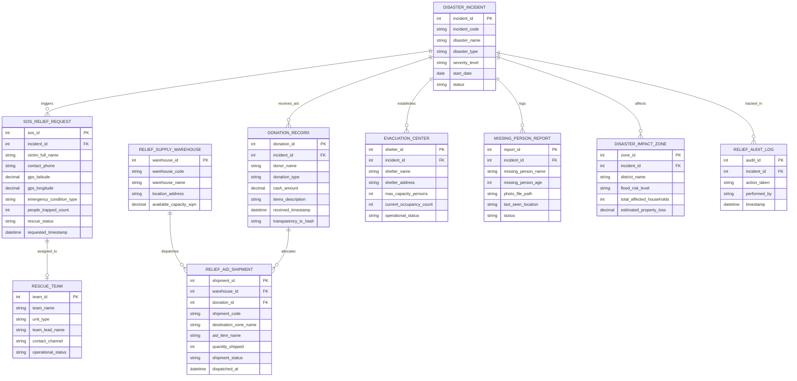

# Conceptual ERD — Disaster Relief Management System

## Mermaid Code

## Entity Description Table | Bảng mô tả Entity

| # | Entity Name | Vietnamese Name | Description | Key Attributes | Main Relationships |
|---|-------------|-----------------|-------------|----------------|-------------------|
| 1 | DISASTER_INCIDENT | Sự cố Thiên tai Bão lụt | Hồ sơ theo dõi cơn bão, đợt lũ quét hoặc thảm họa thiên tai | incident_id, incident_code, disaster_name, disaster_type, severity_level | Triggers SOS_RELIEF_REQUEST, receives DONATION_RECORD |
| 2 | SOS_RELIEF_REQUEST | Tín hiệu SOS Cứu hộ Khẩn cấp | Yêu cầu cứu hộ khẩn cấp từ nạn nhân kèm tọa độ GPS và tình trạng ngập | sos_id, victim_full_name, gps_latitude, gps_longitude, rescue_status | Belongs to DISASTER_INCIDENT, assigned to RESCUE_TEAM |
| 3 | RESCUE_TEAM | Đội Cứu hộ Cứu nạn | Thông tin lực lượng canô, trực thăng cứu hộ công an, quân đội | team_id, team_name, unit_type, team_lead_name, operational_status | Assigned to SOS_RELIEF_REQUEST |
| 4 | RELIEF_SUPPLY_WAREHOUSE | Kho Nhu yếu phẩm Cứu trợ | Quản lý dung tích và vị trí các kho hàng chứa lương thực cứu trợ | warehouse_id, warehouse_code, warehouse_name, available_capacity_sqm | Dispatches RELIEF_AID_SHIPMENT |
| 5 | DONATION_RECORD | Khoản Tài trợ Từ thiện NGO | Ghi nhận tiền mặt và hàng hóa từ thiện từ các nhà hảo tâm và mã minh bạch | donation_id, donor_name, donation_type, cash_amount, transparency_tx_hash | Belongs to DISASTER_INCIDENT, allocates RELIEF_AID_SHIPMENT |
| 6 | RELIEF_AID_SHIPMENT | Chuyến Hàng Cứu trợ | Nhật ký xuất kho và phân phối nhu yếu phẩm tới vùng bão lũ | shipment_id, shipment_code, aid_item_name, quantity_shipped, shipment_status | Belongs to WAREHOUSE, DONATION_RECORD |
| 7 | EVACUATION_CENTER | Điểm Sơ tán Tập trung | Thông tin vị trí, sức chứa và số lượng cư dân đang trú ẩn tại điểm sơ tán | shelter_id, shelter_name, max_capacity_persons, current_occupancy_count | Belongs to DISASTER_INCIDENT |
| 8 | MISSING_PERSON_REPORT | Báo tin Người Mất tích | Hồ sơ tiếp nhận thông tin người thân bị thất lạc trong thiên tai | report_id, missing_person_name, last_seen_location, status | Belongs to DISASTER_INCIDENT |
| 9 | DISASTER_IMPACT_ZONE | Vùng Ảnh hưởng Thiên tai | Bản đồ khoanh vùng ngập sâu, sạt lở đất và thiệt hại tài sản | zone_id, district_name, flood_risk_level, estimated_property_loss | Belongs to DISASTER_INCIDENT |
| 10 | RELIEF_AUDIT_LOG | Nhật ký Kiểm toán Cứu trợ | Lưu toàn bộ lịch sử phát tín hiệu SOS, điều xe, xuất kho và thu chi từ thiện | audit_id, action_taken, performed_by, timestamp | Belongs to DISASTER_INCIDENT |

## Relationship Description | Mô tả Quan hệ

| # | From Entity | Cardinality | To Entity | Relationship Label | Business Explanation |
|---|-------------|-------------|-----------|-------------------|----------------------|
| 1 | DISASTER_INCIDENT | one-to-many | SOS_RELIEF_REQUEST | triggers | Một đợt thiên tai bão lụt kích hoạt hàng ngàn yêu cầu SOS cứu hộ khẩn cấp |
| 2 | DISASTER_INCIDENT | one-to-many | DONATION_RECORD | receives_aid | Một đợt thiên tai tiếp nhận nhiều khoản đóng góp tài trợ tiền và hàng từ thiện |
| 3 | DISASTER_INCIDENT | one-to-many | EVACUATION_CENTER | establishes | Một đợt thiên tai thiết lập nhiều điểm sơ tán tập trung cho nhân dân |
| 4 | DISASTER_INCIDENT | one-to-many | MISSING_PERSON_REPORT | logs | Một đợt thiên tai ghi nhận các tin báo người thân bị thất lạc/mất tích |
| 5 | DISASTER_INCIDENT | one-to-many | DISASTER_IMPACT_ZONE | affects | Một đợt thiên tai gây ảnh hưởng tới nhiều địa bàn khu vực vùng lụt |
| 6 | SOS_RELIEF_REQUEST | one-to-one | RESCUE_TEAM | assigned_to | Mỗi điểm SOS cứu hộ được gán duy nhất cho một Đội canô/trực thăng cứu hộ |
| 7 | RELIEF_SUPPLY_WAREHOUSE | one-to-many | RELIEF_AID_SHIPMENT | dispatches | Một kho cứu trợ xuất nhiều chuyến hàng nhu yếu phẩm đi phát cho dân |
| 8 | DONATION_RECORD | one-to-many | RELIEF_AID_SHIPMENT | allocates | Một khoản tài trợ từ thiện được phân bổ thành nhiều chuyến hàng cứu trợ |
| 9 | DISASTER_INCIDENT | one-to-many | RELIEF_AUDIT_LOG | tracked_in | Mọi hoạt động cứu hộ cứu trợ được ghi lại nhật ký kiểm toán bất biến minh bạch |
