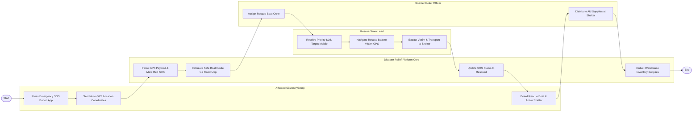

# Swimlane Diagram — Disaster Relief Management System

## Mermaid Code

## Flow Description | Mô tả luồng

| Lane | Actor | Role in Flow |
|------|-------|-------------|
| 1 | Affected Citizen (Victim) | Bấm nút SOS khẩn cấp trên ứng dụng di động, gửi tọa độ GPS tự động, bước lên canô cứu hộ và di chuyển đến điểm sơ tán. |
| 2 | Disaster Relief Platform Core | Bóc tách tọa độ GPS, đánh dấu điểm SOS đỏ trên bản đồ, tính tuyến đường canô an toàn, cập nhật trạng thái đã cứu và trừ kho nhu yếu phẩm. |
| 3 | Rescue Team Lead | Nhận vị trí SOS cứu hộ ưu tiên trên thiết bị di động, điều khiển canô tiếp cận tọa độ nạn nhân, đưa nạn nhân lên xuồng an toàn. |
| 4 | Disaster Relief Officer | Phân công đội canô cứu hộ và thực hiện phát nhu yếu phẩm cứu trợ cho người dân tại điểm sơ tán. |
