# Action Tree — Disaster Relief Management System

## Mermaid Code

```mermaid
graph TD
    Root["Disaster Relief Management System"]

    Root --> M1["SOS Emergency Intake & Victim Tracking"]
    Root --> M2["Hydro-Meteorological Warning & GIS"]
    Root --> M3["Relief Inventory & Supply Logistics"]
    Root --> M4["Rescue Dispatch & Evacuation Shelters"]
    Root --> M5["NGO Donations & Financial Transparency"]
    Root --> M6["Post-Disaster Loss & Steering Analytics"]

    M1 --> A11["Receive Mobile SOS Emergency Requests"]
    M1 --> A12["Triangulate GPS Victim Coordinates"]
    M1 --> A13["Register Missing Person Incidents"]
    M1 --> A14["Prioritize Red Alarm SOS Cases"]

    M2 --> A21["Track Satellite Storm Radar Vectors"]
    M2 --> A22["Monitor River Water Level Sensors"]
    M2 --> A23["Map Flooded Risk GIS Heatmaps"]
    M2 --> A24["Issue Geo-Fenced SMS Evacuation"]

    M3 --> A31["Manage Warehouse Relief Goods"]
    M3 --> A32["Dispatch Aid Shipments Flood Zones"]
    M3 --> A33["Distribute Rice Water Medicine Aid"]
    M3 --> A34["Scan Citizen VNeID Aid Receipts"]

    M4 --> A41["Dispatch Rescue Boats Helicopters"]
    M4 --> A42["Navigate Safe Flood Water Routes"]
    M4 --> A43["Monitor Evacuation Shelter Capacity"]
    M4 --> A44["Coordinate Military Troop Airlifts"]

    M5 --> A51["Track NGO Cash Goods Donations"]
    M5 --> A52["Publish Public Transparent Ledgers"]
    M5 --> A53["Issue Donor E-Receipt Proofs"]
    M5 --> A54["Audit Aid Distribution No-Loss"]

    M6 --> A61["Assess Infrastructure Loss Damage"]
    M6 --> A62["Export Steering Committee Dashboards"]
    M6 --> A63["Run VR Rescue Team Simulations"]
    M6 --> A64["Log System Immutable Audit Trails"]
```

## Module Description | Mô tả Module

| # | Module | Description | Actions |
|---|--------|-------------|---------|
| 1 | SOS Emergency Intake & Victim Tracking | Tiếp nhận tín hiệu SOS khẩn cấp từ nạn nhân, định vị GPS, tiếp nhận báo tin người mất tích và phân cấp báo động cứu hộ | Receive Mobile SOS Emergency Requests, Triangulate GPS Victim Coordinates, Register Missing Person Incidents, Prioritize Red Alarm SOS Cases |
| 2 | Hydro-Meteorological Warning & GIS | Theo dõi radar vệ tinh bão, mực nước sông hồ, dựng bản đồ nhiệt GIS ngập lụt lũ quét và phát SMS cảnh báo sơ tán | Track Satellite Storm Radar Vectors, Monitor River Water Level Sensors, Map Flooded Risk GIS Heatmaps, Issue Geo-Fenced SMS Evacuation |
| 3 | Relief Inventory & Supply Logistics | Quản lý kho hàng nhu yếu phẩm cứu trợ (gạo, nước, thuốc), điều phối các chuyến hàng và phát quà cho dân qua QR VNeID | Manage Warehouse Relief Goods, Dispatch Aid Shipments Flood Zones, Distribute Rice Water Medicine Aid, Scan Citizen VNeID Aid Receipts |
| 4 | Rescue Dispatch & Evacuation Shelters | Điều động canô, trực thăng cứu hộ quân đội, dẫn đường thủy an toàn và quản lý sức chứa các điểm sơ tán tập trung | Dispatch Rescue Boats Helicopters, Navigate Safe Flood Water Routes, Monitor Evacuation Shelter Capacity, Coordinate Military Troop Airlifts |
| 5 | NGO Donations & Financial Transparency | Tiếp nhận tiền và hàng từ thiện từ nhà hảo tâm, công khai minh bạch 100% dòng tiền tài trợ và gửi xác nhận minh bạch | Track NGO Cash Goods Donations, Publish Public Transparent Ledgers, Issue Donor E-Receipt Proofs, Audit Aid Distribution No-Loss |
| 6 | Post-Disaster Loss & Steering Analytics | Thống kê đánh giá thiệt hại hạ tầng sau thiên tai, trích xuất báo cáo BI trình Ban Chỉ đạo và diễn tập mô phỏng VR | Assess Infrastructure Loss Damage, Export Steering Committee Dashboards, Run VR Rescue Team Simulations, Log System Immutable Audit Trails |
