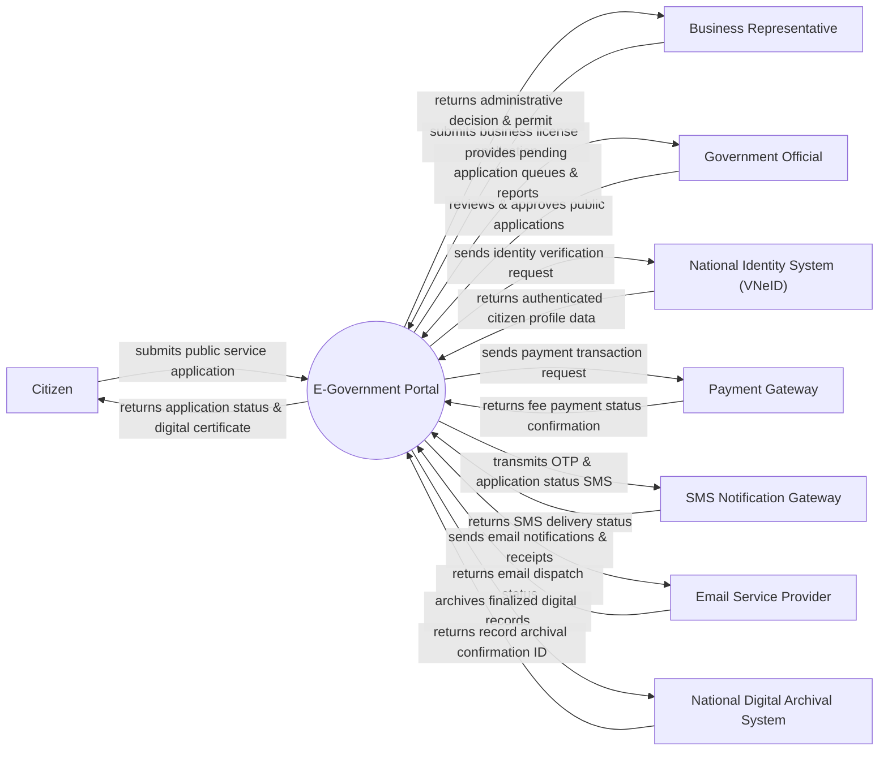

# Context Diagram — E-Government Portal

## Mermaid Code

## Actor & Interaction Table | Bảng Actor & Tương tác

| # | Actor | Actor Type | Data Sent TO System | Data Received FROM System | Notes |
|---|-------|------------|---------------------|---------------------------|-------|
| 1 | Citizen | Primary | Application data, personal documents, feedback, fee payments | Service status update, issued digital certificates, notifications | Nguoi dung cong dan thuc hien cac thut tuc hanh chinh cong |
| 2 | Business Representative | Primary | Business registration info, license requests, corporate tax files | Business permits, license approvals, fee receipts | Dai dien doanh nghiep thuc hien thut tuc phap ly cho to chuc |
| 3 | Government Official | Primary | Application reviews, approvals, rejections, service configuration | Queue of pending applications, citizen dossiers, SLA reports | Can bo cong chuc tiep nhan va xu ly ho so hanh chinh |
| 4 | National Identity System (VNeID) | Supporting | Authenticated citizen attributes, eID verification result | SSO authentication request, identity token query | He thong dinh danh dien tu quoc gia dung de xac thuc nguoi dung |
| 5 | Payment Gateway | Supporting | Payment success/failure status, transaction reference ID | Payment order details, administrative fee amount, citizen ID | Cong thanh toan quoc gia (Napas, VNPay, Momo) xu ly le phi hanh chinh |
| 6 | SMS Notification Gateway | Supporting | SMS delivery receipts, error status codes | Recipient phone numbers, OTP codes, status update messages | Dich vu tin nhan SMS thong bao tien do ho so va OTP |
| 7 | Email Service Provider | Supporting | Delivery logs, bounce tracking info | Recipient email address, formatted email body, digital attachments | He thong gui email thong bao dien tu (SendGrid/AWS SES) |
| 8 | National Digital Archival System | Supporting | Archival receipt ID, storage verification status | Finalized electronic records, digital signatures, metadata | He thong luu trữ va so hoa ho so hanh chinh quoc gia |

## System Boundary Description | Mô tả Phạm vi Hệ thống

Hệ thống E-Government Portal (Cổng Thông tin Điện tử Chính phủ) đóng vai trò là đầu mối giao tiếp trực tuyến duy nhất giữa công dân, doanh nghiệp và các cơ quan quản lý nhà nước. Hệ thống chịu trách nhiệm cung cấp dịch vụ công trực tuyến mức độ toàn trình, tiếp nhận và quản lý luồng hồ sơ thủ tục hành chính, tích hợp xác thực danh tính số quốc gia (VNeID), thanh toán lệ phí trực tuyến và trả kết quả số hóa (bản điện tử có chữ ký số). Tuy nhiên, cổng dịch vụ KHÔNG trực tiếp lưu trữ cơ sở dữ liệu định danh gốc (ủy quyền cho VNeID), KHÔNG tự xử lý hạ tầng giao dịch ngân hàng (ủy quyền cho Cổng thanh toán quốc gia) và KHÔNG thay thế quy trình thẩm định chuyên môn nội bộ của các sở/ngành chuyên trách mà chỉ đóng vai trò luân chuyển và theo dõi trạng thái hồ sơ.
