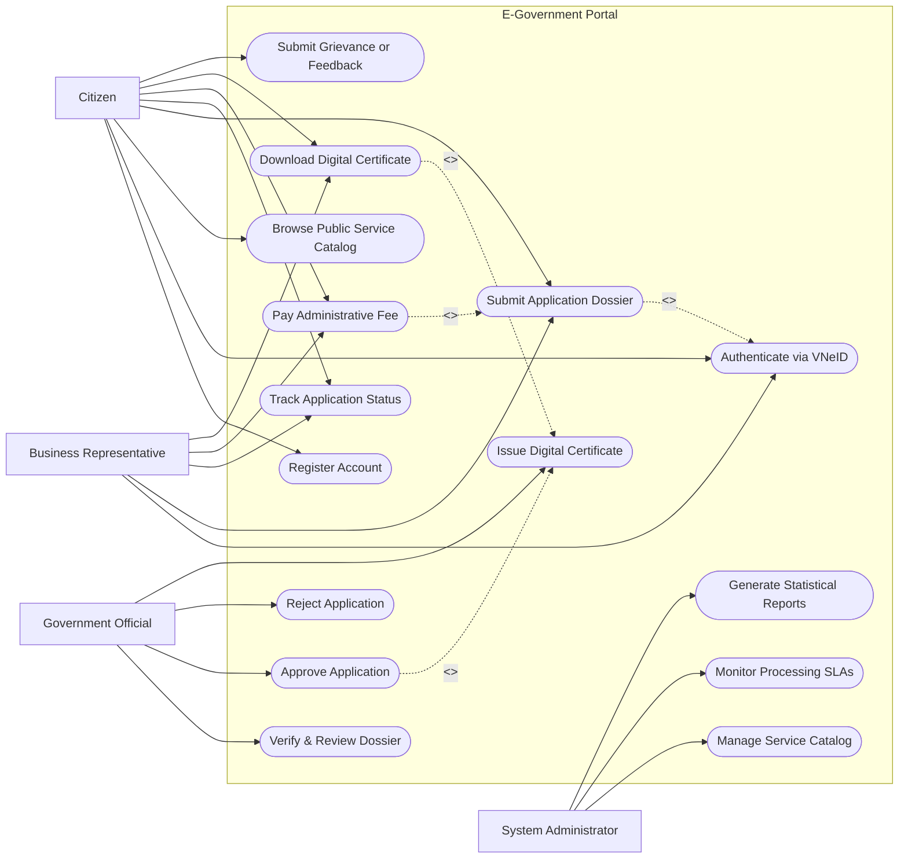

# Use Case Diagram — E-Government Portal

## Mermaid Code

## Actor Table | Bảng Actor

| # | Actor | Actor Type | Role Description | Related Use Cases |
|---|-------|------------|------------------|-------------------|
| 1 | Citizen | Primary | Cá nhân sử dụng dịch vụ công trực tuyến | UC01, UC02, UC03, UC04, UC05, UC06, UC07, UC08 |
| 2 | Business Representative | Primary | Đại diện doanh nghiệp nộp hồ sơ dịch vụ hành chính doanh nghiệp | UC02, UC04, UC05, UC06, UC07 |
| 3 | Government Official | Primary | Cán bộ nhà nước thụ lý, kiểm tra và phê duyệt hồ sơ | UC09, UC10, UC11, UC12 |
| 4 | System Administrator | System / Secondary | Quản trị viên hệ thống cấu hình danh mục, giám sát và xuất báo cáo | UC13, UC14, UC15 |

## Use Case Table | Bảng Use Case

| # | UC ID | Use Case Name | Primary Actor | Secondary Actor | Description | Priority |
|---|-------|---------------|---------------|-----------------|-------------|----------|
| 1 | UC01 | Register Account | Citizen | - | Đăng ký tài khoản cổng dịch vụ công | High |
| 2 | UC02 | Authenticate via VNeID | Citizen, BusinessRep | VNeID System | Xác thực đăng nhập qua ứng dụng VNeID quốc gia | High |
| 3 | UC03 | Browse Public Service Catalog | Citizen | - | Tra cứu danh mục và hướng dẫn thủ tục hành chính | High |
| 4 | UC04 | Submit Application Dossier | Citizen, BusinessRep | - | Điền biểu mẫu điện tử và tải lên các tệp hồ sơ đính kèm | High |
| 5 | UC05 | Track Application Status | Citizen, BusinessRep | SMS Gateway | Tra cứu tiến độ giải quyết hồ sơ qua mã hồ sơ | High |
| 6 | UC06 | Pay Administrative Fee | Citizen, BusinessRep | Payment Gateway | Thanh toán phí/lệ phí dịch vụ công trực tuyến | High |
| 7 | UC07 | Download Digital Certificate | Citizen, BusinessRep | - | Tải về kết quả thủ tục hành chính dưới dạng tệp số hóa | High |
| 8 | UC08 | Submit Grievance or Feedback | Citizen | - | Gửi phản ánh, kiến nghị về dịch vụ công và cán bộ | Medium |
| 9 | UC09 | Verify & Review Dossier | GovOfficial | - | Kiểm tra tính hợp lệ và đầy đủ của hồ sơ điện tử | High |
| 10 | UC10 | Approve Application | GovOfficial | - | Phê duyệt hồ sơ đủ điều kiện giải quyết | High |
| 11 | UC11 | Reject Application | GovOfficial | Email Service | Từ chối hoặc yêu cầu bổ sung hồ sơ chưa đạt | High |
| 12 | UC12 | Issue Digital Certificate | GovOfficial | Archival System | Ký số và ban hành kết quả thủ tục hành chính điện tử | High |
| 13 | UC13 | Manage Service Catalog | SysAdmin | - | Thêm, sửa, cập nhật quy trình thủ tục hành chính | Medium |
| 14 | UC14 | Monitor Processing SLAs | SysAdmin | - | Theo dõi hạn xử lý và cảnh báo hồ sơ trễ hạn | High |
| 15 | UC15 | Generate Statistical Reports | SysAdmin | - | Tổng hợp báo cáo tình hình giải quyết thủ tục hành chính | Medium |

## Use Case Specification | Đặc tả Use Case

---

### UC04 — Submit Application Dossier

| Field | Detail |
|-------|--------|
| **UC ID** | UC04 |
| **Use Case Name** | Submit Application Dossier |
| **Actor(s)** | Primary: Citizen, Business Representative / Secondary: None |
| **Description** | Nguời dùng chọn dịch vụ công, khai báo thông tin trên biểu mẫu điện tử, đính kèm tệp hồ sơ và gửi lên hệ thống để tiếp nhận. |
| **Precondition** | 1. Nguồn dùng đã đăng nhập thành công qua VNeID (UC02).   2. Dịch vụ công đang ở trạng thái hoạt động trên Cổng. |
| **Main Flow** | 1. Citizen chọn thủ tục hành chính cần thực hiện từ danh mục.   2. System hiển thị biểu mẫu điện tử (e-Form) và danh mục tài liệu cần đính kèm.   3. Citizen điền đầy đủ các thông tin bắt buộc trên e-Form.   4. Citizen tải lên các tệp tài liệu số hóa (PDF, PNG).   5. System kiểm tra định dạng tệp và dung lượng hợp lệ.   6. Citizen nhấn "Nộp hồ sơ".   7. System khởi tạo hồ sơ, cấp Mã hồ sơ duy nhất (Dossier Code), lưu trữ thông tin và gửi thông báo tiếp nhận cho Citizen. |
| **Alternative Flow** | **AF1** — Lưu bản nháp: Tại bước 4, Citizen chọn "Lưu bản nháp". System lưu thông tin đã điền và tài liệu đã tải lên, cho phép Citizen tiếp tục hoàn thiện sau.   **AF2** — Nộp thay người khác: Tại bước 3, Citizen đánh dấu "Nộp thay" và nhập mã định danh cá nhân của người ủy quyền. System kiểm tra giấy ủy quyền hợp lệ trước khi cho nộp. |
| **Exception Flow** | **EX1** — Tệp đính kèm không đúng định dạng hoặc vượt quá dung lượng: System hiển thị thông báo lỗi, đánh dấu trường bị lỗi và yêu cầu Citizen chọn tệp khác.   **EX2** — Mất kết nối mạng trong lúc nộp: System thông báo gián đoạn kết nối, lưu tự động dữ liệu vào bộ nhớ tạm local storage để Citizen không mất thông tin. |
| **Postcondition** | Hồ sơ được tạo ở trạng thái "Mới nộp" (Submitted), mã hồ sơ được gửi qua email/SMS cho công dân và hồ sơ xuất hiện trong hàng đợi của cán bộ thụ lý. |
| **Business Rule** | **BR1**: Mã hồ sơ phải tuân theo cấu trúc chuẩn quy định quốc gia `[Mã Cơ Quan]-[Năm]-[STT]`.   **BR2**: Mọi tài liệu tải lên phải được tự động quét vi-rút trước khi lưu trữ vào hệ thống. |

---

### UC06 — Pay Administrative Fee

| Field | Detail |
|-------|--------|
| **UC ID** | UC06 |
| **Use Case Name** | Pay Administrative Fee |
| **Actor(s)** | Primary: Citizen, Business Representative / Secondary: Payment Gateway |
| **Description** | Nguời dùng thanh toán lệ phí hành chính cho hồ sơ đã được duyệt điều kiện thanh toán thông qua Cổng thanh toán quốc gia. |
| **Precondition** | 1. Hồ sơ ở trạng thái "Chờ thanh toán lệ phí" do cán bộ thụ lý xác nhận.   2. Số tiền lệ phí đã được định khoản theo đúng biểu phí quy định. |
| **Main Flow** | 1. Citizen truy cập chi tiết hồ sơ và chọn "Thanh toán lệ phí".   2. System hiển thị thông tin hóa đơn bao gồm mã hồ sơ, tên thủ tục, số tiền lệ phí.   3. Citizen lựa chọn phương thức thanh toán (Thẻ ngân hàng, QR Code, Ví điện tử).   4. System chuyển hướng Citizen đến giao diện Cổng thanh toán quốc gia.   5. Citizen thực hiện xác thực giao dịch tại ngân hàng/ví điện tử.   6. Payment Gateway trả về kết quả thanh toán cho System.   7. System xác nhận thanh toán thành công, cập nhật trạng thái hồ sơ sang "Đã thanh toán" và xuất biên lai điện tử. |
| **Alternative Flow** | **AF1** — Thanh toán trực tiếp tại bộ phận một cửa: Citizen chọn phương thức "Thanh toán tại bộ phận 1 cửa". System in phiếu thu lệ phí offline và chờ cán bộ thu ngân xác nhận trên hệ thống. |
| **Exception Flow** | **EX1** — Giao dịch thanh toán thất bại (không đủ số dư/hết thời gian chờ): System nhận thông báo lỗi từ Payment Gateway, giữ nguyên trạng thái "Chờ thanh toán" và cho phép Citizen thử lại.   **EX2** — Sai lệch số tiền thanh toán: System tự động hủy giao dịch, ghi log sự cố và gửi yêu cầu đối soát tới Cổng thanh toán. |
| **Postcondition** | Hồ sơ chuyển sang trạng thái "Đã thanh toán - Đang thụ lý chính thức", biên lai điện tử có mã tra cứu được lưu vào hồ sơ công dân. |
| **Business Rule** | **BR1**: Biên lai điện tử phải được ký số pháp lý theo tiêu chuẩn hóa đơn/biên lai nhà nước.   **BR2**: Thời hạn thanh toán lệ phí là 7 ngày làm việc kể từ khi thông báo, quá hạn hồ sơ sẽ tự động chuyển sang trạng thái tạm hủy. |

---

### UC09 — Verify & Review Dossier

| Field | Detail |
|-------|--------|
| **UC ID** | UC09 |
| **Use Case Name** | Verify & Review Dossier |
| **Actor(s)** | Primary: Government Official / Secondary: None |
| **Description** | Cán bộ tiếp nhận kiểm tra chi tiết tính pháp lý, tính đầy đủ và tính chính xác của các giấy tờ trong hồ sơ điện tử do công dân nộp. |
| **Precondition** | 1. Cán bộ đã đăng nhập vào phân hệ cán bộ với đúng thẩm quyền xử lý.   2. Hồ sơ nằm trong danh sách hàng đợi "Mới nộp" của cơ quan/phòng ban. |
| **Main Flow** | 1. GovOfficial chọn hồ sơ từ danh sách hàng đợi xử lý.   2. System hiển thị thông tin e-Form và các tệp văn bản đính kèm.   3. GovOfficial đối soát thông tin cá nhân với dữ liệu cơ sở dữ liệu quốc gia (nếu có).   4. GovOfficial kiểm tra tính hợp lệ của từng tài liệu thành phần.   5. GovOfficial nhập ghi chú kiểm tra và đánh giá kết quả thụ lý.   6. System ghi nhận lịch sử kiểm tra hồ sơ và thời gian thực hiện. |
| **Alternative Flow** | **AF1** — Hồ sơ thiếu giấy tờ/không hợp lệ: GovOfficial chọn "Yêu cầu sửa đổi bổ sung", nhập lý do chi tiết. System gửi thông báo và mở lại quyền chỉnh sửa cho công dân.   **AF2** — Hồ sơ không thuộc thẩm quyền giải quyết: GovOfficial chọn "Chuyển cơ quan khác", chọn cơ quan tiếp nhận. System luân chuyển hồ sơ đến đúng đơn vị chuyên trách. |
| **Exception Flow** | **EX1** — Không thể xem/mở file đính kèm do lỗi tệp: System hiển thị nút "Yêu cầu nộp lại tệp", GovOfficial gửi thông báo yêu cầu công dân tải lại bản rõ hơn. |
| **Postcondition** | Hồ sơ chuyển trạng thái sang "Đã tiếp nhận - Chờ phê duyệt" hoặc "Yêu cầu bổ sung". |
| **Business Rule** | **BR1**: Thời gian thẩm định sơ bộ hồ sơ không được vượt quá 8 giờ làm việc kể từ khi hệ thống tiếp nhận.   **BR2**: Mọi thao tác xem, sửa, ghi chú của cán bộ đều phải được ghi log truy vết không thể sửa xóa (Audit Log). |

---

### UC10 — Approve Application

| Field | Detail |
|-------|--------|
| **UC ID** | UC10 |
| **Use Case Name** | Approve Application |
| **Actor(s)** | Primary: Government Official / Secondary: None |
| **Description** | Lãnh đạo/cán bộ có thẩm quyền duyệt kết quả giải quyết hồ sơ thủ tục hành chính và quyết định cấp kết quả cho công dân. |
| **Precondition** | 1. Hồ sơ đã qua bước thẩm định đạt yêu cầu (UC09).   2. Công dân đã hoàn thành nghĩa vụ tài chính (nếu thủ tục có lệ phí). |
| **Main Flow** | 1. GovOfficial mở hồ sơ đã qua thẩm định kỹ thuật.   2. System hiển thị dự thảo kết quả giải quyết (giấy phép, chứng nhận, quyết định).   3. GovOfficial rà soát lại toàn bộ nội dung dự thảo.   4. GovOfficial cắm USB Token/chữ ký số và nhấn "Phê duyệt & Ký số".   5. System thực hiện ký số pháp lý lên tài liệu kết quả.   6. System chuyển hồ sơ sang trạng thái "Đã phê duyệt - Chờ trả kết quả". |
| **Alternative Flow** | **AF1** — Lãnh đạo bác bỏ kết quả thẩm định: GovOfficial chọn "Trả lại phòng chuyên môn", ghi rõ lý do. System chuyển hồ sơ về lại bước thẩm định UC09. |
| **Exception Flow** | **EX1** — Lỗi chữ ký số (Token hết hạn/không hợp lệ): System báo lỗi xác thực chữ ký số, hủy thao tác phê duyệt và yêu cầu cán bộ kiểm tra lại chứng thư số. |
| **Postcondition** | Văn bản kết quả điện tử đã được ký số hợp pháp, sẵn sàng ban hành và lưu trữ quốc gia. |
| **Business Rule** | **BR1**: Văn bản ban hành bắt buộc phải gắn con dấu thời gian (Timestamp) và chứng thư số công cộng còn hiệu lực. |

---

### UC08 — Submit Grievance or Feedback

| Field | Detail |
|-------|--------|
| **UC ID** | UC08 |
| **Use Case Name** | Submit Grievance or Feedback |
| **Actor(s)** | Primary: Citizen / Secondary: None |
| **Description** | Công dân gửi phản ánh, kiến nghị hoặc khiếu nại về chất lượng dịch vụ công, thái độ cán bộ hoặc sự chậm trễ trong xử lý hồ sơ. |
| **Precondition** | 1. Citizen đã được xác thực danh tính trên cổng dịch vụ công. |
| **Main Flow** | 1. Citizen truy cập mục "Phản ánh & Kiến nghị".   2. System hiển thị form tiếp nhận phản ánh.   3. Citizen chọn nhóm chủ đề (Chậm trễ hồ sơ, Thái độ phục vụ, Lỗi hệ thống, Khác).   4. Citizen nhập tiêu đề, nội dung chi tiết, mã hồ sơ liên quan (nếu có) và đính kèm bằng chứng (hình ảnh, tài liệu).   5. Citizen nhấn "Gửi phản ánh".   6. System tạo Mã phản ánh duy nhất, tự động phân loại và gửi đến bộ phận thanh tra/quản lý chất lượng. |
| **Alternative Flow** | **AF1** — Gửi phản ánh ẩn danh: Citizen chọn "Gửi ẩn danh". System ẩn thông tin định danh cá nhân đối với cán bộ xử lý trực tiếp nhưng vẫn giữ mã theo dõi cho công dân. |
| **Exception Flow** | **EX1** — Nội dung phản ánh chứa từ ngữ vi phạm tiêu chuẩn cộng đồng: System cảnh báo bộ lọc từ cấm, yêu cầu công dân chỉnh sửa văn minh trước khi gửi. |
| **Postcondition** | Phản ánh được lưu ở trạng thái "Mới tiếp nhận", hệ thống cam kết thời gian phản hồi tối đa theo quy định pháp luật. |
| **Business Rule** | **BR1**: Phản ánh về hồ sơ chậm trễ phải tự động gửi cảnh báo đôn đốc tới Thủ trưởng đơn vị xử lý hồ sơ đó. |
