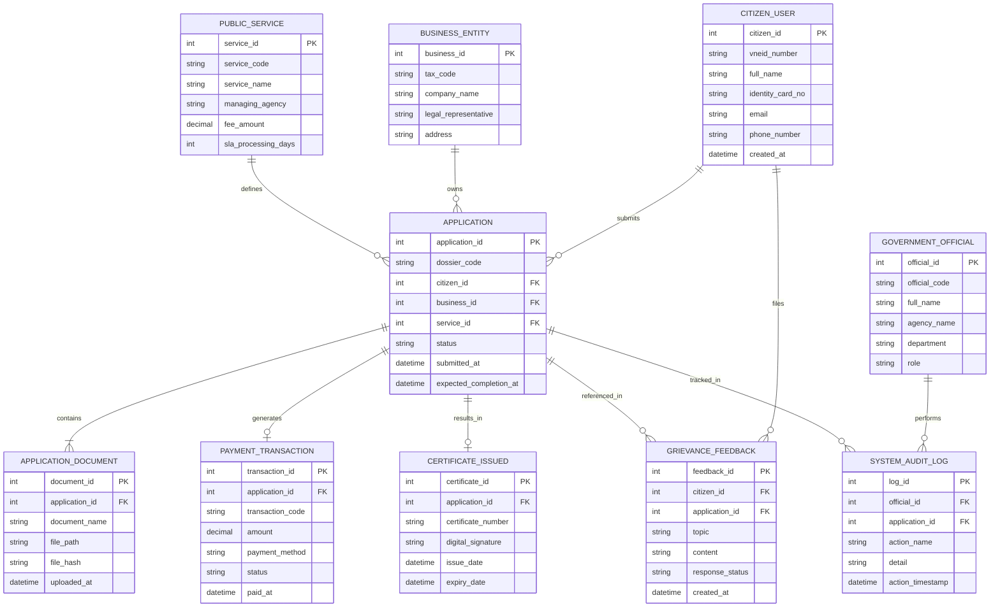

# Conceptual ERD — E-Government Portal

## Mermaid Code

## Entity Description Table | Bảng mô tả Entity

| # | Entity Name | Vietnamese Name | Description | Key Attributes | Main Relationships |
|---|-------------|-----------------|-------------|----------------|-------------------|
| 1 | CITIZEN_USER | Nguời dùng Công dân | Lưu trữ thông tin tài khoản công dân được đồng bộ qua VNeID | citizen_id, vneid_number, identity_card_no | Has many APPLICATION, files GRIEVANCE_FEEDBACK |
| 2 | BUSINESS_ENTITY | Thực thể Doanh nghiệp | Thông tin pháp nhân doanh nghiệp nộp thủ tục | business_id, tax_code, company_name | Has many APPLICATION |
| 3 | PUBLIC_SERVICE | Dịch vụ Công | Danh mục thủ tục hành chính công được cung cấp trên cổng | service_id, service_code, fee_amount, sla_processing_days | Defines many APPLICATION |
| 4 | APPLICATION | Hồ sơ Hành chính | Thông tin hồ sơ thủ tục do công dân/doanh nghiệp nộp | application_id, dossier_code, status | Belongs to CITIZEN_USER, PUBLIC_SERVICE |
| 5 | APPLICATION_DOCUMENT | Tài liệu Hồ sơ | Các tệp đính kèm điện tử chứng minh trong hồ sơ | document_id, file_path, file_hash | Belongs to APPLICATION |
| 6 | PAYMENT_TRANSACTION | Giao dịch Thanh toán | Nhật ký thanh toán lệ phí hành chính trực tuyến | transaction_id, transaction_code, amount, status | Belongs to APPLICATION |
| 7 | CERTIFICATE_ISSUED | Kết quả / Giấy phép Đã cấp | Văn bản điện tử kết quả có chữ ký số được ban hành | certificate_id, certificate_number, digital_signature | Belongs to APPLICATION |
| 8 | GRIEVANCE_FEEDBACK | Phản ánh Kiến nghị | Thông tin phản ánh, khiếu nại của người dân về thủ tục | feedback_id, topic, content, response_status | Belongs to CITIZEN_USER, APPLICATION |
| 9 | GOVERNMENT_OFFICIAL | Cán bộ Nhà nước | Thông tin công chức, viên chức thụ lý hồ sơ | official_id, official_code, agency_name, role | Performs many SYSTEM_AUDIT_LOG |
| 10 | SYSTEM_AUDIT_LOG | Nhật ký Truy vết Hệ thống | Ghi lại mọi thao tác truy cập, xử lý, ký duyệt trên hệ thống | log_id, action_name, action_timestamp | Belongs to GOVERNMENT_OFFICIAL, APPLICATION |

## Relationship Description | Mô tả Quan hệ

| # | From Entity | Cardinality | To Entity | Relationship Label | Business Explanation |
|---|-------------|-------------|-----------|-------------------|----------------------|
| 1 | CITIZEN_USER | one-to-many | APPLICATION | submits | Một công dân có thể nộp nhiều hồ sơ thủ tục hành chính khác nhau |
| 2 | BUSINESS_ENTITY | one-to-many | APPLICATION | owns | Một doanh nghiệp sở hữu nhiều hồ sơ đăng ký kinh doanh/giấy phép |
| 3 | PUBLIC_SERVICE | one-to-many | APPLICATION | defines | Một dịch vụ công quy định cấu hình cho nhiều hồ sơ được khởi tạo |
| 4 | APPLICATION | one-to-many | APPLICATION_DOCUMENT | contains | Một hồ sơ chứa nhiều tài liệu, văn bản điện tử đính kèm |
| 5 | APPLICATION | one-to-one | PAYMENT_TRANSACTION | generates | Một hồ sơ phát sinh tối đa một giao dịch thanh toán lệ phí trực tuyến |
| 6 | APPLICATION | one-to-one | CERTIFICATE_ISSUED | results_in | Một hồ sơ sau khi duyệt sẽ sinh ra một kết quả văn bản số hóa duy nhất |
| 7 | CITIZEN_USER | one-to-many | GRIEVANCE_FEEDBACK | files | Một công dân có thể gửi nhiều phản ánh kiến nghị |
| 8 | APPLICATION | one-to-many | GRIEVANCE_FEEDBACK | referenced_in | Một hồ sơ có thể bị phản ánh nhiều lần về tiến độ hoặc kết quả |
| 9 | GOVERNMENT_OFFICIAL | one-to-many | SYSTEM_AUDIT_LOG | performs | Một cán bộ thực hiện nhiều thao tác xử lý và được ghi nhật ký |
| 10 | APPLICATION | one-to-many | SYSTEM_AUDIT_LOG | tracked_in | Một hồ sơ lưu vết lịch sử luân chuyển qua nhiều bước kiểm tra |
