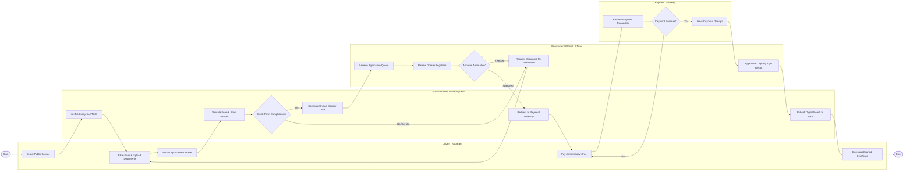

# Swimlane Diagram — E-Government Portal

## Mermaid Code

## Flow Description | Mô tả luồng

| Lane | Actor | Role in Flow |
|------|-------|-------------|
| 1 | Citizen / Applicant | Chọn dịch vụ, điền biểu mẫu điện tử, đính kèm giấy tờ, nộp hồ sơ, thanh toán lệ phí và tải về kết quả điện tử. |
| 2 | E-Government Portal System | Xác thực định danh VNeID, tự động kiểm tra định dạng và vi-rút, sinh mã hồ sơ, luân chuyển trạng thái và phát hành kết quả lên ví giấy tờ. |
| 3 | Government Official / Officer | Phân công thụ lý, kiểm tra tính pháp lý của tài liệu, yêu cầu bổ sung nếu thiếu và duyệt ký số kết quả giải quyết. |
| 4 | Payment Gateway | Tiếp nhận yêu cầu thanh toán lệ phí dịch vụ công, xử lý giao dịch qua ngân hàng/ví điện tử và trả biên lai xác nhận. |
