# Action Tree — E-Government Portal

## Mermaid Code

```mermaid
graph TD
    Root["E-Government Portal"]

    Root --> M1["User & Identity Management"]
    Root --> M2["Public Service Catalog"]
    Root --> M3["Dossier Processing Engine"]
    Root --> M4["Online Fee Payment"]
    Root --> M5["Certificate & Result Issuance"]
    Root --> M6["Feedback & System Admin"]

    M1 --> A11["Register Citizen Account"]
    M1 --> A12["Authenticate with VNeID SSO"]
    M1 --> A13["Manage Citizen Profile"]
    M1 --> A14["Manage Business Profile"]

    M2 --> A21["Browse Services by Agency"]
    M2 --> A22["Search Procedures by Keyword"]
    M2 --> A23["View Procedure Instructions & Fees"]
    M2 --> A24["Download Application Templates"]

    M3 --> A31["Fill Electronic e-Form"]
    M3 --> A32["Upload Supporting Documents"]
    M3 --> A33["Track Dossier Real-time Status"]
    M3 --> A34["Review & Verify Submitted Dossiers"]
    M3 --> A35["Request Dossier Amendments"]

    M4 --> A41["Select Payment Provider"]
    M4 --> A42["Execute Online Fee Payment"]
    M4 --> A43["Download Digital Receipt"]
    M4 --> A44["Reconcile Daily Fee Revenues"]

    M5 --> A51["Generate Electronic Result File"]
    M5 --> A52["Apply Officer Digital Signature"]
    M5 --> A53["Push Result to Citizen Citizen Vault"]
    M5 --> A54["Verify Digital Result Authenticity"]

    M6 --> A61["Submit Grievance or Complaint"]
    M6 --> A62["Track SLA Compliance & Delays"]
    M6 --> A63["Configure Agency Workflows"]
    M6 --> A64["Export Performance Metrics & Reports"]
```

## Module Description | Mô tả Module

| # | Module | Description | Actions |
|---|--------|-------------|---------|
| 1 | User & Identity Management | Quản lý tài khoản công dân, doanh nghiệp và tích hợp đăng nhập một lần VNeID | Register Citizen Account, Authenticate with VNeID SSO, Manage Citizen Profile, Manage Business Profile |
| 2 | Public Service Catalog | Quản lý danh mục dịch vụ công trực tuyến, quy trình và biểu mẫu hướng dẫn | Browse Services by Agency, Search Procedures by Keyword, View Procedure Instructions & Fees, Download Application Templates |
| 3 | Dossier Processing Engine | Động cơ tiếp nhận, kiểm tra, luân chuyển và xử lý hồ sơ thủ tục hành chính | Fill Electronic e-Form, Upload Supporting Documents, Track Dossier Real-time Status, Review & Verify Submitted Dossiers, Request Dossier Amendments |
| 4 | Online Fee Payment | Xử lý thanh toán lệ phí hành chính trực tuyến và đối soát thu ngân sách | Select Payment Provider, Execute Online Fee Payment, Download Digital Receipt, Reconcile Daily Fee Revenues |
| 5 | Certificate & Result Issuance | Quản lý ban hành kết quả số hóa, ký số điện tử và lưu trữ sổ bản sao | Generate Electronic Result File, Apply Officer Digital Signature, Push Result to Citizen Citizen Vault, Verify Digital Result Authenticity |
| 6 | Feedback & System Admin | Tiếp nhận phản ánh kiến nghị, quản trị SLA xử lý hồ sơ và báo cáo thống kê | Submit Grievance or Complaint, Track SLA Compliance & Delays, Configure Agency Workflows, Export Performance Metrics & Reports |
