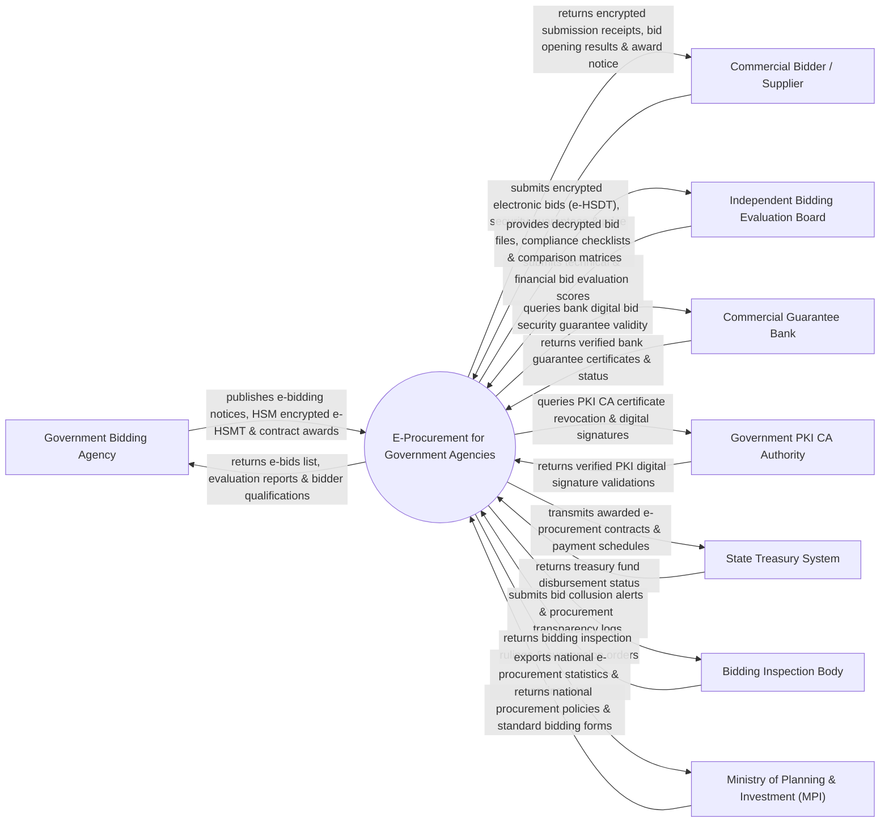

# Context Diagram — E-Procurement for Government Agencies

## Mermaid Code

## Actor & Interaction Table | Bảng Actor & Tương tác

| # | Actor | Actor Type | Data Sent TO System | Data Received FROM System | Notes |
|---|-------|------------|---------------------|---------------------------|-------|
| 1 | Government Bidding Agency | Primary | E-bidding notices, HSM encrypted bidding documents (E-HSMT), contract awards | E-bids list, evaluation reports, bidder qualification profiles | Bên mời thầu / Chủ đầu tư thuộc các cơ quan nhà nước |
| 2 | Commercial Bidder / Supplier | Primary | Encrypted electronic bids (E-HSDT), digital bank guarantees, price proposals | Encrypted submission receipts, public bid opening results, award notice | Nhà thầu / Nhà cung cấp tham gia đấu thầu qua mạng |
| 3 | Independent Bidding Evaluation Board | Primary | Technical evaluation scores, financial comparison matrices, ranking | Decrypted bid files, compliance checklists, comparison tools | Tổ chuyên gia đấu thầu thẩm định hồ sơ dự thầu |
| 4 | Commercial Guarantee Bank | Supporting | Digital bank guarantee certificates, security deposit status | Bank guarantee verification queries, call-on-guarantee orders | Ngân hàng thương mại phát hành Bảo lãnh dự thầu điện tử |
| 5 | Government PKI CA Authority | Supporting | Digital certificate status, Certificate Revocation Lists (CRL) | PKI signature validation queries, timestamp verification | Ban Cơ yếu Chính phủ / CA công cộng xác thực chữ ký số |
| 6 | State Treasury System | Supporting | Treasury fund disbursement status, payment confirmations | Awarded e-procurement contracts, payment schedules | Kho bạc Nhà nước thực hiện kiểm soát chi hợp đồng trúng thầu |
| 7 | Bidding Inspection Body | Regulatory | Bidding inspection rulings, anti-collusion directives, suspension orders | Bid collusion alerts, procurement transparency audit trails | Thanh tra Kế hoạch & Đầu tư / Cơ quan kiểm tra chống thông thầu |
| 8 | Ministry of Planning & Investment (MPI) | Regulatory | National procurement policies, standard electronic bidding forms (E-HSMT) | National e-procurement statistics, budget saving rates, BI dashboards | Bộ Kế hoạch & Đầu tư quản lý Cổng Mua sắm công Quốc gia |

## System Boundary Description | Mô tả Phạm vi Hệ thống

Hệ thống E-Procurement for Government Agencies (Hệ thống Đấu thầu Qua mạng Quốc gia / Mua sắm công Điện tử) chịu trách nhiệm tự động hóa toàn bộ quy trình mua sắm công và đấu thầu sử dụng vốn nhà nước: Đăng tải thông báo mời thầu, phát hành Hồ sơ mời thầu điện tử (E-HSMT) mã hóa HSM, nộp Hồ sơ dự thầu điện tử (E-HSDT) bảo mật, xác thực Bảo lãnh dự thầu ngân hàng điện tử, Mở thầu công khai trực tuyến, đánh giá hồ sơ thầu, sử dụng thuật toán AI phát hiện hành vi thông thầu (Collusive Bidding Rigging), ký hợp đồng điện tử bằng chữ ký số PKI và gửi dữ liệu giải ngân sang Kho bạc. Tuy nhiên, hệ thống KHÔNG trực tiếp sản xuất hàng hóa và KHÔNG thay thế việc giao hàng thực tế tại công trường/cơ quan.
