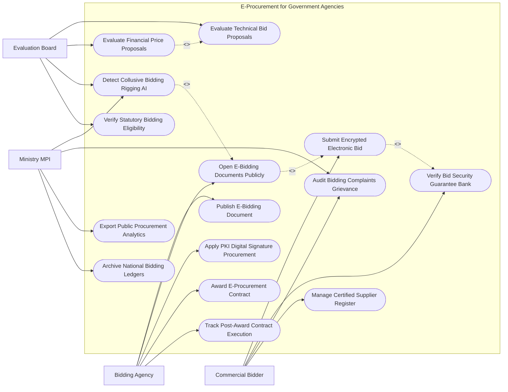

# Use Case Diagram — E-Procurement for Government Agencies

## Mermaid Code

## Actor Table | Bảng Actor

| # | Actor | Actor Type | Role Description | Related Use Cases |
|---|-------|------------|------------------|-------------------|
| 1 | Commercial Bidder | Primary | Nhà thầu nộp E-HSDT mã hóa, gửi bảo lãnh dự thầu ngân hàng và khiếu nại kiến nghị | UC02, UC03, UC10, UC12 |
| 2 | Bidding Agency | Primary | Bên mời thầu đăng thông báo E-HSMT, mở thầu công khai, ký số hợp đồng và quản lý thực hiện | UC01, UC04, UC07, UC08, UC11 |
| 3 | Evaluation Board | Primary | Tổ chuyên gia thẩm định hồ sơ kỹ thuật, tài chính, kiểm tra năng lực và phát hiện thông thầu | UC05, UC06, UC09, UC13 |
| 4 | Ministry MPI | Regulatory | Bộ Kế hoạch & Đầu tư giám sát AI chống thông thầu, giải quyết kiến nghị và phân tích báo cáo | UC09, UC10, UC14, UC15 |

## Use Case Table | Bảng Use Case

| # | UC ID | Use Case Name | Primary Actor | Secondary Actor | Description | Priority |
|---|-------|---------------|---------------|-----------------|-------------|----------|
| 1 | UC01 | Publish E-Bidding Document | Agency | MPI | Đăng tải Thông báo mời thầu và phát hành Hồ sơ mời thầu điện tử (E-HSMT) | High |
| 2 | UC02 | Submit Encrypted Electronic Bid | Bidder | PKI CA | Mã hóa và nộp Hồ sơ dự thầu điện tử (E-HSDT) lên Cổng Mua sắm công trước giờ đóng thầu | High |
| 3 | UC03 | Verify Bid Security Guarantee Bank | Bidder | CommercialBank | Tự động xác thực Thư bảo lãnh dự thầu ngân hàng điện tử phát hành từ ngân hàng | High |
| 4 | UC04 | Open E-Bidding Documents Publicly | Agency | Bidder | Tự động giải mã và công khai Biên bản mở thầu trực tuyến cho tất cả nhà thầu xem | High |
| 5 | UC05 | Evaluate Technical Bid Proposals | Evaluator | - | Đánh giá tính hợp lệ và năng lực kỹ thuật của E-HSDT theo phương pháp Đạt/Không đạt | High |
| 6 | UC06 | Evaluate Financial Price Proposals | Evaluator | Agency | Mở và đánh giá giá dự thầu, giá sau sửa lỗi hiệu chỉnh và xếp hạng nhà thầu | High |
| 7 | UC07 | Apply PKI Digital Signature Procurement | Agency, Bidder | PKI CA | Ký số PKI chuyên dùng vào Báo cáo đánh giá, Quyết định phê duyệt và Hợp đồng | High |
| 8 | UC08 | Award E-Procurement Contract | Agency | Bidder | Ban hành Quyết định phê duyệt kết quả lựa chọn nhà thầu và công khai kết quả trúng thầu | High |
| 9 | UC09 | Detect Collusive Bidding Rigging AI | Evaluator, MPI | AI Engine | Thuật toán AI phát hiện hành vi thông thầu (quét trùng địa chỉ IP, trùng mã băm file, cùng chủ) | High |
| 10 | UC10 | Audit Bidding Complaints Grievance | Bidder, MPI | Inspection | Tiếp nhận và xử lý các kiến nghị, khiếu nại của nhà thầu về kết quả lựa chọn nhà thầu | High |
| 11 | UC11 | Track Post-Award Contract Execution | Agency | StateTreasury | Theo dõi tiến độ thực hiện hợp đồng trúng thầu, các đợt giao hàng và nghiệm thu thanh toán | High |
| 12 | UC12 | Manage Certified Supplier Register | Bidder | MPI | Đăng ký và quản lý hồ sơ năng lực nhà thầu công khai trên CSDL Quốc gia | Medium |
| 13 | UC13 | Verify Statutory Bidding Eligibility | Evaluator | TaxAgency | Kiểm tra tư cách hợp lệ của nhà thầu (Không bị tạm dừng, không bị nợ thuế, không giải thể) | High |
| 14 | UC14 | Export Public Procurement Analytics | MPI | Executive | Trích xuất báo cáo tỷ lệ tiết kiệm ngân sách qua đấu thầu nộp Thủ tướng Chính phủ | Low |
| 15 | UC15 | Archive National Bidding Ledgers | System | Archives | Đóng gói và lưu trữ vĩnh viễn toàn bộ dữ liệu gói thầu theo Luật Đấu thầu | Low |

## Use Case Specification | Đặc tả Use Case

---

### UC01 — Publish E-Bidding Document

| Field | Detail |
|-------|--------|
| **UC ID** | UC01 |
| **Use Case Name** | Publish E-Bidding Document |
| **Actor(s)** | Primary: Government Bidding Agency / Secondary: Ministry of Planning & Investment (MPI) |
| **Description** | Bên mời thầu biên soạn và phát hành Hồ sơ mời thầu điện tử (E-HSMT) miễn phí trên Cổng Đấu thầu qua mạng Quốc gia. |
| **Precondition** | 1. Dự án và Kế hoạch lựa chọn nhà thầu đã được cấp có thẩm quyền phê duyệt. |
| **Main Flow** | 1. Agency đăng nhập Cổng Mua sắm công Quốc gia bằng Chữ ký số PKI.   2. Agency chọn hình thức lựa chọn nhà thầu: Đấu thầu rộng rãi qua mạng, Chỉ định thầu qua mạng, Chào hàng cạnh tranh qua mạng.   3. Agency nạp Biểu mẫu E-HSMT chuẩn do Bộ Kế hoạch & Đầu tư quy định (E-HSMT Xây lắp, Hàng hóa, Dịch vụ).   4. Agency nhập các thông tin gói thầu: Tên gói thầu, Giá gói thầu, Thời điểm đóng/mở thầu, Mức bảo lãnh dự thầu, Tiêu chuẩn đánh giá kỹ thuật và tài chính.   5. Agency tải lên các tệp đính kèm: Bản vẽ thiết kế, Tiêu chuẩn kỹ thuật chi tiết.   6. Agency ký số PKI phê duyệt E-HSMT.   7. System tự động xuất bản Thông báo mời thầu (E-TBMT) lên Cổng thông tin công khai và phát hành E-HSMT miễn phí cho tất cả nhà thầu tải về. |
| **Alternative Flow** | **AF1** — Sửa đổi/Làm rõ E-HSMT: Agency đăng tải văn bản làm rõ hoặc sửa đổi E-HSMT trước thời điểm đóng thầu tối thiểu 10 ngày, System tự động thông báo tới các nhà thầu đã quan tâm. |
| **Exception Flow** | **EX1** — Đăng tải E-HSMT không đúng mẫu quy định của MPI: System ngăn chặn xuất bản và báo lỗi "Mẫu E-HSMT không hợp lệ". |
| **Postcondition** | E-HSMT được công khai minh bạch toàn quốc, sẵn sàng cho các nhà thầu nộp E-HSDT (UC02). |
| **Business Rule** | **BR1**: 100% Hồ sơ mời thầu điện tử bắt buộc phải phát hành miễn phí trên Cổng Mua sắm công Quốc gia. |

---

### UC02 — Submit Encrypted Electronic Bid

| Field | Detail |
|-------|--------|
| **UC ID** | UC02 |
| **Use Case Name** | Submit Encrypted Electronic Bid |
| **Actor(s)** | Primary: Commercial Bidder / Secondary: Government PKI CA Authority |
| **Description** | Nhà thầu lập, mã hóa an toàn và nộp Hồ sơ dự thầu điện tử (E-HSDT) lên Cổng Mua sắm công trước thời điểm đóng thầu. |
| **Precondition** | 1. E-HSMT đã được xuất bản (UC01) và chưa đến thời điểm đóng thầu.   2. Nhà thầu có tài khoản hợp lệ trên Hệ thống Mạng đấu thầu quốc gia (UC12). |
| **Main Flow** | 1. Bidder tải biểu mẫu E-HSDT từ gói thầu trên Cổng Mua sắm công.   2. Bidder nhập thông tin E-HSDT: Đơn dự thầu, Bảng giá dự thầu, Đề xuất kỹ thuật, Tiến độ thực hiện.   3. Bidder đính kèm Thư bảo lãnh dự thầu điện tử từ Ngân hàng (UC03) và các tệp năng lực kinh nghiệm.   4. Bidder ký số PKI chuyên dùng lên toàn bộ Hồ sơ dự thầu.   5. System mã hóa 2 lớp (Dual-layer Encryption) toàn bộ tệp E-HSDT bằng Khóa công khai của Bên mời thầu (Public Key) và Khóa hệ thống.   6. Bidder bấm "Nộp E-HSDT": System truyền tệp mã hóa vào Kho lưu trữ bảo mật (Secure Storage).   7. System tự động phát hành Phiếu xác nhận nộp E-HSDT thành công kèm Mã băm (SHA-256 Hash Digest) và Dấu thời gian (Timestamp). |
| **Alternative Flow** | **AF1** — Rút hoặc Nộp lại E-HSDT trước giờ đóng thầu: Bidder bấm "Rút E-HSDT", System ghi nhận hủy hồ sơ cũ và cho phép nộp lại hồ sơ mới trước thời điểm đóng thầu. |
| **Exception Flow** | **EX1** — Nộp E-HSDT quá thời điểm đóng thầu (dù chỉ 1 giây): System tự động khóa luồng nộp thầu, từ chối tiếp nhận và báo lỗi "Đã hết hạn nộp thầu". |
| **Postcondition** | E-HSDT được mã hóa an toàn tuyệt đối, không ai (kể cả Bên mời thầu hay Admin) có thể mở xem trước giờ mở thầu. |
| **Business Rule** | **BR1**: E-HSDT nộp qua mạng bắt buộc phải được mã hóa và ký số PKI hợp lệ theo quy định của Luật Đấu thầu. |

---

### UC04 — Open E-Bidding Documents Publicly

| Field | Detail |
|-------|--------|
| **UC ID** | UC04 |
| **Use Case Name** | Open E-Bidding Documents Publicly |
| **Actor(s)** | Primary: Government Bidding Agency / Secondary: Commercial Bidder |
| **Description** | Hệ thống tự động giải mã và công khai Biên bản mở thầu trực tuyến cho tất cả nhà thầu và cộng đồng theo dõi ngay sau giờ đóng thầu. |
| **Precondition** | 1. Đã đến thời điểm đóng thầu/mở thầu quy định trong E-HSMT.   2. Có ít nhất 01 Hồ sơ dự thầu E-HSDT được nộp hợp lệ (UC02). |
| **Main Flow** | 1. Đúng giờ mở thầu quy định, System kích hoạt Tiến trình Mở thầu Trực tuyến Tự động.   2. Agency cắm USB Token ký số PKI để cung cấp Khóa giải mã (Private Key).   3. System tiến hành giải mã tất cả các tệp E-HSDT đã nộp trong Kho lưu trữ bảo mật.   4. System tự động trích xuất các thông tin cốt lõi: Danh sách nhà thầu nộp HSDT, Giá dự thầu, Giảm giá (nếu có), Mức bảo lãnh dự thầu, Thời gian thực hiện hợp đồng.   5. System tự động lập Biên bản mở thầu điện tử (E-Opening Record PDF).   6. Agency ký số duyệt Biên bản mở thầu.   7. System tự động công khai Biên bản mở thầu trên Cổng Mua sắm công và gửi thông báo cho tất cả các nhà thầu tham dự. |
| **Alternative Flow** | **AF1** — Đấu thầu 2 giai đoạn / 2 túi hồ sơ: System chỉ giải mã và mở Hồ sơ đề xuất kỹ thuật ở Giai đoạn 1; Hồ sơ đề xuất tài chính vẫn giữ mã hóa sealed cho đến khi đánh giá xong kỹ thuật. |
| **Exception Flow** | **EX1** — Đáo hạn đóng thầu nhưng có ít hơn 03 nhà thầu nộp HSDT: System phát thông báo cho Agency lựa chọn "Gia hạn thời điểm đóng thầu thêm 04 ngày" hoặc "Cho phép mở thầu ngay". |
| **Postcondition** | Biên bản mở thầu được công khai minh bạch 100%, chuyển toàn bộ tệp E-HSDT đã giải mã sang cho Tổ chuyên gia đánh giá (UC05). |
| **Business Rule** | **BR1**: Việc mở thầu qua mạng phải được hoàn thành tự động trong vòng 02 giờ kể từ thời điểm đóng thầu. |

---

### UC06 — Evaluate Financial Price Proposals

| Field | Detail |
|-------|--------|
| **UC ID** | UC06 |
| **Use Case Name** | Evaluate Financial Price Proposals |
| **Actor(s)** | Primary: Independent Bidding Evaluation Board / Secondary: Government Bidding Agency |
| **Description** | Đánh giá Hồ sơ đề xuất tài chính, tự động sửa lỗi đại số, hiệu chỉnh sai lệch đơn giá và xếp hạng nhà thầu trúng thầu. |
| **Precondition** | 1. Các nhà thầu đã được đánh giá "Đạt" ở bước đánh giá Hồ sơ đề xuất kỹ thuật (UC05). |
| **Main Flow** | 1. Evaluator mở Phân hệ Đánh giá Tài chính Gói thầu.   2. System tự động hiển thị Bảng giá dự thầu chi tiết của các nhà thầu vượt qua bước kỹ thuật.   3. System tự động thực hiện Sửa lỗi đại số (Arithmetical Correction Check: Nhân lại số lượng x đơn giá) và Hiệu chỉnh sai lệch.   4. System tính toán Giá đánh giá ($Evaluated\_Price$) hoặc Giá thấp nhất theo phương pháp quy định trong E-HSMT.   5. System áp dụng các quy định ưu đãi trong đấu thầu (Ưu đãi hàng hóa sản xuất trong nước, doanh nghiệp nhỏ).   6. System tự động sắp xếp Xếp hạng Nhà thầu: Hạng 1 (Giá đánh giá thấp nhất / Điểm tổng hợp cao nhất), Hạng 2, Hạng 3.   7. Evaluator lập Báo cáo đánh giá hồ sơ đề xuất tài chính, ký số PKI và trình Bên mời thầu phê duyệt (UC08). |
| **Alternative Flow** | **AF1** — Thương thảo hợp đồng với Nhà thầu Hạng 1: Agency mời Nhà thầu Hạng 1 đến thương thảo chi tiết điều khoản hợp đồng trước khi quyết định phê duyệt trúng thầu. |
| **Exception Flow** | **EX1** — Giá dự thầu của tất cả nhà thầu đều vượt Giá gói thầu được duyệt: System đề xuất giải pháp "Mời các nhà thầu chào lại giá dự thầu" hoặc "Điều chỉnh tăng giá gói thầu". |
| **Postcondition** | Danh sách xếp hạng nhà thầu được xác lập minh bạch, làm căn cứ phê duyệt trúng thầu (UC08). |
| **Business Rule** | **BR1**: Nhà thầu xếp hạng 1 là nhà thầu có giá đánh giá thấp nhất (hoặc điểm tổng hợp cao nhất) và không vượt giá gói thầu. |

---

### UC09 — Detect Collusive Bidding Rigging AI

| Field | Detail |
|-------|--------|
| **UC ID** | UC09 |
| **Use Case Name** | Detect Collusive Bidding Rigging AI |
| **Actor(s)** | Primary: Evaluation Board, Ministry MPI / Secondary: AI Engine |
| **Description** | Thuật toán AI phân tích dữ liệu tệp thầu, mã băm, địa chỉ IP và mối quan hệ doanh nghiệp để tự động phát hiện hành vi thông thầu (Bid Rigging). |
| **Precondition** | 1. Hồ sơ dự thầu E-HSDT đã được nộp và mở thầu công khai (UC04). |
| **Main Flow** | 1. AI Engine tự động quét toàn bộ dữ liệu thô của các E-HSDT tham dự gói thầu.   2. AI thực hiện các thuật toán phát hiện bất thường thông thầu:   - Quét địa chỉ IP / MAC Address: Kiểm tra xem các E-HSDT của các nhà thầu khác nhau có được nộp từ cùng 1 máy tính/cùng 1 đường truyền Wi-Fi hay không.   - Quét mã băm Metadata File (File Hash Analysis): Kiểm tra các tệp thuyết minh kỹ thuật hay báo giá có được tạo từ cùng 1 phần mềm/cùng 1 tác giả (Author Metadata).   - Phân tích cấu trúc đơn giá (Price Pattern Analysis): Phát hiện các nhà thầu "quân xanh" cố tình bỏ giá cao bất thường để "quân đỏ" trúng thầu.   - Phân tích CSDL Doanh nghiệp: Kiểm tra mối quan hệ sở hữu chéo, cùng người đại diện pháp luật giữa các nhà thầu.   3. If Phát hiện chỉ dấu thông thầu ($Risk\_Score > 85\%$): AI bật cảnh báo Đỏ "Nghi vấn thông thầu (Collusion Alert)".   4. System xuất Báo cáo phân tích bằng chứng thông thầu gửi cho Evaluator và Thanh tra Kế hoạch & Đầu tư (MPI).   5. Evaluator lập biên bản tạm dừng đánh giá gói thầu và chuyển sang cơ quan thanh tra xử lý (UC10). |
| **Alternative Flow** | **AF1** — Cảnh báo nhầm do dùng chung máy tính thư viện/dịch vụ công: Evaluator yêu cầu nhà thầu giải trình bổ sung bằng chứng độc lập. |
| **Exception Flow** | **EX1** — Phát hiện hành vi thông thầu nghiêm trọng có dấu hiệu hình sự: System tự động niêm phong chứng cứ điện tử và gửi báo cáo cho Cơ quan Cảnh sát Điều tra. |
| **Postcondition** | Môi trường đấu thầu qua mạng được bảo vệ minh bạch, loại bỏ các liên minh "quân xanh quân đỏ" trục lợi ngân sách. |
| **Business Rule** | **BR1**: Nghiêm cấm tuyệt đối mọi hình thức thông thầu, thỏa thuận dàn xếp giá dự thầu giữa các nhà thầu tham dự. |
