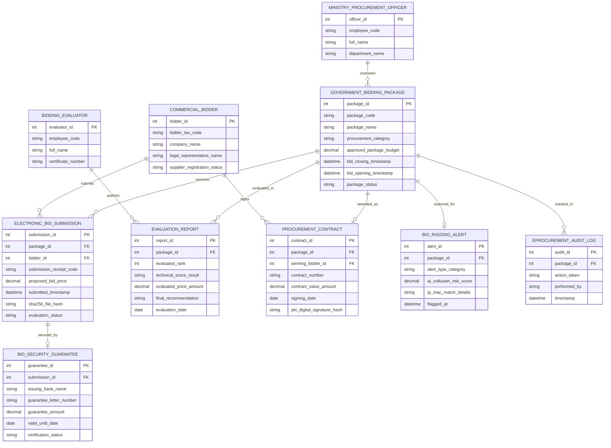

# Conceptual ERD — E-Procurement for Government Agencies

## Mermaid Code

## Entity Description Table | Bảng mô tả Entity

| # | Entity Name | Vietnamese Name | Description | Key Attributes | Main Relationships |
|---|-------------|-----------------|-------------|----------------|-------------------|
| 1 | GOVERNMENT_BIDDING_PACKAGE | Gói thầu Mua sắm công | Thông tin gói thầu mua sắm công (mã gói thầu, giá gói thầu, thời điểm đóng/mở thầu) | package_id, package_code, package_name, approved_package_budget, package_status | Receives ELECTRONIC_BID_SUBMISSION, awarded as CONTRACT |
| 2 | COMMERCIAL_BIDDER | Nhà thầu / Nhà cung cấp | Thông tin doanh nghiệp đăng ký tư cách nhà thầu hợp lệ trên Hệ thống Mạng đấu thầu QG | bidder_id, bidder_tax_code, company_name, supplier_registration_status | Submits ELECTRONIC_BID_SUBMISSION, signs CONTRACT |
| 3 | ELECTRONIC_BID_SUBMISSION | Hồ sơ Dự thầu Điện tử (E-HSDT) | Chi tiết bản nộp thầu điện tử mã hóa, giá dự thầu, mã băm SHA-256 và thời gian nộp | submission_id, submission_receipt_code, proposed_bid_price, sha256_file_hash | Belongs to PACKAGE, BIDDER, secured by GUARANTEE |
| 4 | BID_SECURITY_GUARANTEE | Bảo lãnh Dự thầu Ngân hàng | Thư bảo lãnh dự thầu điện tử do ngân hàng thương mại phát hành bảo đảm nộp thầu | guarantee_id, issuing_bank_name, guarantee_letter_number, guarantee_amount | Secures ELECTRONIC_BID_SUBMISSION |
| 5 | EVALUATION_REPORT | Báo cáo Đánh giá Hồ sơ thầu | Kết quả chấm thầu kỹ thuật, giá đánh giá và xếp hạng nhà thầu do Tổ chuyên gia lập | report_id, evaluated_rank, technical_score_result, final_recommendation | Belongs to PACKAGE, authored by EVALUATOR |
| 6 | PROCUREMENT_CONTRACT | Hợp đồng Mua sắm Điện tử | Hợp đồng kinh tế giữa Bên mời thầu và Nhà thầu trúng thầu có chữ ký số PKI | contract_id, contract_number, contract_value_amount, pki_digital_signature_hash | Belongs to PACKAGE, WINNING_BIDDER |
| 7 | BIDDING_EVALUATOR | Chuyên gia Thẩm định Thầu | Thông tin chuyên gia có chứng chỉ đào tạo đấu thầu tham gia Tổ chuyên gia chấm thầu | evaluator_id, employee_code, full_name, certificate_number | Authors EVALUATION_REPORT |
| 8 | BID_RIGGING_ALERT | Cảnh báo AI Thông thầu | Cảnh báo AI phát hiện trùng IP, trùng mã băm tệp hoặc liên minh dàn xếp giá thầu | alert_id, alert_type_category, ai_collusion_risk_score, ip_mac_match_details | Scanned for GOVERNMENT_BIDDING_PACKAGE |
| 9 | MINISTRY_PROCUREMENT_OFFICER | Cán bộ Bộ KH&ĐT | Thông tin chuyên viên Cục Quản lý Đấu thầu - Bộ Kế hoạch & Đầu tư giám sát | officer_id, employee_code, full_name, department_name | Oversees GOVERNMENT_BIDDING_PACKAGE |
| 10 | EPROCUREMENT_AUDIT_LOG | Nhật ký Kiểm toán Đấu thầu | Lưu toàn bộ lịch sử đăng tải HSMT, nộp HSDT, mở thầu, ký hợp đồng và khiếu nại | audit_id, action_taken, performed_by, timestamp | Belongs to GOVERNMENT_BIDDING_PACKAGE |

## Relationship Description | Mô tả Quan hệ

| # | From Entity | Cardinality | To Entity | Relationship Label | Business Explanation |
|---|-------------|-------------|-----------|-------------------|----------------------|
| 1 | GOVERNMENT_BIDDING_PACKAGE | one-to-many | ELECTRONIC_BID_SUBMISSION | receives | Một gói thầu mua sắm công tiếp nhận nhiều Hồ sơ dự thầu điện tử (E-HSDT) |
| 2 | COMMERCIAL_BIDDER | one-to-many | ELECTRONIC_BID_SUBMISSION | submits | Một nhà thầu nộp nhiều E-HSDT cho các gói thầu mua sắm công khác nhau |
| 3 | ELECTRONIC_BID_SUBMISSION | one-to-one | BID_SECURITY_GUARANTEE | secured_by | Mỗi E-HSDT được bảo đảm bằng duy nhất một Thư bảo lãnh dự thầu ngân hàng |
| 4 | GOVERNMENT_BIDDING_PACKAGE | one-to-many | EVALUATION_REPORT | evaluated_in | Một gói thầu được đánh giá và ghi nhận trong các Báo cáo đánh giá thầu |
| 5 | GOVERNMENT_BIDDING_PACKAGE | one-to-one | PROCUREMENT_CONTRACT | awarded_as | Gói thầu kết thúc thành công bằng duy nhất một Hợp đồng mua sắm điện tử |
| 6 | COMMERCIAL_BIDDER | one-to-many | PROCUREMENT_CONTRACT | signs | Nhà thầu trúng thầu ký kết các Hợp đồng mua sắm điện tử với Bên mời thầu |
| 7 | BIDDING_EVALUATOR | one-to-many | EVALUATION_REPORT | authors | Một chuyên gia đấu thầu tham gia lập và ký nhiều Báo cáo đánh giá hồ sơ thầu |
| 8 | GOVERNMENT_BIDDING_PACKAGE | one-to-one | BID_RIGGING_ALERT | scanned_for | Mỗi gói thầu được thuật toán AI quét tự động phát hiện dấu hiệu thông thầu |
| 9 | MINISTRY_PROCUREMENT_OFFICER | one-to-many | GOVERNMENT_BIDDING_PACKAGE | oversees | Cán bộ Bộ KH&ĐT giám sát tính tuân thủ pháp luật của nhiều gói thầu mua sắm công |
| 10 | GOVERNMENT_BIDDING_PACKAGE | one-to-many | EPROCUREMENT_AUDIT_LOG | tracked_in | Mọi thao tác trên gói thầu được ghi lại nhật ký kiểm toán bất biến minh bạch |
