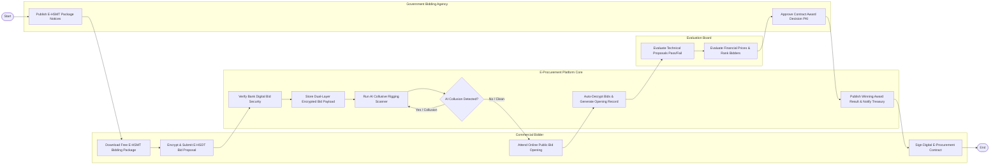

# Swimlane Diagram — E-Procurement for Government Agencies

## Mermaid Code

## Flow Description | Mô tả luồng

| Lane | Actor | Role in Flow |
|------|-------|-------------|
| 1 | Commercial Bidder | Tải E-HSMT miễn phí, mã hóa và nộp E-HSDT trực tuyến, tham dự mở thầu online và ký số hợp đồng trúng thầu. |
| 2 | E-Procurement Platform Core | Xác thực bảo lãnh ngân hàng, lưu tệp mã hóa, chạy AI quét thông thầu, tự động giải mã mở thầu và công khai kết quả. |
| 3 | Evaluation Board | Đánh giá hồ sơ đề xuất kỹ thuật (Đạt/Không đạt), thẩm định giá đề xuất tài chính và xếp hạng nhà thầu trúng thầu. |
| 4 | Government Bidding Agency | Đăng tải E-HSMT công khai và ký số PKI Quyết định phê duyệt kết quả lựa chọn nhà thầu. |
