# Action Tree — E-Procurement for Government Agencies

## Mermaid Code

```mermaid
graph TD
    Root["E-Procurement for Government Agencies"]

    Root --> M1["E-Bidding Notice & Document Management"]
    Root --> M2["Encrypted Bid Submission & Security Guarantee"]
    Root --> M3["Public Opening & Evaluation Engine"]
    Root --> M4["Contract Award & PKI Digital Signatures"]
    Root --> M5["Collusive Rigging AI Detection & Grievance"]
    Root --> M6["MPI Analytics & Procurement Audit"]

    M1 --> A11["Publish E-Bidding Document E-HSMT"]
    M1 --> A12["Manage Standard E-Bidding Form Templates"]
    M1 --> A13["Issue Clarification Amendments E-HSMT"]
    M1 --> A14["Manage Certified Supplier Register"]

    M2 --> A21["Submit Encrypted Electronic Bids E-HSDT"]
    M2 --> A22["Verify Bid Security Guarantee Banks"]
    M2 --> A23["Issue E-Bid Submission Receipts SHA256"]
    M2 --> A24["Verify Statutory Bidding Eligibility"]

    M3 --> A31["Open E-Bidding Documents Publicly"]
    M3 --> A32["Evaluate Technical Proposals Pass Fail"]
    M3 --> A33["Evaluate Financial Price Proposals"]
    M3 --> A34["Rank Bidders Evaluated Price"]

    M4 --> A41["Award E-Procurement Contracts"]
    M4 --> A42["Apply PKI Digital Signature Procurement"]
    M4 --> A43["Track Post-Award Contract Execution"]
    M4 --> A44["Transmit Awarded Contracts State Treasury"]

    M5 --> A51["Detect Collusive Bidding Rigging AI"]
    M5 --> A52["Match IP MAC File Hash Metadata"]
    M5 --> A53["Audit Bidding Complaints Grievance"]
    M5 --> A54["Issue Bidding Suspension Enforcement"]

    M6 --> A61["Export Public Procurement Analytics"]
    M6 --> A62["Calculate Budget Savings Rates MPI"]
    M6 --> A63["Log System Immutable Audit Trails"]
    M6 --> A64["Archive National Bidding Ledgers"]
```

## Module Description | Mô tả Module

| # | Module | Description | Actions |
|---|--------|-------------|---------|
| 1 | E-Bidding Notice & Document Management | Đăng tải Thông báo mời thầu, phát hành E-HSMT miễn phí, làm rõ hồ sơ và quản lý CSDL Đăng ký nhà thầu toàn quốc | Publish E-Bidding Document E-HSMT, Manage Standard E-Bidding Form Templates, Issue Clarification Amendments E-HSMT, Manage Certified Supplier Register |
| 2 | Encrypted Bid Submission & Security Guarantee | Mã hóa 2 lớp và nộp E-HSDT, xác thực Thư bảo lãnh dự thầu ngân hàng điện tử, cấp phiếu xác nhận nộp thầu và kiểm tra tư cách | Submit Encrypted Electronic Bids E-HSDT, Verify Bid Security Guarantee Banks, Issue E-Bid Submission Receipts SHA256, Verify Statutory Bidding Eligibility |
| 3 | Public Opening & Evaluation Engine | Tự động giải mã mở thầu công khai trực tuyến, đánh giá hồ sơ kỹ thuật (Đạt/Không đạt), sửa lỗi đại số và xếp hạng nhà thầu | Open E-Bidding Documents Publicly, Evaluate Technical Proposals Pass Fail, Evaluate Financial Price Proposals, Rank Bidders Evaluated Price |
| 4 | Contract Award & PKI Digital Signatures | Phê duyệt kết quả trúng thầu, ký số PKI chuyên dùng hợp đồng mua sắm điện tử, theo dõi thực hiện và chuyển dữ liệu Kho bạc | Award E-Procurement Contracts, Apply PKI Digital Signature Procurement, Track Post-Award Contract Execution, Transmit Awarded Contracts State Treasury |
| 5 | Collusive Rigging AI Detection & Grievance | Thuật toán AI phát hiện thông thầu (quét IP, MAC, mã băm file, quan hệ chủ sở hữu), tiếp nhận giải quyết khiếu nại kiến nghị | Detect Collusive Bidding Rigging AI, Match IP MAC File Hash Metadata, Audit Bidding Complaints Grievance, Issue Bidding Suspension Enforcement |
| 6 | MPI Analytics & Procurement Audit | Trích xuất báo cáo phân tích tỷ lệ tiết kiệm ngân sách nộp Bộ KH&ĐT và Thủ tướng, lưu trữ bảo mật hồ sơ thầu quốc gia | Export Public Procurement Analytics, Calculate Budget Savings Rates MPI, Log System Immutable Audit Trails, Archive National Bidding Ledgers |
