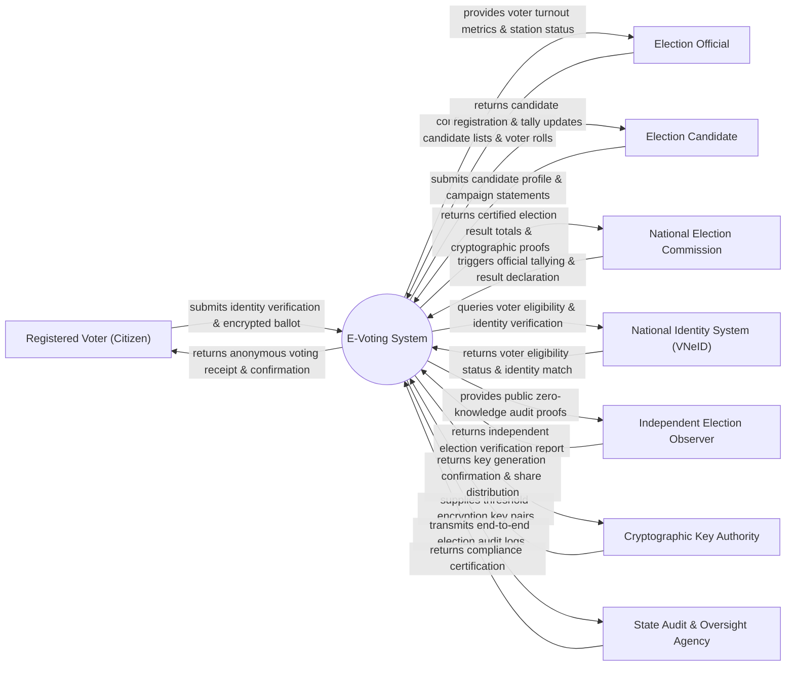

# Context Diagram — E-Voting System

## Mermaid Code

## Actor & Interaction Table | Bảng Actor & Tương tác

| # | Actor | Actor Type | Data Sent TO System | Data Received FROM System | Notes |
|---|-------|------------|---------------------|---------------------------|-------|
| 1 | Registered Voter (Citizen) | Primary | Identity credentials, selection choices, ballot confirmation | Anonymous cryptographic receipt, ballot verification token | Cử tri thực hiện quyền bầu cử điện tử |
| 2 | Election Official | Primary | Precinct setups, voter roll updates, election parameters | Turnout metrics, polling station activity, voter queue | Cán bộ tổ bầu cử điều hành công tác bầu cử |
| 3 | Election Candidate | Primary | Candidate profile details, biographical information | Registered status, final candidate listings | ứng cử viên đăng ký tham gia cử tuyển |
| 4 | National Election Commission | Primary | Election schedule, tally authorization command | Final certified tally, mathematical integrity proofs | Hội đồng Bầu cử Quốc gia phê duyệt và công bố |
| 5 | National Identity System (VNeID) | Supporting | Voter age validation, citizenship status confirmation | Voter query parameters, voter ID lookup | Hệ thống định danh dân cư xác nhận cử tri đủ điều kiện |
| 6 | Independent Election Observer | Supporting | Independent verification requests, mathematical checks | Public Zero-Knowledge proofs, anonymous ballot hashes | Tổ chức giám sát độc lập kiểm tra tính hợp lệ của cuộc bầu cử |
| 7 | Cryptographic Key Authority | Supporting | Threshold key shares, master encryption public key | Key distribution confirmation, ceremony logs | Cơ quan quản lý khóa mã hóa bất đồng bộ |
| 8 | State Audit & Oversight Agency | Regulatory | Security audit parameters, integrity check demands | Complete immutable election audit logs | Cơ quan kiểm toán an ninh mạng và an toàn thông tin |

## System Boundary Description | Mô tả Phạm vi Hệ thống

Hệ thống E-Voting System (Hệ thống Bầu chọn Điện tử Quốc gia) chịu trách nhiệm tổ chức các cuộc bỏ phiếu, bầu cử trực tuyến với độ an toàn mật mã cao nhất. Hệ thống đảm bảo 3 nguyên tắc cốt lõi: Bỏ phiếu kín (không thể suy ngược phiếu bầu của ai), Mỗi cử tri chỉ bỏ 1 phiếu (chống bỏ phiếu trùng) và Có thể kiểm tra công khai (End-to-End Verifiable - cử tri tự kiểm tra xem phiếu của mình có nằm trong hòm phiếu và được tính đúng hay không). Hệ thống KHÔNG trực tiếp vận hành hạ tầng mạng viễn thông quốc gia và KHÔNG can thiệp vào thẩm định tư cách đại biểu quốc hội ngoài phạm vi xử lý dữ liệu bầu cử.
