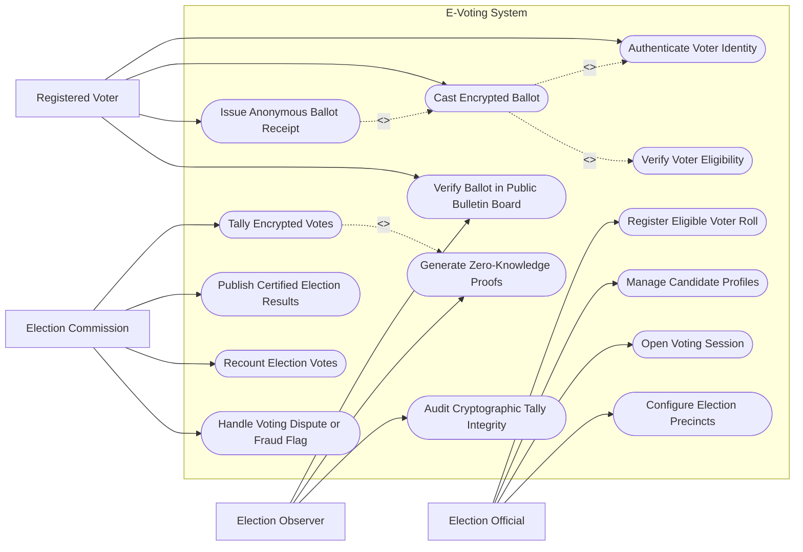

# Use Case Diagram — E-Voting System

## Mermaid Code

## Actor Table | Bảng Actor

| # | Actor | Actor Type | Role Description | Related Use Cases |
|---|-------|------------|------------------|-------------------|
| 1 | Registered Voter | Primary | Cử tri đủ điều kiện thực hiện xác thực và bỏ phiếu mã hóa | UC02, UC04, UC05, UC06 |
| 2 | Election Official | Primary | Cán bộ bầu cử lập danh sách cử tri, cấu hình đơn vị bầu cử | UC01, UC07, UC08, UC15 |
| 3 | Election Commission | Primary | Hội đồng bầu cử chỉ đạo mở hòm phiếu, kiểm phiếu và công bố kết quả | UC09, UC11, UC13, UC14 |
| 4 | Election Observer | Secondary | Tổ chức/cá nhân giám sát độc lập kiểm toán bằng toán học mật mã | UC06, UC10, UC12 |

## Use Case Table | Bảng Use Case

| # | UC ID | Use Case Name | Primary Actor | Secondary Actor | Description | Priority |
|---|-------|---------------|---------------|-----------------|-------------|----------|
| 1 | UC01 | Register Eligible Voter Roll | Officer | VNeID | Lập và xác minh danh sách cử tri đủ từ 18 tuổi theo từng địa bàn | High |
| 2 | UC02 | Authenticate Voter Identity | Voter | VNeID | Xác thực danh tính cử tri bằng sinh trắc học và OTP VNeID | High |
| 3 | UC03 | Verify Voter Eligibility | System | - | Kiểm tra cử tri chưa bỏ phiếu và không bị tước quyền bầu cử | High |
| 4 | UC04 | Cast Encrypted Ballot | Voter | - | Chọn ứng cử viên, mã hóa phiếu bầu (Homomorphic Encryption) và gửi | High |
| 5 | UC05 | Issue Anonymous Ballot Receipt | Voter | - | Cấp mã tra cứu phiếu bầu ẩn danh (Ballot Tracker Hash) cho cử tri | High |
| 6 | UC06 | Verify Ballot in Public Bulletin Board | Voter, Observer | - | Cử tri tra cứu xem phiếu bầu của mình đã nằm trong hòm phiếu công khai | High |
| 7 | UC07 | Manage Candidate Profiles | Officer | - | Cập nhật tiểu sử, chương trình hành động của các ứng cử viên | Medium |
| 8 | UC08 | Open Voting Session | Officer | - | Kích hoạt bắt đầu và kết thúc thời gian bỏ phiếu của cuộc bầu cử | High |
| 9 | UC09 | Tally Encrypted Votes | Commission | CryptoAuthority | Giải mã tổng số lượng phiếu bầu bằng thuật toán giải mã ngưỡng | High |
| 10 | UC10 | Generate Zero-Knowledge Proofs | System | Observer | Sinh bằng chứng toán học ZKP chứng minh phiếu bầu hợp lệ | High |
| 11 | UC11 | Publish Certified Election Results | Commission | - | Công bố chính thức kết quả bầu cử kèm theo dữ liệu chứng minh mật mã | High |
| 12 | UC12 | Audit Cryptographic Tally Integrity | Observer | - | Kiểm toán độc lập tính chính xác của thuật toán đếm phiếu | Medium |
| 13 | UC13 | Recount Election Votes | Commission | - | Tự động kiểm phiếu lại trên dữ liệu mật mã khi có khiếu nại | Medium |
| 14 | UC14 | Handle Voting Dispute or Fraud Flag | Commission | - | Xử lý các phản ánh vi phạm, cố tình giả mạo hoặc tấn công bỏ phiếu | High |
| 15 | UC15 | Configure Election Precincts | Officer | - | Chia khu vực bầu cử, đơn vị bầu cử và số lượng đại biểu cần bầu | Medium |

## Use Case Specification | Đặc tả Use Case

---

### UC02 — Authenticate Voter Identity

| Field | Detail |
|-------|--------|
| **UC ID** | UC02 |
| **Use Case Name** | Authenticate Voter Identity |
| **Actor(s)** | Primary: Registered Voter / Secondary: VNeID System |
| **Description** | Cử tri đăng nhập và thực hiện xác thực danh tính 2 yếu tố (Khuôn mặt/Vân tay + OTP) trước khi bước vào phòng bỏ phiếu điện tử. |
| **Precondition** | 1. Cuộc bầu cử đang trong khung giờ mở cửa chính thức (UC08).   2. Cử tri có tài khoản định danh VNeID mức 2. |
| **Main Flow** | 1. Voter truy cập Cổng Bầu cử Điện tử Quốc gia.   2. Voter chọn "Đăng nhập xác thực cử tri".   3. System chuyển hướng sang Cổng xác thực VNeID.   4. Voter quét mã QR và thực hiện quét khuôn mặt sinh trắc học trên ứng dụng VNeID.   5. VNeID trả về kết quả xác thực danh tính thành công kèm Mã định danh cá nhân.   6. System kiểm tra danh sách cử tri (Voter Roll) thuộc đơn vị bầu cử tương ứng.   7. System tạo phiên làm việc bảo mật ngắn hạn (Secure Voting Session Token) và cấp quyền vào phòng bỏ phiếu. |
| **Alternative Flow** | **AF1** — Xác thực tại cây Bỏ phiếu (Kiosk) ở điểm bầu cử: Voter cắm thẻ CCCD gắn chip vào máy Kiosk, quét vân tay trực tiếp tại chỗ để vào hệ thống. |
| **Exception Flow** | **EX1** — Cử tri chưa đủ tuổi hoặc bị tước quyền bầu cử: System báo lỗi "Không đủ điều kiện bầu cử" và từ chối cấp phiên bỏ phiếu.   **EX2** — Sinh trắc học không khớp: System khóa đăng nhập 15 phút, yêu cầu cử tri liên hệ Tổ bầu cử địa phương để hỗ trợ. |
| **Postcondition** | Cử tri được cấp mã token bỏ phiếu hợp lệ, thông tin danh tính được tách rời khỏi lá phiếu chuẩn bị nộp. |
| **Business Rule** | **BR1**: Phiên bỏ phiếu (Session Token) chỉ có hiệu lực tối đa 10 phút, quá thời hạn cử tri phải xác thực lại từ đầu. |

---

### UC04 — Cast Encrypted Ballot

| Field | Detail |
|-------|--------|
| **UC ID** | UC04 |
| **Use Case Name** | Cast Encrypted Ballot |
| **Actor(s)** | Primary: Registered Voter / Secondary: None |
| **Description** | Cử tri thực hiện tích chọn ứng cử viên trên lá phiếu điện tử, hệ thống mã hóa đồng hình phiếu bầu và ghi nhận vào hòm phiếu công khai. |
| **Precondition** | 1. Cử tri đã xác thực danh tính thành công (UC02).   2. Cử tri chưa từng bỏ phiếu trong cuộc bầu cử này (UC03). |
| **Main Flow** | 1. System hiển thị danh sách ứng cử viên của đơn vị bầu cử.   2. Voter tích chọn các ứng cử viên muốn bầu theo đúng số lượng quy định.   3. Voter kiểm tra lại danh sách đã chọn và bấm "Xác nhận gửi lá phiếu".   4. System sử dụng Thuật toán mã hóa đồng hình (Homomorphic Encryption - Paillier/ElGamal) với Khóa công khai của cuộc bầu cử để mã hóa lựa chọn của Voter thành chuỗi mật mã $C$.   5. System sinh bằng chứng Zero-Knowledge Proof (ZKP) chứng minh chuỗi $C$ chứa đúng số lượng lựa chọn hợp lệ mà không tiết lộ nội dung.   6. System đẩy lá phiếu mã hóa $C$ vào Hòm phiếu điện tử (Public Bulletin Board Ledger).   7. System đánh dấu trạng thái cử tri "Đã bỏ phiếu" vào Danh sách cử tri (để chặn bỏ phiếu lần 2). |
| **Alternative Flow** | **AF1** — Thay đổi lựa chọn trước khi bấm gửi: Voter bấm "Sửa lựa chọn", System quay lại bước 1 cho phép bỏ chọn hoặc chọn lại ứng cử viên khác. |
| **Exception Flow** | **EX1** — Chọn quá số lượng đại biểu quy định: System báo lỗi "Phiếu không hợp lệ - Chọn vượt quá số lượng cho phép", nút gửi bị ẩn.   **EX2** — Mất kết nối mạng khi đang gửi: System lưu bản mã tạm thời, tự động gửi lại khi kết nối khôi phục hoặc hướng dẫn cử tri thử lại. |
| **Postcondition** | Lá phiếu mã hóa được lưu vĩnh viễn trong hòm phiếu công khai, trạng thái cử tri chuyển thành "Đã hoàn thành nghĩa vụ bầu cử". |
| **Business Rule** | **BR1**: Lá phiếu mã hóa $C$ không bao giờ chứa bất kỳ thông tin nhân khẩu hay IP nào của cử tri để bảo đảm nguyên tắc bỏ phiếu kín tuyệt đối. |

---

### UC05 — Issue Anonymous Ballot Receipt

| Field | Detail |
|-------|--------|
| **UC ID** | UC05 |
| **Use Case Name** | Issue Anonymous Ballot Receipt |
| **Actor(s)** | Primary: Registered Voter / Secondary: None |
| **Description** | Cấp cho cử tri phiếu xác nhận ẩn danh chứa mã băm cryptographic hash của lá phiếu vừa gửi để phục vụ tự kiểm tra. |
| **Precondition** | 1. Lá phiếu mã hóa đã được đẩy thành công vào Hòm phiếu điện tử (UC04). |
| **Main Flow** | 1. System tính toán mã băm SHA-256 duy nhất của lá phiếu mã hóa (Ballot Tracking Hash).   2. System hiển thị Thẻ xác nhận bỏ phiếu trên màn hình bao gồm: Mã cuộc bầu cử, Ngày giờ gửi, Mã băm lá phiếu (Ballot Hash).   3. System cung cấp nút "Tải phiếu xác nhận PDF" hoặc "Quét mã QR lưu vào máy".   4. Voter lưu trữ phiếu xác nhận hoặc chụp lại mã băm.   5. System kết thúc phiên bỏ phiếu và tự động xóa mọi dữ liệu tạm thời trên bộ nhớ đệm trình duyệt. |
| **Alternative Flow** | **AF1** — In phiếu xác nhận giấy tại Kiosk: Máy Kiosk tự động in phiếu xác nhận bằng giấy chứa mã QR băm ẩn danh cho cử tri cầm về. |
| **Exception Flow** | **EX1** — Cử tri đóng trình duyệt trước khi tải phiếu: Voter vẫn có thể đăng nhập lại sau đó để tải lại Thẻ xác nhận ẩn danh (nhưng không xem lại được nội dung đã bầu). |
| **Postcondition** | Cử tri có trong tay mã băm tra cứu để tự kiểm tra tính hiện diện của phiếu bầu trên Bảng tin công khai (UC06). |
| **Business Rule** | **BR1**: Phiếu xác nhận chỉ chứa duy nhất mã băm mật mã của lá phiếu mã hóa, tuyệt đối không in danh sách ứng cử viên đã chọn. |

---

### UC09 — Tally Encrypted Votes

| Field | Detail |
|-------|--------|
| **UC ID** | UC09 |
| **Use Case Name** | Tally Encrypted Votes |
| **Actor(s)** | Primary: Election Commission / Secondary: Cryptographic Key Authority |
| **Description** | Thực hiện cộng tổng các lá phiếu mã hóa trực tiếp trong không gian mật mã và dùng thuật toán giải mã ngưỡng để ra kết quả tổng mà không giải mã từng lá phiếu riêng lẻ. |
| **Precondition** | 1. Thời gian bỏ phiếu đã chính thức kết thúc.   2. Hội đồng bầu cử và các bên giữ mảnh khóa mật mã (Threshold Key Holders) có mặt đông đủ. |
| **Main Flow** | 1. ElectionCommission gửi lệnh "Khóa hòm phiếu và bắt đầu kiểm phiếu".   2. System tính toán tổng mật mã của tất cả lá phiếu: $C_{total} = \prod C_i$ (tận dụng tính chất Homomorphic Addition).   3. Các thành viên giữ mảnh khóa (Key Authority Members) xuất trình mảnh khóa giải mã riêng của mình.   4. System kết hợp tối thiểu $k$ trên $n$ mảnh khóa (Threshold Decryption Ceremony) để giải mã duy nhất chuỗi tổng $C_{total}$.   5. System thu được kết quả tổng số phiếu bầu của từng ứng cử viên.   6. System tự động kiểm tra đối soát tổng số phiếu giải mã với tổng số cử tri đã tham gia bỏ phiếu. |
| **Alternative Flow** | **AF1** — Có 1 thành viên giữ khóa vắng mặt: Thuật toán ngưỡng $(k, n)$ cho phép hệ thống vẫn giải mã thành công miễn là có đủ tối thiểu $k$ thành viên có mặt. |
| **Exception Flow** | **EX1** — Không đủ số lượng mảnh khóa tối thiểu $k$: System thông báo từ chối giải mã và tạm dừng quá trình kiểm phiếu cho đến khi đủ mảnh khóa theo quy định. |
| **Postcondition** | Tổng số phiếu bầu của từng ứng cử viên được tính toán chính xác tuyệt đối mà không một lá phiếu cá nhân nào bị mở hoặc tiết lộ. |
| **Business Rule** | **BR1**: Quá trình kiểm phiếu bằng toán học mật mã phải được tự động ghi hình và lưu toàn bộ log phục vụ công khai kiểm toán. |

---

### UC11 — Publish Certified Election Results

| Field | Detail |
|-------|--------|
| **UC ID** | UC11 |
| **Use Case Name** | Publish Certified Election Results |
| **Actor(s)** | Primary: Election Commission / Secondary: None |
| **Description** | Công bố chính thức biên bản kết quả bầu cử kèm theo toàn bộ bằng chứng toán học mật mã lên cổng thông tin toàn quốc. |
| **Precondition** | 1. Quá trình kiểm phiếu mật mã (UC09) đã hoàn tất.   2. Hội đồng bầu cử đã xem xét và duyệt biên bản tổng hợp kết quả. |
| **Main Flow** | 1. ElectionCommission tải lên Biên bản xác nhận kết quả bầu cử có chữ ký số của Chủ tịch Hội đồng bầu cử.   2. System tổng hợp file kết quả bao gồm: Tổng số cử tri, Tỷ lệ đi bầu, Số phiếu bầu của từng ứng cử viên, Bằng chứng toán học ZKP (UC10).   3. Commission bấm nút "Công bố kết quả chính thức".   4. System xuất bản kết quả lên Cổng Bầu cử Quốc gia và gửi thông điệp báo chí.   5. System cho phép toàn bộ công chúng và các tổ chức giám sát tải về gói dữ liệu kiểm toán công khai (Public Audit Package). |
| **Alternative Flow** | **AF1** — Công bố kết quả tạm thời theo thời gian thực (cho các cuộc thăm dò): System công bố kết quả sơ bộ theo tỷ lệ % đã kiểm trước khi chốt biên bản chính thức. |
| **Exception Flow** | **EX1** — Phát sinh khiếu nại kết quả (UC14): System ghi nhận trạng thái "Kết quả đang trong thời gian khiếu nại" trước khi chuyển sang trạng thái "Phê duyệt cuối cùng". |
| **Postcondition** | Kết quả bầu cử có hiệu lực pháp lý chính thức, gói dữ liệu kiểm toán công khai sẵn sàng cho bất kỳ ai thẩm định lại độc lập. |
| **Business Rule** | **BR1**: Dữ liệu hòm phiếu mã hóa vĩnh viễn không được xóa bỏ khỏi bộ lưu trữ dữ liệu quốc gia để đảm bảo khả năng tái kiểm toán sau này. |
