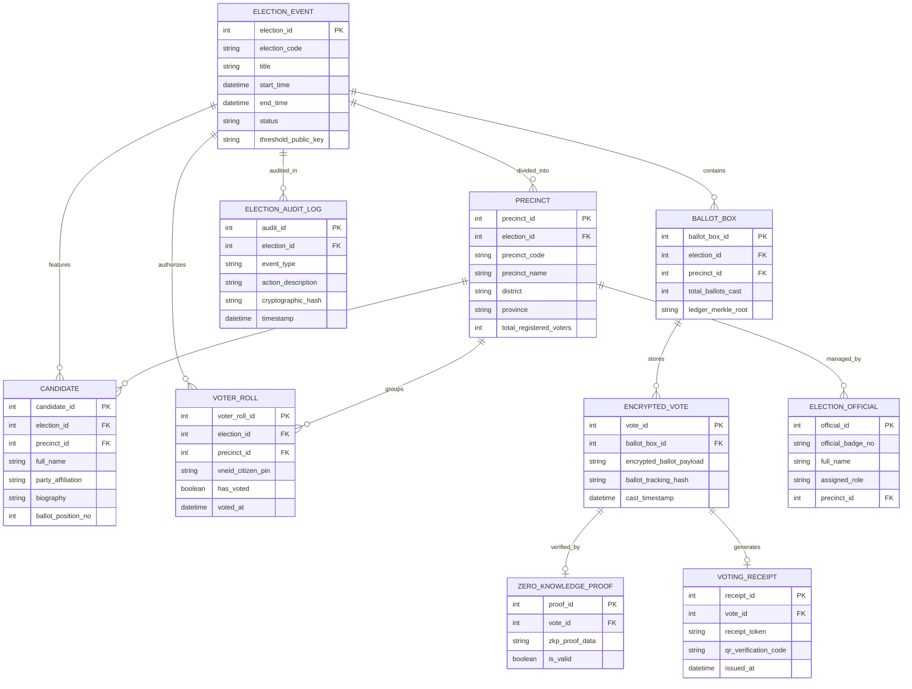

# Conceptual ERD — E-Voting System

## Mermaid Code

## Entity Description Table | Bảng mô tả Entity

| # | Entity Name | Vietnamese Name | Description | Key Attributes | Main Relationships |
|---|-------------|-----------------|-------------|----------------|-------------------|
| 1 | ELECTION_EVENT | Cuộc Bầu cử | Thông tin sự kiện bầu cử, thời gian và khóa mã hóa công khai | election_id, election_code, title, threshold_public_key | Divided into PRECINCT, features CANDIDATE |
| 2 | PRECINCT | Đơn vị / Khu vực Bầu cử | Khu vực địa lý bầu cử (tỉnh/thành/huyện/xã) quy định số lượng đại biểu | precinct_id, precinct_code, precinct_name, total_registered_voters | Belongs to ELECTION_EVENT, groups VOTER_ROLL |
| 3 | CANDIDATE | Ứng cử viên | Thông tin người ứng cử tham gia cuộc bầu cử | candidate_id, full_name, party_affiliation, ballot_position_no | Belongs to ELECTION_EVENT, PRECINCT |
| 4 | VOTER_ROLL | Danh sách Cử tri | Quản lý cử tri đủ điều kiện và trạng thái đã bỏ phiếu hay chưa | voter_roll_id, vneid_citizen_pin, has_voted, voted_at | Belongs to ELECTION_EVENT, PRECINCT |
| 5 | BALLOT_BOX | Hòm phiếu Điện tử | Lưu trữ sổ cái danh sách các lá phiếu mã hóa của từng đơn vị bầu cử | ballot_box_id, total_ballots_cast, ledger_merkle_root | Belongs to ELECTION_EVENT, stores ENCRYPTED_VOTE |
| 6 | ENCRYPTED_VOTE | Lá phiếu Mã hóa | Dữ liệu nội dung bỏ phiếu đã mã hóa đồng hình và mã băm tra cứu | vote_id, encrypted_ballot_payload, ballot_tracking_hash | Belongs to BALLOT_BOX, verified by ZKP |
| 7 | ZERO_KNOWLEDGE_PROOF | Bằng chứng Không tiết lộ | Bằng chứng toán học ZKP chứng minh lá phiếu hợp lệ không chọn quá quy định | proof_id, zkp_proof_data, is_valid | Belongs to ENCRYPTED_VOTE |
| 8 | ELECTION_OFFICIAL | Cán bộ Bầu cử | Thông tin thành viên tổ bầu cử điều hành công tác tại đơn vị | official_id, official_badge_no, full_name, assigned_role | Manages PRECINCT |
| 9 | VOTING_RECEIPT | Phiếu Xác nhận Ẩn danh | Thẻ tra cứu ẩn danh cấp cho cử tri kiểm tra lá phiếu của mình | receipt_id, receipt_token, qr_verification_code | Belongs to ENCRYPTED_VOTE |
| 10 | ELECTION_AUDIT_LOG | Nhật ký Kiểm toán Bầu cử | Ghi lại toàn bộ sự kiện, thao tác kiểm phiếu và log an ninh mật mã | audit_id, event_type, cryptographic_hash, timestamp | Belongs to ELECTION_EVENT |

## Relationship Description | Mô tả Quan hệ

| # | From Entity | Cardinality | To Entity | Relationship Label | Business Explanation |
|---|-------------|-------------|-----------|-------------------|----------------------|
| 1 | ELECTION_EVENT | one-to-many | PRECINCT | divided_into | Một cuộc bầu cử được chia thành nhiều khu vực/đơn vị bầu cử |
| 2 | ELECTION_EVENT | one-to-many | CANDIDATE | features | Một cuộc bầu cử có nhiều ứng cử viên đăng ký tham gia |
| 3 | ELECTION_EVENT | one-to-many | VOTER_ROLL | authorizes | Một cuộc bầu cử xác nhận danh sách cử tri hợp lệ |
| 4 | ELECTION_EVENT | one-to-many | BALLOT_BOX | contains | Một cuộc bầu cử có các hòm phiếu điện tử tương ứng các đơn vị |
| 5 | PRECINCT | one-to-many | CANDIDATE | assigned_to | Một đơn vị bầu cử có danh sách ứng cử viên tranh cử cụ thể |
| 6 | PRECINCT | one-to-many | VOTER_ROLL | groups | Một đơn vị bầu cử quản lý danh sách cử tri thuộc địa bàn |
| 7 | BALLOT_BOX | one-to-many | ENCRYPTED_VOTE | stores | Một hòm phiếu điện tử chứa nhiều lá phiếu mã hóa |
| 8 | ENCRYPTED_VOTE | one-to-one | ZERO_KNOWLEDGE_PROOF | verified_by | Mỗi lá phiếu mã hóa đi kèm một bằng chứng toán học ZKP |
| 9 | ENCRYPTED_VOTE | one-to-one | VOTING_RECEIPT | generates | Mỗi lá phiếu nộp thành công sinh ra một phiếu xác nhận ẩn danh |
| 10 | PRECINCT | one-to-many | ELECTION_OFFICIAL | managed_by | Một đơn vị bầu cử do nhiều cán bộ tổ bầu cử điều hành |
| 11 | ELECTION_EVENT | one-to-many | ELECTION_AUDIT_LOG | audited_in | Mọi diễn biến cuộc bầu cử được ghi nhật ký kiểm toán bất biến |
