# Swimlane Diagram — E-Voting System

## Mermaid Code

```mermaid
flowchart LR
    Start(["Start"])

    subgraph Lane1["Voter (Citizen)"]
        A1["Authenticate via VNeID Biometrics"]
        A2["Select Candidates on e-Ballot"]
        A3["Review & Confirm Selections"]
        A4["Submit Encrypted Ballot"]
        A5["Save Anonymous Ballot Receipt"]
    end

    subgraph Lane2["E-Voting System Portal"]
        S1["Validate Voter Eligibility"]
        S2["Apply Homomorphic Encryption"]
        S3["Generate ZKP Validity Proof"]
        S4["Store Ballot in Public Bulletin Board"]
        S5["Mark Voter Has Voted Status"]
    end

    subgraph Lane3["Election Commission"]
        O1["Open Official Election Period"]
        O2["Close Election Polling Session"]
        O3["Initiate Threshold Key Ceremony"]
        O4["Publish Certified Final Tally"]
    end

    subgraph Lane4["Cryptographic Tally Engine"]
        T1["Compute Homomorphic Product C_total"]
        T2["Combine Threshold Private Keys"]
        T3{"Threshold Keys Valid?"}
        T4["Decrypt Final Candidate Vote Counts"]
        T5["Output Audit Integrity Certificate"]
    end

    Finish(["End"])

    Start --> O1 --> A1 --> S1 --> A2 --> A3 --> A4 --> S2 --> S3 --> S4 --> S5 --> A5 --> O2 --> O3 --> T1 --> T2 --> T3
    T3 -->|"No"| O3
    T3 -->|"Yes"| T4 --> T5 --> O4 --> Finish
```

## Flow Description | Mô tả luồng

| Lane | Actor | Role in Flow |
|------|-------|-------------|
| 1 | Voter (Citizen) | Xác thực danh tính sinh trắc VNeID, tích chọn ứng cử viên trên lá phiếu điện tử, xác nhận nộp lá phiếu và lưu giữ mã tra cứu ẩn danh. |
| 2 | E-Voting System Portal | Kiểm tra điều kiện tư cách cử tri, mã hóa lá phiếu bằng thuật toán mã hóa đồng hình, tạo bằng chứng ZKP, ghi hòm phiếu và đánh dấu đã bầu. |
| 3 | Election Commission | Điều hành mở cửa/đóng cửa hòm phiếu, chủ trì lễ giải mã bằng n mảnh khóa mật mã và duyệt công bố kết quả bầu cử chính thức. |
| 4 | Cryptographic Tally Engine | Động cơ kiểm phiếu tính tích mã hóa các lá phiếu, phối hợp các mảnh khóa riêng giải mã tổng số phiếu và cấp chứng thư kiểm toán an toàn mật mã. |
