# Action Tree — E-Voting System

## Mermaid Code

```mermaid
graph TD
    Root["E-Voting System"]

    Root --> M1["Voter Roll & Eligibility"]
    Root --> M2["Voter Authentication"]
    Root --> M3["Homomorphic Ballot Encryption"]
    Root --> M4["Bulletin Board & Receipts"]
    Root --> M5["Threshold Decryption Tally"]
    Root --> M6["Results & Cryptographic Audit"]

    M1 --> A11["Sync Voter Roll with VNeID"]
    M1 --> A12["Verify Minimum Voting Age"]
    M1 --> A13["Manage Special Precinct Rolls"]
    M1 --> A14["Check Single-Vote Constraint"]

    M2 --> A21["Authenticate VNeID Biometrics"]
    M2 --> A22["Verify One-Time Passcode OTP"]
    M2 --> A23["Issue Anonymous Session Token"]
    M2 --> A24["Detect Suspicious Login Spoofing"]

    M3 --> A31["Select Candidates on e-Ballot"]
    M3 --> A32["Encrypt Ballot via Paillier ElGamal"]
    M3 --> A33["Generate Zero-Knowledge Proof ZKP"]
    M3 --> A34["Seal Encrypted Ballot Payload"]

    M4 --> A41["Append Vote to Public Bulletin Board"]
    M4 --> A42["Issue Ballot Tracking Hash Receipt"]
    M4 --> A43["Verify Vote Existence in Ledger"]
    M4 --> A44["Manage Merkle Tree Ledger State"]

    M5 --> A51["Compute Homomorphic Product Total"]
    M5 --> A52["Initiate Threshold Key Ceremony"]
    M5 --> A53["Combine Decryption Key Shares"]
    M5 --> A54["Decrypt Candidate Vote Tally Totals"]

    M6 --> A61["Publish Certified Election Results"]
    M6 --> A62["Export Public Audit Data Package"]
    M6 --> A63["Execute Automated Tally Recount"]
    M6 --> A64["Log Immutable Cryptographic Audit"]
```

## Module Description | Mô tả Module

| # | Module | Description | Actions |
|---|--------|-------------|---------|
| 1 | Voter Roll & Eligibility | Đồng bộ danh sách cử tri đủ 18 tuổi từ VNeID, quản lý đơn vị bầu cử và chặn bỏ phiếu nhiều lần | Sync Voter Roll with VNeID, Verify Minimum Voting Age, Manage Special Precinct Rolls, Check Single-Vote Constraint |
| 2 | Voter Authentication | Xác thực danh tính cử tri bằng sinh trắc học và OTP, phát hành mã token phiên làm việc bảo mật ẩn danh | Authenticate VNeID Biometrics, Verify One-Time Passcode OTP, Issue Anonymous Session Token, Detect Suspicious Login Spoofing |
| 3 | Homomorphic Ballot Encryption | Mã hóa lựa chọn lá phiếu bằng thuật toán đồng hình (Paillier/ElGamal) và sinh bằng chứng không tiết lộ ZKP | Select Candidates on e-Ballot, Encrypt Ballot via Paillier ElGamal, Generate Zero-Knowledge Proof ZKP, Seal Encrypted Ballot Payload |
| 4 | Bulletin Board & Receipts | Ghi lá phiếu mã hóa vào hòm phiếu công khai, phát hành mã tra cứu băm ẩn danh cho cử tri | Append Vote to Public Bulletin Board, Issue Ballot Tracking Hash Receipt, Verify Vote Existence in Ledger, Manage Merkle Tree Ledger State |
| 5 | Threshold Decryption Tally | Cộng tích mã hóa các lá phiếu và giải mã tổng số phiếu bằng giải thuật giải mã ngưỡng với n đại diện giữ khóa | Compute Homomorphic Product Total, Initiate Threshold Key Ceremony, Combine Decryption Key Shares, Decrypt Candidate Vote Tally Totals |
| 6 | Results & Cryptographic Audit | Công bố kết quả chính thức, xuất gói dữ liệu kiểm toán công khai và chạy đếm lại toán học khi có khiếu nại | Publish Certified Election Results, Export Public Audit Data Package, Execute Automated Tally Recount, Log Immutable Cryptographic Audit |
