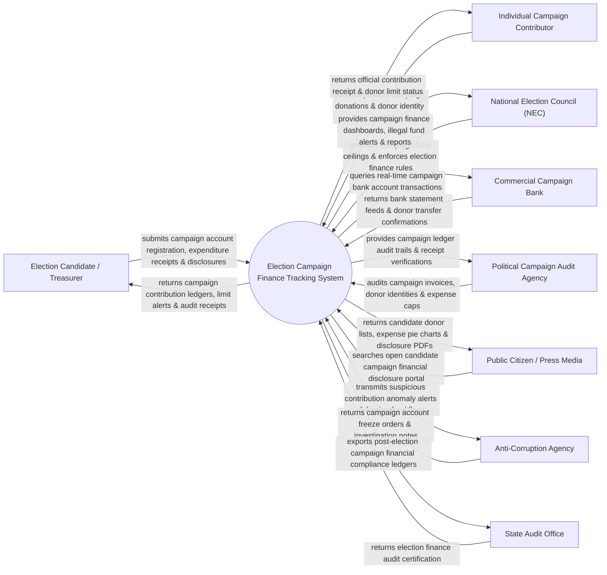

# Context Diagram — Election Campaign Finance Tracking System

## Mermaid Code

## Actor & Interaction Table | Bảng Actor & Tương tác

| # | Actor | Actor Type | Data Sent TO System | Data Received FROM System | Notes |
|---|-------|------------|---------------------|---------------------------|-------|
| 1 | Election Candidate / Treasurer | Primary | Campaign bank account details, expenditure invoices, disclosure filings | Real-time campaign contribution ledger, cap alerts, audit receipts | Ứng cử viên đại biểu Quốc hội / HĐND và Thủ quỹ chiến dịch |
| 2 | Individual Campaign Contributor | Primary | Campaign donation funds, citizen identity proof (VNeID/Tax ID) | Official contribution receipt, individual donation limit status | Nạn nhân/Công dân đóng góp tài chính ủng hộ chiến dịch bầu cử |
| 3 | National Election Council (NEC) | Primary | Statutory contribution caps, campaign spending limits, election rules | Executive campaign finance dashboards, illegal fund alerts, reports | Hội đồng Bầu cử Quốc gia quản lý minh bạch tài chính bầu cử |
| 4 | Commercial Campaign Bank | Supporting | Real-time campaign bank account statements, wire transfer logs | Dedicated campaign account registration queries | Ngân hàng thương mại mở tài khoản chuyên dùng bầu cử |
| 5 | Political Campaign Audit Agency | Supporting | Campaign invoice audit findings, expense compliance ratings | Detailed campaign ledger audit trails, receipt image files | Đơn vị kiểm toán tài chính chiến dịch vận động bầu cử |
| 6 | Public Citizen / Press Media | Supporting | Candidate search queries, campaign finance term filters | Candidate donor lists, expense breakdown charts, public PDFs | Công chúng và báo chí truyền thông giám sát minh bạch bầu cử |
| 7 | Anti-Corruption Agency | Regulatory | Campaign account freeze directives, investigation orders | Foreign contribution alerts, anonymous fund anomaly flags | Cơ quan Phòng chống Tham nhũng phát hiện dòng tiền bất hợp pháp |
| 8 | State Audit Office | Regulatory | Post-election audit standards, campaign compliance rules | Immutable campaign ledgers, financial audit certificates | Kiểm toán Nhà nước kiểm tra công khai quyết toán tài chính bầu cử |

## System Boundary Description | Mô tả Phạm vi Hệ thống

Hệ thống Election Campaign Finance Tracking System (Hệ thống Theo dõi và Kiểm soát Tài chính Chiến dịch Bầu cử) chịu trách nhiệm tự động hóa quy trình quản lý minh bạch tài chính vận động bầu cử Đại biểu Quốc hội và HĐND: Quản lý tài khoản ngân hàng chuyên dùng của ứng cử viên, kiểm soát hạn mức đóng góp tối đa của cá nhân/tổ chức, giám sát chi phí quảng cáo truyền thông chiến dịch, sử dụng thuật toán AI phát hiện dòng tiền từ nước ngoài hoặc đóng góp ẩn danh bất hợp pháp, công khai minh bạch tài chính bầu cử cho nhân dân và báo cáo Hội đồng Bầu cử Quốc gia. Tuy nhiên, hệ thống KHÔNG trực tiếp tổ chức bỏ phiếu bầu cử và KHÔNG thay thế việc thẩm định tư cách đại biểu của Hội đồng Bầu cử.
