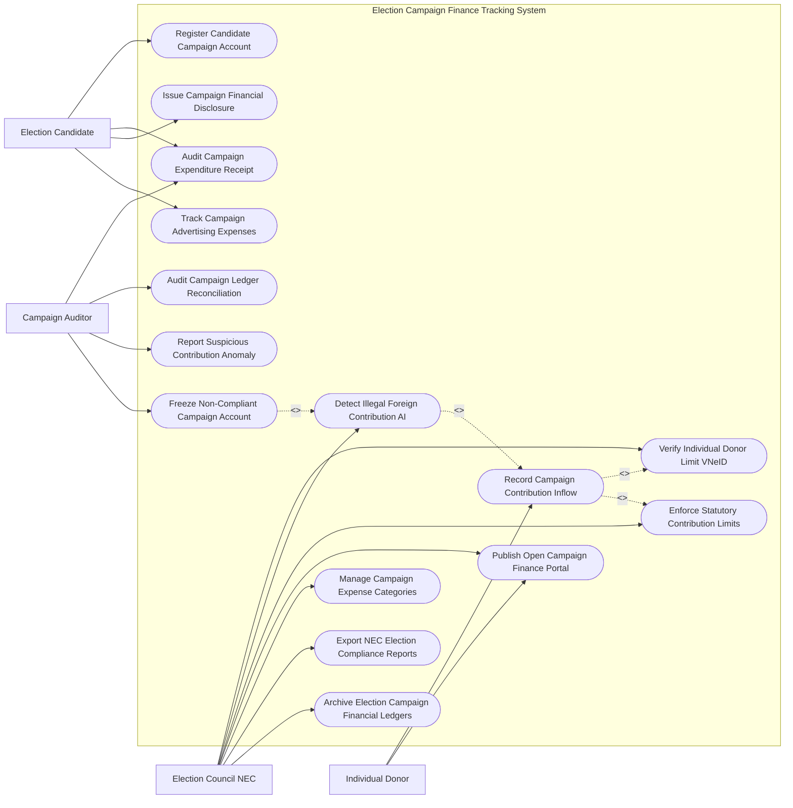

# Use Case Diagram — Election Campaign Finance Tracking System

## Mermaid Code

## Actor Table | Bảng Actor

| # | Actor | Actor Type | Role Description | Related Use Cases |
|---|-------|------------|------------------|-------------------|
| 1 | Election Candidate | Primary | Ứng cử viên/Thủ quỹ đăng ký tài khoản chiến dịch, nộp hóa đơn chi phí và báo cáo công khai | UC01, UC04, UC08, UC09 |
| 2 | Individual Donor | Primary | Nhà tài trợ chuyển tiền ủng hộ chiến dịch bầu cử và tra cứu cổng thông tin công khai | UC02, UC07 |
| 3 | Campaign Auditor | Primary | Kiểm toán viên kiểm tra tính hợp pháp của hóa đơn, phát hiện bất thường và đề xuất phong tỏa | UC04, UC10, UC11, UC12 |
| 4 | Election Council NEC | Primary | Hội đồng Bầu cử Quốc gia quy định trần đóng góp, theo dõi AI tài trợ nước ngoài và kiểm toán | UC03, UC05, UC06, UC07, UC13, UC14, UC15 |

## Use Case Table | Bảng Use Case

| # | UC ID | Use Case Name | Primary Actor | Secondary Actor | Description | Priority |
|---|-------|---------------|---------------|-----------------|-------------|----------|
| 1 | UC01 | Register Candidate Campaign Account | Candidate | CampaignBank | Đăng ký tài khoản ngân hàng chuyên dùng duy nhất phục vụ vận động bầu cử | High |
| 2 | UC02 | Record Campaign Contribution Inflow | Donor | Candidate | Ghi nhận khoản tiền/hàng hóa tài trợ chiến dịch bầu cử từ nhà tài trợ | High |
| 3 | UC03 | Verify Individual Donor Limit VNeID | NEC | VNeID | Xác thực nhân thân nhà tài trợ và kiểm tra hạn mức đóng góp tối đa/cá nhân | High |
| 4 | UC04 | Audit Campaign Expenditure Receipt | Candidate, Auditor | - | Tải lên và thẩm định hóa đơn, chứng từ chi tiêu vận động bầu cử (in ấn, hội trường) | High |
| 5 | UC05 | Detect Illegal Foreign Contribution AI | NEC | AI Engine | Thuật toán AI quét phát hiện dòng tiền tài trợ từ nước ngoài hoặc tổ chức vô danh | High |
| 6 | UC06 | Enforce Statutory Contribution Limits | NEC | CampaignBank | Tự động chặn và hoàn trả khoản tiền đóng góp vượt trần quy định của luật | High |
| 7 | UC07 | Publish Open Campaign Finance Portal | Donor, NEC | Public | Công khai minh bạch thu chi tài chính bầu cử của từng ứng cử viên cho nhân dân | High |
| 8 | UC08 | Issue Campaign Financial Disclosure | Candidate | NEC | Nộp Báo cáo kê khai tài chính chiến dịch định kỳ trước và sau bầu cử | High |
| 9 | UC09 | Track Campaign Advertising Expenses | Candidate | - | Theo dõi hạn mức chi tiêu cho quảng cáo báo chí, mạng xã hội và họp báo | Medium |
| 10 | UC10 | Audit Campaign Ledger Reconciliation | Auditor | Bank | Đối soát sổ sách thu chi chiến dịch với sao kê tài khoản ngân hàng chuyên dùng | High |
| 11 | UC11 | Report Suspicious Contribution Anomaly | Auditor | AntiCorruption | Phát hiện và báo cáo các giao dịch đóng góp nghi vấn rửa tiền/rải tiền rải rác | High |
| 12 | UC12 | Freeze Non-Compliant Campaign Account | Auditor | CampaignBank | Ra lệnh phong tỏa tài khoản chiến dịch vi phạm nghiêm trọng luật tài chính bầu cử | High |
| 13 | UC13 | Manage Campaign Expense Categories | NEC | - | Cấu hình danh mục các khoản chi tiêu hợp lệ và mức trần chi tiêu tối đa | Medium |
| 14 | UC14 | Export NEC Election Compliance Reports | NEC | StateAudit | Trích xuất báo cáo tuân thủ tài chính bầu cử nộp Hội đồng Bầu cử Quốc gia | Low |
| 15 | UC15 | Archive Election Campaign Financial Ledgers | NEC | NationalArchives | Đóng gói và lưu trữ vĩnh viễn sổ sách tài chính bầu cử sau khi công bố kết quả | Low |

## Use Case Specification | Đặc tả Use Case

---

### UC01 — Register Candidate Campaign Account

| Field | Detail |
|-------|--------|
| **UC ID** | UC01 |
| **Use Case Name** | Register Candidate Campaign Account |
| **Actor(s)** | Primary: Election Candidate / Secondary: Commercial Campaign Bank |
| **Description** | Ứng cử viên đại biểu Quốc hội/HĐND đăng ký tài khoản ngân hàng chuyên dùng duy nhất để quản lý mọi dòng tiền vận động bầu cử. |
| **Precondition** | 1. Ứng cử viên đã được Ủy ban Mặt trận Tổ quốc thông qua danh sách ứng cử chính thức. |
| **Main Flow** | 1. Candidate mở Ngân hàng thương mại được NEC chỉ định để mở Tài khoản Chuyên dùng Vận động Bầu cử.   2. Candidate truy cập Cổng Quản lý Tài chính Bầu cử, chọn mục "Kê khai Tài khoản Chiến dịch".   3. Candidate nhập Số tài khoản ngân hàng chuyên dùng, Tên ngân hàng, Họ tên Thủ quỹ chiến dịch.   4. Candidate tải lên Quyết định công nhận ứng cử viên chính thức.   5. System kết nối API Ngân hàng (CampaignBank) để xác nhận tài khoản đã được gắn nhãn "Tài khoản Bầu cử Chuyên dùng".   6. System kích hoạt cơ chế giám sát tự động thời gian thực (Real-time Transaction Monitoring) trên tài khoản.   7. Candidate nhận Giấy xác nhận đăng ký tài khoản chiến dịch bầu cử hợp lệ. |
| **Alternative Flow** | **AF1** — Thay đổi Thủ quỹ chiến dịch: Candidate nộp văn bản thay đổi, System cập nhật thông tin và cấp quyền truy cập sổ sách cho Thủ quỹ mới. |
| **Exception Flow** | **EX1** — Candidate sử dụng tài khoản cá nhân thông thường để nhận tiền tài trợ: System phát cảnh báo vi phạm, yêu cầu chuyển toàn bộ tiền sang tài khoản chuyên dùng trong 48 giờ. |
| **Postcondition** | Tài khoản chiến dịch chuyên dùng được đăng ký chính thức, sẵn sàng tiếp nhận các khoản đóng góp hợp pháp (UC02). |
| **Business Rule** | **BR1**: Mọi khoản thu chi cho chiến dịch vận động bầu cử bắt buộc phải thực hiện duy nhất qua 01 Tài khoản ngân hàng chuyên dùng đã đăng ký. |

---

### UC02 — Record Campaign Contribution Inflow

| Field | Detail |
|-------|--------|
| **UC ID** | UC02 |
| **Use Case Name** | Record Campaign Contribution Inflow |
| **Actor(s)** | Primary: Individual Donor / Secondary: Election Candidate, Campaign Bank |
| **Description** | Ghi nhận khoản tiền hoặc tài sản đóng góp ủng hộ chiến dịch bầu cử từ các cá nhân/tổ chức hợp pháp. |
| **Precondition** | 1. Ứng cử viên đã đăng ký tài khoản chiến dịch hợp lệ (UC01).   2. Đang trong thời gian cho phép vận động bầu cử theo luật định. |
| **Main Flow** | 1. Donor thực hiện chuyển khoản vào Tài khoản Ngân hàng Chuyên dùng của Candidate.   2. Donor nhập thông tin xác thực: Mã số CCCD/VNeID, Mã số thuế, Họ và tên, Quốc tịch.   3. Bank gửi thông điệp giao dịch thời gian thực (Real-time Transaction Notification) về cho System.   4. System tự động kiểm tra nhân thân và quốc tịch của Donor qua VNeID (UC03).   5. System kiểm tra tổng số tiền đóng góp lũy kế của Donor vs Hạn mức trần cho phép (UC06).   6. Nếu hợp lệ: System ghi nhận khoản đóng góp vào Sổ thu tài chính chiến dịch của Candidate.   7. System tự động phát hành Biên nhận đóng góp tài chính bầu cử điện tử (E-Contribution Receipt PDF) gửi cho Donor. |
| **Alternative Flow** | **AF1** — Đóng góp bằng tài sản/vật chất (In-kind Contribution: Cho mượn hội trường, xe di chuyển): Candidate nộp Biên bản định giá tài sản tài trợ, System quy đổi thành giá trị tiền mặt tương đương. |
| **Exception Flow** | **EX1** — Đóng góp từ nguồn nước ngoài hoặc ẩn danh (UC05): System tự động chặn giao dịch, yêu cầu Ngân hàng hoàn trả tiền hoặc nộp vào Quỹ ngân sách nhà nước. |
| **Postcondition** | Khoản đóng góp hợp pháp được ghi sổ, tiền được đưa vào quỹ vận động bầu cử của ứng cử viên. |
| **Business Rule** | **BR1**: Không được nhận đóng góp tài chính bầu cử từ cá nhân/tổ chức nước ngoài, tổ chức phi chính phủ nước ngoài hoặc đóng góp ẩn danh. |

---

### UC03 — Verify Individual Donor Limit VNeID

| Field | Detail |
|-------|--------|
| **UC ID** | UC03 |
| **Use Case Name** | Verify Individual Donor Limit VNeID |
| **Actor(s)** | Primary: Election Council NEC / Secondary: VNeID Core System |
| **Description** | Hệ thống tự động kiểm tra xác thực quốc tịch, nhân thân và tổng số tiền đóng góp lũy kế của một cá nhân cho các ứng cử viên. |
| **Precondition** | 1. Có khoản đóng góp tài trợ bầu cử mới được chuyển vào hệ thống (UC02). |
| **Main Flow** | 1. System trích xuất Mã số định danh VNeID/CCCD của Donor từ giao dịch chuyển tiền.   2. System gửi yêu cầu xác thực API tới CSDL Quốc gia về Dân cư (VNeID).   3. VNeID xác nhận: Quốc tịch Việt Nam = True, Độ tuổi $\ge 18$, Không bị tước quyền công dân.   4. System tính tổng số tiền đóng góp lũy kế của Donor này đối với TẤT CẢ các ứng cử viên trong cùng kỳ bầu cử: $Total\_Donated = \sum Contribution\_Amount$.   5. System so sánh với Hạn mức đóng góp tối đa/cá nhân theo Luật Bầu cử (Ví dụ: Tối đa 50,000,000 VND/cá nhân/kỳ bầu cử).   6. If $Total\_Donated + New\_Amount \le Limit$: System xác nhận "Đóng góp hợp lệ".   7. System cập nhật hạn mức còn lại của Donor và cho phép gạch nợ ghi sổ. |
| **Alternative Flow** | **AF1** — Đóng góp từ Tổ chức/Doanh nghiệp trong nước: System kết nối CSDL Đăng ký Doanh nghiệp kiểm tra tỷ lệ sở hữu vốn nước ngoài ($FDI < 51\%$). |
| **Exception Flow** | **EX1** — Số tiền đóng góp vượt trần quy định: System tự động từ chối phần tiền vượt trần, chuyển sang Use Case Thực thi hạn mức đóng góp (UC06) để hoàn tiền lại cho Donor. |
| **Postcondition** | Đảm bảo tính công bằng, ngăn chặn các đại gia hoặc nhóm lợi ích dùng tiền chi phối kết quả bầu cử. |
| **Business Rule** | **BR1**: Tổng số tiền đóng góp của một cá nhân cho một hoặc nhiều ứng cử viên không được vượt quá mức trần do Luật Bầu cử quy định. |

---

### UC05 — Detect Illegal Foreign Contribution AI

| Field | Detail |
|-------|--------|
| **UC ID** | UC05 |
| **Use Case Name** | Detect Illegal Foreign Contribution AI |
| **Actor(s)** | Primary: Election Council NEC / Secondary: Anti-Corruption Agency |
| **Description** | Sử dụng thuật toán AI phân tích chuỗi giao dịch tài chính để phát hiện dòng tiền tài trợ từ nước ngoài hoặc rải nhỏ số tiền nhằm lách luật. |
| **Precondition** | 1. Dữ liệu giao dịch chuyển tiền vào các tài khoản chiến dịch được cập nhật thời gian thực. |
| **Main Flow** | 1. Thuật toán AI Anomaly Detection liên tục quét các giao dịch tài chính chảy vào tất cả các tài khoản chiến dịch bầu cử.   2. AI phân tích các mô hình nghi vấn:   - Dòng tiền từ các Ngân hàng nước ngoài hoặc ví điện tử quốc tế (PayPal, Crypto, Offshore Accounts).   - Mô hình Structuring (Smurfing): Nhiều tài khoản cá nhân khác nhau cùng chuyển các khoản tiền nhỏ ($< 10,000,000\,VND$) từ cùng 1 địa chỉ IP/cùng 1 nguồn tiền gốc.   - Đóng góp từ các công ty bình phong (Shell companies) có vốn tài trợ nước ngoài.   3. Khi phát hiện mô hình bất thường: AI cảnh báo Đỏ "Phát hiện dòng tiền can thiệp bầu cử nghi vấn".   4. System tự động tạm khóa số tiền nghi vấn và khởi tạo Hồ sơ điều tra tài chính bầu cử.   5. System gửi báo cáo cảnh báo khẩn cấp cho Cơ quan Phòng chống Tham nhũng và Hội đồng Bầu cử Quốc gia.   6. CampaignAuditor thẩm định và ra lệnh phong tỏa tài khoản chiến dịch vi phạm (UC12). |
| **Alternative Flow** | **AF1** — Nguồn tiền tài trợ từ kiều bào Việt Nam ở nước ngoài: System kiểm tra nếu chưa có quốc tịch Việt Nam chính thức thì vẫn tính là nguồn vốn nước ngoài bị cấm. |
| **Exception Flow** | **EX1** — Cảnh báo nhầm (False Positive): Auditor xác minh giao dịch là hợp pháp, bấm "Giải tỏa cảnh báo AI" để đưa tiền vào quỹ chiến dịch. |
| **Postcondition** | Vấn đề can thiệp tài chính từ nước ngoài vào bầu cử quốc gia được phát hiện và ngăn chặn triệt để. |
| **Business Rule** | **BR1**: Nghiêm cấm tuyệt đối mọi hình thức nhận tài trợ chiến dịch bầu cử từ nguồn vốn có yếu tố nước ngoài. |

---

### UC07 — Publish Open Campaign Finance Portal

| Field | Detail |
|-------|--------|
| **UC ID** | UC07 |
| **Use Case Name** | Publish Open Campaign Finance Portal |
| **Actor(s)** | Primary: Individual Donor, Election Council NEC / Secondary: Public Citizen |
| **Description** | Công khai minh bạch toàn bộ dữ liệu thu chi tài chính chiến dịch bầu cử của từng ứng cử viên trên Cổng thông tin công khai cho cử tri giám sát. |
| **Precondition** | 1. Báo cáo tài chính kê khai chiến dịch bầu cử (UC08) đã được kiểm toán xác nhận. |
| **Main Flow** | 1. System tự động tổng hợp dữ liệu tài chính của tất cả các Ứng cử viên Đại biểu Quốc hội / HĐND.   2. System biên tập giao diện công khai gồm:   - Tổng số tiền tài trợ nhận được của từng ứng cử viên.   - Danh sách các nhà tài trợ đóng góp (Họ tên, Số tiền, Ngày đóng - đã ẩn danh thông tin cá nhân nhạy cảm).   - Biểu đồ phân bổ chi tiêu: Quảng cáo (%), Thuê hội trường (%), In ấn tài liệu (%), Đội ngũ chiến dịch (%).   3. System tạo tệp Báo cáo công khai tài chính bầu cử (Public Disclosure PDF) kèm mã QR xác thực.   4. NEC phê duyệt xuất bản dữ liệu công khai.   5. PublicCitizen truy cập Cổng Open Campaign Finance Portal, tìm kiếm theo tên ứng cử viên hoặc đơn vị bầu cử.   6. PublicCitizen xem biểu đồ tương tác, đối soát số liệu và tải báo cáo tài chính về kiểm tra. |
| **Alternative Flow** | **AF1** — Cử tri gửi phản ánh tài chính bầu cử không minh bạch: Cử tri bấm "Phản ánh dấu hiệu vi phạm chi tiêu bầu cử", System gửi thông tin sang Ban kiểm toán (UC11). |
| **Exception Flow** | **EX1** — Ứng cử viên chậm nộp báo cáo kê khai tài chính: System hiển thị nhãn màu Đỏ "Chưa nộp báo cáo tài chính đúng hạn" trên hồ sơ công khai của ứng cử viên đó. |
| **Postcondition** | Tài chính bầu cử được công khai minh bạch 100%, củng cố niềm tin của cử tri vào tính công bằng của cuộc bầu cử. |
| **Business Rule** | **BR1**: Dữ liệu công khai tài chính chiến dịch bầu cử phải được cập nhật công khai trước ngày bầu cử chính thức 07 ngày. |
