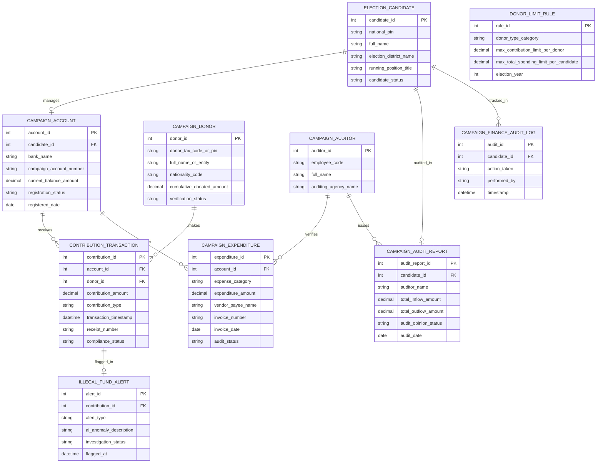

# Conceptual ERD — Election Campaign Finance Tracking System

## Mermaid Code

## Entity Description Table | Bảng mô tả Entity

| # | Entity Name | Vietnamese Name | Description | Key Attributes | Main Relationships |
|---|-------------|-----------------|-------------|----------------|-------------------|
| 1 | ELECTION_CANDIDATE | Ứng cử viên Bầu cử | Thông tin nhân thân và đơn vị bầu cử của ứng cử viên ĐBQH/HĐND | candidate_id, national_pin, full_name, election_district_name, candidate_status | Manages CAMPAIGN_ACCOUNT, audited in CAMPAIGN_AUDIT_REPORT |
| 2 | CAMPAIGN_ACCOUNT | Tài khoản Ngân hàng Chuyên dùng | Thông tin tài khoản ngân hàng duy nhất phục vụ vận động bầu cử | account_id, bank_name, campaign_account_number, current_balance_amount | Belongs to ELECTION_CANDIDATE, receives CONTRIBUTION, disburses EXPENDITURE |
| 3 | CAMPAIGN_DONOR | Nhà Tài trợ Bầu cử | Thông tin xác thực nhân thân và tổng tiền đóng góp của cá nhân/tổ chức | donor_id, donor_tax_code_or_pin, nationality_code, cumulative_donated_amount | Makes CONTRIBUTION_TRANSACTION |
| 4 | CONTRIBUTION_TRANSACTION | Giao dịch Tài trợ Bầu cử | Chi tiết nhật ký khoản tiền/tài sản đóng góp vào tài khoản chiến dịch | contribution_id, contribution_amount, contribution_type, receipt_number | Belongs to CAMPAIGN_ACCOUNT, DONOR, flagged in ILLEGAL_FUND_ALERT |
| 5 | CAMPAIGN_EXPENDITURE | Hóa đơn Chi phí Chiến dịch | Nhật ký các khoản chi tiêu vận động bầu cử (quảng cáo, in ấn, hội trường) | expenditure_id, expense_category, expenditure_amount, invoice_number | Belongs to CAMPAIGN_ACCOUNT, verified by AUDITOR |
| 6 | DONOR_LIMIT_RULE | Quy định Trần Đóng góp | Cấu hình mức trần đóng góp tối đa/cá nhân và mức trần chi tiêu tối đa/ứng viên | rule_id, donor_type_category, max_contribution_limit_per_donor, election_year | Config rule entity |
| 7 | CAMPAIGN_AUDIT_REPORT | Báo cáo Kiểm toán Tài chính | Báo cáo kiểm toán thu chi chiến dịch chính thức do đơn vị kiểm toán phát hành | audit_report_id, total_inflow_amount, total_outflow_amount, audit_opinion_status | Belongs to ELECTION_CANDIDATE, issued by AUDITOR |
| 8 | ILLEGAL_FUND_ALERT | Cảnh báo Dòng tiền Bất hợp pháp | Cảnh báo AI phát hiện tài trợ nước ngoài, nguồn tiền ẩn danh hoặc lách luật | alert_id, alert_type, ai_anomaly_description, investigation_status | Belongs to CONTRIBUTION_TRANSACTION |
| 9 | CAMPAIGN_AUDITOR | Kiểm toán viên Tài chính Bầu cử | Thông tin kiểm toán viên thuộc Kiểm toán Nhà nước hoặc đơn vị độc lập | auditor_id, employee_code, full_name, auditing_agency_name | Verifies EXPENDITURE, issues AUDIT_REPORT |
| 10 | CAMPAIGN_FINANCE_AUDIT_LOG | Nhật ký Kiểm toán Tài chính | Lưu lại lịch sử kê khai tài chính, cảnh báo AI, phong tỏa và phê duyệt báo cáo | audit_id, action_taken, performed_by, timestamp | Belongs to ELECTION_CANDIDATE |

## Relationship Description | Mô tả Quan hệ

| # | From Entity | Cardinality | To Entity | Relationship Label | Business Explanation |
|---|-------------|-------------|-----------|-------------------|----------------------|
| 1 | ELECTION_CANDIDATE | one-to-one | CAMPAIGN_ACCOUNT | manages | Mỗi ứng cử viên sở hữu duy nhất một Tài khoản ngân hàng chuyên dùng |
| 2 | CAMPAIGN_ACCOUNT | one-to-many | CONTRIBUTION_TRANSACTION | receives | Một tài khoản chiến dịch tiếp nhận nhiều khoản đóng góp ủng hộ |
| 3 | CAMPAIGN_DONOR | one-to-many | CONTRIBUTION_TRANSACTION | makes | Một nhà tài trợ có thể thực hiện nhiều giao dịch chuyển tiền ủng hộ |
| 4 | CAMPAIGN_ACCOUNT | one-to-many | CAMPAIGN_EXPENDITURE | disburses | Một tài khoản chiến dịch chi trả cho nhiều hóa đơn chi phí vận động bầu cử |
| 5 | CONTRIBUTION_TRANSACTION | one-to-one | ILLEGAL_FUND_ALERT | flagged_in | Giao dịch tài trợ bất thường bị phát hiện phát sinh duy nhất một Cảnh báo AI |
| 6 | ELECTION_CANDIDATE | one-to-one | CAMPAIGN_AUDIT_REPORT | audited_in | Mỗi ứng cử viên được lập một Báo cáo kiểm toán quyết toán tài chính bầu cử |
| 7 | CAMPAIGN_AUDITOR | one-to-many | CAMPAIGN_EXPENDITURE | verifies | Một kiểm toán viên thẩm định tính hợp lệ của nhiều hóa đơn chi tiêu |
| 8 | CAMPAIGN_AUDITOR | one-to-many | CAMPAIGN_AUDIT_REPORT | issues | Một kiểm toán viên phát hành nhiều Báo cáo kiểm toán tài chính bầu cử |
| 9 | ELECTION_CANDIDATE | one-to-many | CAMPAIGN_FINANCE_AUDIT_LOG | tracked_in | Mọi thao tác trên hồ sơ tài chính bầu cử được ghi nhật ký kiểm toán bất biến |
