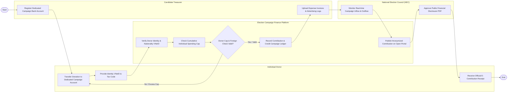

# Swimlane Diagram — Election Campaign Finance Tracking System

## Mermaid Code

## Flow Description | Mô tả luồng

| Lane | Actor | Role in Flow |
|------|-------|-------------|
| 1 | Individual Donor | Chuyển tiền ủng hộ vào tài khoản chuyên dùng của ứng viên, cung cấp định danh VNeID và nhận biên nhận điện tử. |
| 2 | Election Campaign Finance Platform | Tự động xác thực VNeID, kiểm tra trần đóng góp tối đa và dòng tiền nước ngoài, ghi sổ và công khai công khai minh bạch. |
| 3 | Candidate Treasurer | Đăng ký tài khoản ngân hàng bầu cử chuyên dùng duy nhất và tải lên các hóa đơn chứng từ chi tiêu vận động. |
| 4 | National Election Council (NEC) | Giám sát thời gian thực dòng tiền thu chi chiến dịch bầu cử và phê duyệt xuất bản báo cáo công khai tài chính. |
