# Action Tree — Election Campaign Finance Tracking System

## Mermaid Code

```mermaid
graph TD
    Root["Election Campaign Finance Tracking System"]

    Root --> M1["Candidate Account & Registration"]
    Root --> M2["Contribution Inflow & Donor Limits"]
    Root --> M3["Campaign Expenditure & Receipt Audit"]
    Root --> M4["Anti-Corruption & AI Anomaly Detection"]
    Root --> M5["Open Finance Portal & Disclosures"]
    Root --> M6["NEC Compliance & Election Audit"]

    M1 --> A11["Register Dedicated Campaign Bank Account"]
    M1 --> A12["Verify Candidate Official Nominee Status"]
    M1 --> A13["Authorize Campaign Treasurer Profiles"]
    M1 --> A14["Set Campaign Spending Cap Rules"]

    M2 --> A21["Record Campaign Contribution Inflow"]
    M2 --> A22["Verify Donor Identity VNeID API"]
    M2 --> A23["Enforce Individual Max Contribution Cap"]
    M2 --> A24["Issue E-Contribution Receipts PDF"]

    M3 --> A31["Upload Campaign Expenditure Invoices"]
    M3 --> A32["Audit Advertising Media Expenses"]
    M3 --> A33["Reconcile Bank Statements Real-time"]
    M3 --> A34["Classify Valid Campaign Expenses"]

    M4 --> A41["Detect Illegal Foreign Contributions AI"]
    M4 --> A42["Identify Smurfing Small Payment Anomaly"]
    M4 --> A43["Freeze Non-Compliant Campaign Accounts"]
    M4 --> A44["Report Suspicious Fund Anti-Corruption"]

    M5 --> A51["Publish Open Campaign Finance Portal"]
    M5 --> A52["Render Candidate Expense Pie Charts"]
    M5 --> A53["Anonymize Public Donor Identities"]
    M5 --> A54["Issue Pre-Election Disclosure PDFs"]

    M6 --> A61["Export NEC Election Compliance Reports"]
    M6 --> A62["Audit Post-Election Financial Ledgers"]
    M6 --> A63["Log System Immutable Audit Trails"]
    M6 --> A64["Archive Election Campaign Records"]
```

## Module Description | Mô tả Module

| # | Module | Description | Actions |
|---|--------|-------------|---------|
| 1 | Candidate Account & Registration | Quản lý đăng ký tài khoản ngân hàng chuyên dùng duy nhất của ứng viên, ủy quyền thủ quỹ và cấu hình trần chi tiêu | Register Dedicated Campaign Bank Account, Verify Candidate Official Nominee Status, Authorize Campaign Treasurer Profiles, Set Campaign Spending Cap Rules |
| 2 | Contribution Inflow & Donor Limits | Ghi nhận các khoản đóng góp ủng hộ, xác thực nhân thân VNeID, tự động chặn khoản tiền vượt trần và xuất biên nhận điện tử | Record Campaign Contribution Inflow, Verify Donor Identity VNeID API, Enforce Individual Max Contribution Cap, Issue E-Contribution Receipts PDF |
| 3 | Campaign Expenditure & Receipt Audit | Thẩm định hóa đơn chi phí vận động bầu cử (quảng cáo, in ấn, hội trường), đối soát sao kê ngân hàng và phân loại chi tiêu | Upload Campaign Expenditure Invoices, Audit Advertising Media Expenses, Reconcile Bank Statements Real-time, Classify Valid Campaign Expenses |
| 4 | Anti-Corruption & AI Anomaly Detection | Thuật toán AI quét phát hiện dòng tiền tài trợ từ nước ngoài, rải nhỏ số tiền lách luật, phong tỏa tài khoản vi phạm | Detect Illegal Foreign Contributions AI, Identify Smurfing Small Payment Anomaly, Freeze Non-Compliant Campaign Accounts, Report Suspicious Fund Anti-Corruption |
| 5 | Open Finance Portal & Disclosures | Công khai minh bạch tài chính bầu cử của ứng cử viên cho nhân dân giám sát, ẩn danh nhà tài trợ và xuất bản báo cáo kê khai | Publish Open Campaign Finance Portal, Render Candidate Expense Pie Charts, Anonymize Public Donor Identities, Issue Pre-Election Disclosure PDFs |
| 6 | NEC Compliance & Election Audit | Trích xuất báo cáo tuân thủ tài chính nộp Hội đồng Bầu cử Quốc gia, kiểm toán quyết toán sau bầu cử và lưu trữ lịch sử | Export NEC Election Compliance Reports, Audit Post-Election Financial Ledgers, Log System Immutable Audit Trails, Archive Election Campaign Records |
