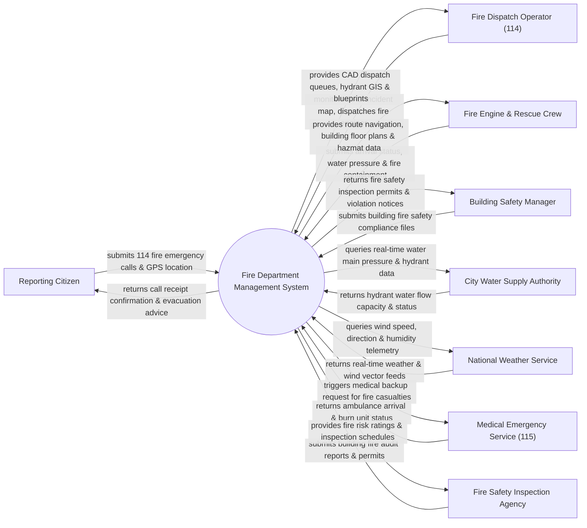

# Context Diagram — Fire Department Management System

## Mermaid Code

## Actor & Interaction Table | Bảng Actor & Tương tác

| # | Actor | Actor Type | Data Sent TO System | Data Received FROM System | Notes |
|---|-------|------------|---------------------|---------------------------|-------|
| 1 | Reporting Citizen | Primary | 114 Fire emergency calls, GPS coordinates, fire photos/videos | Call acknowledgment, emergency evacuation & safety instructions | Người dân gọi điện báo cháy hoặc báo tin qua ứng dụng khẩn cấp |
| 2 | Fire Dispatch Operator (114) | Primary | Fire alert classification, truck dispatch orders, alarm level | Computer-Aided Dispatch (CAD) map, hydrant GIS, station queue | Điện thoại viên 114 trực điều phối trung tâm chỉ hữu PCCC |
| 3 | Fire Engine & Rescue Crew | Primary | On-scene arrival, fire containment updates, water supply requests | Navigation routes, building floor plans, hazmat hazard warnings | Đội hình chiến sĩ PCCC & CNCH trực tiếp chữa cháy |
| 4 | Building Safety Manager | Primary | Building fire system maintenance logs, architectural blueprints | Fire inspection permits, safety violation remediation notices | Ban quản lý tòa nhà/cơ sở sản xuất thẩm duyệt PCCC |
| 5 | City Water Supply Authority | Supporting | Hydrant location GIS, water main pressure, reservoir levels | Fire hydrant activation query, water pressure boost request | Công ty Cấp nước đô thị quản lý trụ nước chữa cháy |
| 6 | National Weather Service | Supporting | Wind direction, wind speed, ambient humidity, temperature | Weather telemetry query requests | Cơ quan Khí tượng cung cấp hướng gió và tốc độ gió |
| 7 | Medical Emergency Service (115) | Supporting | Burn unit bed capacity, ambulance arrival updates | Fire casualty emergency dispatch requests | Lực lượng Cấp cứu 115 phối hợp cấp cứu nạn nhân bỏng/khói |
| 8 | Fire Safety Inspection Agency | Regulatory | Fire safety inspection results, building compliance ratings | Fire risk profiles, mandatory inspection task schedules | Cơ quan Cảnh sát PCCC thẩm duyệt và kiểm tra an toàn PCCC |

## System Boundary Description | Mô tả Phạm vi Hệ thống

Hệ thống Fire Department Management System (Hệ thống Quản lý Cơ quan Phòng cháy Chữa cháy và Cứu nạn Cứu hộ - PCCC & CNCH) chịu trách nhiệm tự động hóa quy trình nghiệp vụ lực lượng Cảnh sát PCCC: Tiếp nhận cuộc gọi báo cháy 114, điều động xe chữa cháy và xe thang thông minh qua GIS, tra cứu sơ đồ bản vẽ kỹ thuật tòa nhà, định vị trụ nước chữa cháy gần nhất, cảnh báo hóa chất độc hại (Hazmat) và quản lý công tác kiểm tra an toàn PCCC tòa nhà. Tuy nhiên, hệ thống KHÔNG trực tiếp vận hành động cơ cơ khí bơm nước trên xe chữa cháy và KHÔNG thay thế kỹ năng tác chiến trực tiếp của chiến sĩ tại hiện trường.
