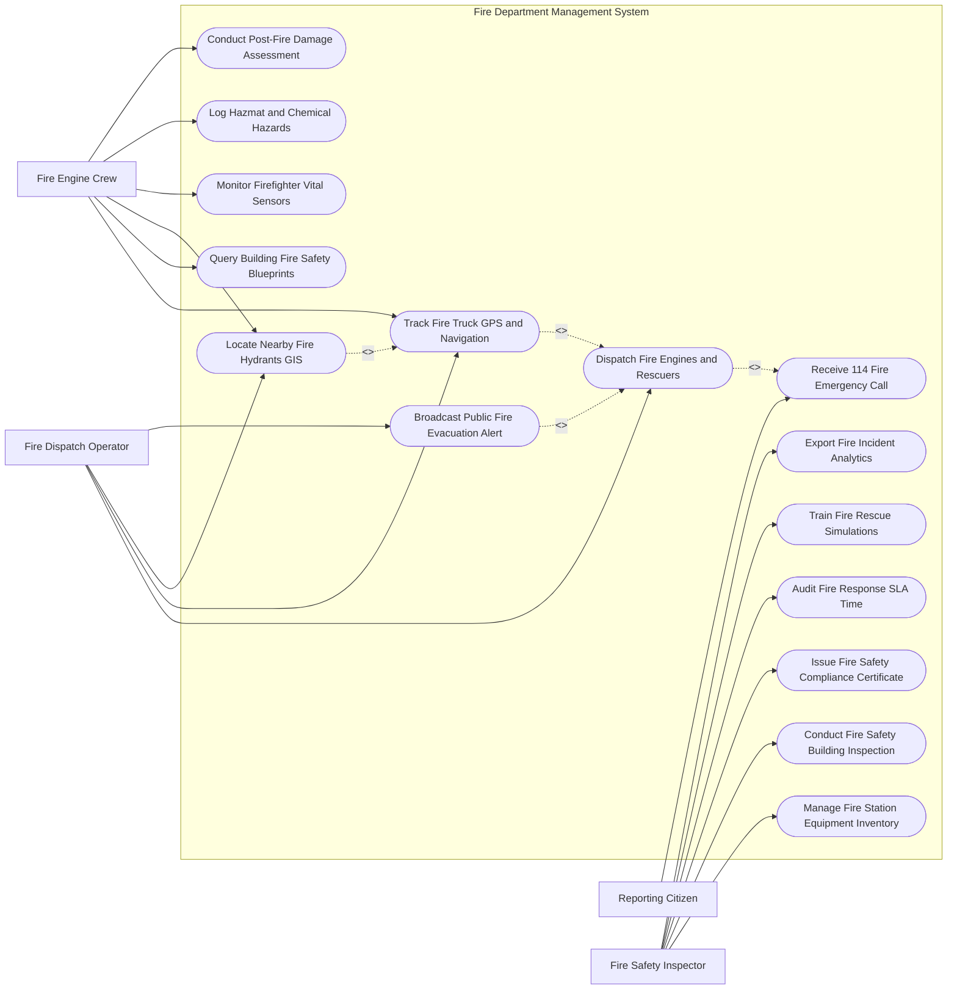

# Use Case Diagram — Fire Department Management System

## Mermaid Code

## Actor Table | Bảng Actor

| # | Actor | Actor Type | Role Description | Related Use Cases |
|---|-------|------------|------------------|-------------------|
| 1 | Reporting Citizen | Primary | Người dân gọi 114 báo cháy hoặc báo khẩn cấp qua ứng dụng di động | UC01 |
| 2 | Fire Dispatch Operator | Primary | Điện thoại viên 114 nhận cuộc gọi, phân loại cấp báo động và xuất xe | UC02, UC03, UC05, UC12 |
| 3 | Fire Engine Crew | Primary | Đội hình chiến sĩ chữa cháy di chuyển đến hiện trường, cứu hộ và dập lửa | UC03, UC04, UC05, UC06, UC10, UC11 |
| 4 | Fire Safety Inspector | Primary | Cán bộ kiểm tra an toàn PCCC tòa nhà, thẩm duyệt phương án và cấp phép | UC07, UC08, UC09, UC13, UC14, UC15 |

## Use Case Table | Bảng Use Case

| # | UC ID | Use Case Name | Primary Actor | Secondary Actor | Description | Priority |
|---|-------|---------------|---------------|-----------------|-------------|----------|
| 1 | UC01 | Receive 114 Fire Emergency Call | Citizen | - | Báo cháy qua tổng đài 114 khẩn cấp kèm định vị tọa độ GPS | High |
| 2 | UC02 | Dispatch Fire Engines and Rescuers | Operator | FireStation | Phát lệnh xuất xe chữa cháy, xe thang, xe bơm và lực lượng cứu hộ | High |
| 3 | UC03 | Track Fire Truck GPS and Navigation | Operator, Crew | GIS Engine | Dẫn đường và giám sát GPS thời gian thực vị trí các xe chữa cháy | High |
| 4 | UC04 | Query Building Fire Safety Blueprints | Crew | - | Tra cứu bản vẽ kiến trúc 3D, lối thoát hiểm và sơ đồ hệ thống PCCC tòa nhà | High |
| 5 | UC05 | Locate Nearby Fire Hydrants GIS | Operator, Crew | WaterUtility | Định vị các trụ nước chữa cháy, bể nước ngầm công cộng trên bản đồ GIS | High |
| 6 | UC06 | Monitor Firefighter Vital Sensors | Crew | - | Giám sát nhịp tim, lượng oxy bình thở và nhiệt độ cơ thể chiến sĩ | High |
| 7 | UC07 | Manage Fire Station Equipment Inventory | Inspector | - | Quản lý bảo trì vòi chữa cháy, lăng phun, bình khí thở và xe chữa cháy | Medium |
| 8 | UC08 | Conduct Fire Safety Building Inspection | Inspector | BuildingManager | Khảo sát kiểm tra định kỳ an toàn PCCC tại các chung cư, nhà máy | High |
| 9 | UC09 | Issue Fire Safety Compliance Certificate | Inspector | BuildingManager | Cấp Giấy chứng nhận đủ điều kiện an toàn PCCC cho cơ sở | High |
| 10 | UC10 | Log Hazmat and Chemical Hazards | Crew | - | Tra cứu và ghi nhận danh mục hóa chất nguy hiểm độc hại tại hiện trường cháy | High |
| 11 | UC11 | Conduct Post-Fire Damage Assessment | Crew | Insurance | Khám nghiệm hiện trường, xác định nguyên nhân cháy và ước tính thiệt hại | Medium |
| 12 | UC12 | Broadcast Public Fire Evacuation Alert | Operator | SMS Gateway | Phát tin nhắn khẩn cấp hướng dẫn cư dân khu vực cháy sơ tán an toàn | High |
| 13 | UC13 | Audit Fire Response SLA Time | Inspector | - | Kiểm toán thời gian từ lúc nhận tin 114 đến khi xe chữa cháy phun nước | High |
| 14 | UC14 | Train Fire Rescue Simulations | Inspector | VR Engine | Tổ chức các buổi diễn tập phương án chữa cháy và cứu nạn cứu hộ | Low |
| 15 | UC15 | Export Fire Incident Analytics | Inspector | MOHA | Trích xuất báo cáo thống kê tình hình cháy nổ và thiệt hại nộp Bộ Công an | Low |

## Use Case Specification | Đặc tả Use Case

---

### UC01 — Receive 114 Fire Emergency Call

| Field | Detail |
|-------|--------|
| **UC ID** | UC01 |
| **Use Case Name** | Receive 114 Fire Emergency Call |
| **Actor(s)** | Primary: Reporting Citizen / Secondary: None |
| **Description** | Tiếp nhận cuộc gọi báo cháy khẩn cấp 114 từ người dân, tự động xác định vị trí tọa độ GPS và khởi tạo vé sự cố CAD. |
| **Precondition** | 1. Có kết nối mạng viễn thông hoặc ứng dụng Báo cháy 114. |
| **Main Flow** | 1. Citizen gọi 114 hoặc bấm nút "Báo cháy SOS" trên ứng dụng.   2. System tự động kích hoạt định vị tọa độ GPS thiết bị/trạm phát sóng di động.   3. System phát âm thanh báo động và hiển thị vị trí sự cố trên Bản đồ GIS của điện thoại viên 114.   4. Operator tiếp nhận cuộc gọi, hỏi thông tin: Quy mô đám cháy, loại chất cháy (nhà ở, kho bãi, hóa chất), số người bị kẹt.   5. Operator gán Mức độ báo động cháy (Báo động 1, Báo động 2, Báo động 3).   6. System sinh Mã sự cố cháy (Fire Incident Ticket ID) và chuyển sang màn hình xuất xe (UC02).   7. System tự động gửi SMS xác nhận cho Citizen kèm các hướng dẫn thoát nạn khẩn cấp. |
| **Alternative Flow** | **AF1** — Tự động báo cháy qua Cảm biến IoT tòa nhà: Cảm biến khói/nhiệt tòa nhà báo động tự động gửi dữ liệu về trung tâm 114 mà không cần người dân gọi. |
| **Exception Flow** | **EX1** — Cuộc gọi báo cháy giả (Báo cháy khống): Operator xác minh lại thông tin qua camera giao thông khu vực, nếu khẳng định tin giả thì hủy vé sự cố và ghi log cảnh báo số điện thoại. |
| **Postcondition** | Sự cố cháy được khởi tạo chính thức trên hệ thống CAD, định vị vị trí chính xác để xuất xe. |
| **Business Rule** | **BR1**: Thời gian tiếp nhận và xử lý cuộc gọi báo cháy 114 không được vượt quá 10 giây. |

---

### UC02 — Dispatch Fire Engines and Rescuers

| Field | Detail |
|-------|--------|
| **UC ID** | UC02 |
| **Use Case Name** | Dispatch Fire Engines and Rescuers |
| **Actor(s)** | Primary: Fire Dispatch Operator / Secondary: Fire Station |
| **Description** | Điều động các Đội chữa cháy, xe chữa cháy, xe thang và lực lượng cứu nạn cứu hộ thuộc các Đội PCCC gần hiện trường nhất. |
| **Precondition** | 1. Sự cố cháy đã được xác nhận và phân cấp báo động (UC01). |
| **Main Flow** | 1. System hiển thị danh sách các Đội PCCC (Fire Station) xung quanh bán kính hiện trường.   2. System đề xuất số lượng phương tiện cần xuất theo cấp báo động (Ví dụ: Báo động 2 = 4 xe chữa cháy + 1 xe thang + 1 xe cứu thương).   3. Operator chọn các Đội PCCC và bấm "Phát lệnh xuất xe khẩn cấp".   4. System truyền thông điệp lệnh điều động tới hệ thống loa báo động và màn hình chỉ huy tại các Đội PCCC.   5. Trực ban Đội PCCC bấm "Xác nhận xuất xe".   6. System kích hoạt chế độ dẫn đường xe chữa cháy GPS (UC03) và cập nhật trạng thái "Xe đã xuất bốt". |
| **Alternative Flow** | **AF1** — Chi viện từ Đội PCCC các quận lân cận (Khi cháy lớn Báo động 3): Operator phát lệnh chi viện liên quận, System tự động thông báo cho các Đội PCCC hỗ trợ. |
| **Exception Flow** | **EX1** — Đội PCCC gần nhất bận chữa cháy vụ khác: System tự động tìm kiếm và đề xuất Đội PCCC có thời gian tiếp cận nhanh nhất tiếp theo. |
| **Postcondition** | Các xe chữa cháy rời bốt di chuyển đến hiện trường, thời gian xuất xe được ghi nhận vào sổ kiểm toán. |
| **Business Rule** | **BR1**: Thời gian từ khi nhận lệnh xuất xe đến khi xe chữa cháy lăn bánh rời khỏi cổng Đội PCCC không được vượt quá 60 giây. |

---

### UC04 — Query Building Fire Safety Blueprints

| Field | Detail |
|-------|--------|
| **UC ID** | UC04 |
| **Use Case Name** | Query Building Fire Safety Blueprints |
| **Actor(s)** | Primary: Fire Engine Crew / Secondary: None |
| **Description** | Chỉ huy chữa cháy tại hiện trường tra cứu sơ đồ bản vẽ 3D tòa nhà, vị trí thang thoát hiểm, hệ thống thông gió và các điểm nguy cơ cháy nổ. |
| **Precondition** | 1. Tòa nhà xảy ra cháy đã được thẩm duyệt và lưu CSDL PCCC (UC09). |
| **Main Flow** | 1. FireCrew mở ứng dụng Chỉ huy Chữa cháy trên máy tính bảng chỉ huy.   2. System tự động định vị vị trí xe chữa cháy và hiển thị hồ sơ tòa nhà đang bị cháy.   3. FireCrew xem sơ đồ kiến trúc 3D tòa nhà, bao gồm: Vị trí tầng bị cháy, cầu thang bộ thoát hiểm, buồng thang nén khí.   4. System hiển thị sơ đồ hệ thống PCCC nội bộ: Vị trí họng nước chữa cháy vách tường, trung tâm báo cháy, máy bơm chữa cháy tòa nhà.   5. FireCrew tra cứu danh mục chất dễ cháy/hóa chất độc hại (UC10) lưu trữ trong tòa nhà.   6. FireCrew lập phương án tiếp cận dập lửa và hướng dẫn luồng di chuyển cho chiến sĩ cứu nạn. |
| **Alternative Flow** | **AF1** — Tòa nhà chưa có sơ đồ 3D: System hiển thị bản vẽ 2D mặt bằng các tầng do chủ đầu tư đã nộp lúc xin phép PCCC. |
| **Exception Flow** | **EX1** — Nhà dân nhỏ lẻ không có bản vẽ kiến trúc: System hiển thị sơ đồ thửa đất địa chính GIS và ảnh vệ tinh khu vực xung quanh. |
| **Postcondition** | Chỉ huy chữa cháy nắm rõ kết cấu tòa nhà để đưa ra phương án tác chiến an toàn hiệu quả nhất. |
| **Business Rule** | **BR1**: Hồ sơ bản vẽ PCCC tòa nhà phải được mã hóa và sẵn sàng tải về thiết bị máy tính bảng chỉ hữu trong vòng < 3 giây. |

---

### UC05 — Locate Nearby Fire Hydrants GIS

| Field | Detail |
|-------|--------|
| **UC ID** | UC05 |
| **Use Case Name** | Locate Nearby Fire Hydrants GIS |
| **Actor(s)** | Primary: Fire Dispatch Operator, Fire Engine Crew / Secondary: City Water Supply Authority |
| **Description** | Tìm kiếm và định vị các trụ nước chữa cháy, bể nước ngầm, ao hồ công cộng gần hiện trường nhất trên bản đồ GIS. |
| **Precondition** | 1. Vị trí địa chỉ đám cháy đã được xác định trên bản đồ GIS. |
| **Main Flow** | 1. System tự động quét bán kính 500m xung quanh điểm cháy.   2. System hiển thị các biểu tượng Trụ nước chữa cháy đô thị (Fire Hydrant) trên bản đồ GIS.   3. System hiển thị thông tin từng trụ nước: Áp lực nước hiện tại (Bar), đường kính họng lấy nước, trạng thái hoạt động (Tốt/Hỏng).   4. System hiển thị thêm các nguồn nước tự nhiên lân cận (Sông, hồ, bể nước ngầm tòa nhà) có thể thả vòi hút.   5. FireCrew chọn trụ nước gần nhất và điều xe tiếp nước đến trạm hút.   6. Nếu áp lực nước yếu: System gửi yêu cầu tự động tới Công ty Cấp nước (Water Utility) để tăng áp lực nước tại tuyến ống khu vực. |
| **Alternative Flow** | **AF1** — Trụ nước chữa cháy gần nhất bị hỏng: System gạch đỏ trụ hỏng, tự động dẫn đường xe chữa cháy đến trụ nước hoạt động tốt tiếp theo. |
| **Exception Flow** | **EX1** — Không có trụ nước trong bán kính 500m: System tính toán phương án tiếp nước nối tiếp giữa nhiều xe chữa cháy (chở nước từ xa về). |
| **Postcondition** | Đảm bảo nguồn cung cấp nước chữa cháy liên tục, không bị đứt đoạn trong suốt quá trình dập lửa. |
| **Business Rule** | **BR1**: Dữ liệu vị trí và áp lực trụ nước chữa cháy trên bản đồ GIS phải được cập nhật kiểm tra định kỳ 06 tháng/lần. |

---

### UC08 — Conduct Fire Safety Building Inspection

| Field | Detail |
|-------|--------|
| **UC ID** | UC08 |
| **Use Case Name** | Conduct Fire Safety Building Inspection |
| **Actor(s)** | Primary: Fire Safety Inspector / Secondary: Building Safety Manager |
| **Description** | Cán bộ cảnh sát PCCC tiến hành khảo sát, kiểm tra an toàn PCCC định kỳ hoặc đột xuất tại các chung cư, trung tâm thương mại, nhà máy. |
| **Precondition** | 1. Cơ sở nằm trong danh sách quản lý PCCC của Cảnh sát PCCC địa phương.   2. Kiểm tra theo kế hoạch định kỳ hoặc có dấu hiệu vi phạm. |
| **Main Flow** | 1. Inspector mở ứng dụng Kiểm tra An toàn PCCC trên máy tính bảng chuyên dụng.   2. Inspector đến thực địa cơ sở và tiến hành kiểm tra theo Danh mục kiểm tra (Checklist): Hệ thống báo cháy tự động, hệ thống chữa cháy vách tường, bình chữa cháy xách tay, lối thoát nạn, ngắt điện sự cố.   3. Inspector thực hiện test thử chuông báo cháy và máy bơm chữa cháy.   4. Inspector nhập kết quả kiểm tra cho từng hạng mục (Đạt/Không đạt) và chụp ảnh vi phạm (nếu có).   5. System tự động tính toán Điểm an toàn PCCC và đưa ra kết luận: "Đạt yêu cầu" hoặc "Tạm dừng hoạt động do vi phạm nghiêm trọng".   6. Inspector và BuildingManager cùng ký số vào Biên bản kiểm tra an toàn PCCC.   7. System gửi biên bản điện tử cho cơ sở và lưu vào CSDL quản lý an toàn PCCC. |
| **Alternative Flow** | **AF1** — Yêu cầu khắc phục vi phạm: Inspector lập Biên bản kiến nghị khắc phục kèm thời hạn (Ví dụ: 15 ngày), System hẹn lịch tái kiểm tra tự động. |
| **Exception Flow** | **EX1** — Cơ sở chống đối không hợp tác kiểm tra: Inspector lập biên bản vi phạm hành chính, tạm đình chỉ hoạt động và niêm phong cơ sở. |
| **Postcondition** | Biên bản kiểm tra PCCC được lưu trữ, làm căn cứ gia hạn hoặc thu hồi Giấy chứng nhận đủ điều kiện PCCC (UC09). |
| **Business Rule** | **BR1**: Mọi cơ sở nguy hiểm về cháy nổ (Karaoke, vũ trường, chung cư cao tầng) bắt buộc phải được kiểm tra PCCC tối thiểu 01 lần/năm. |
