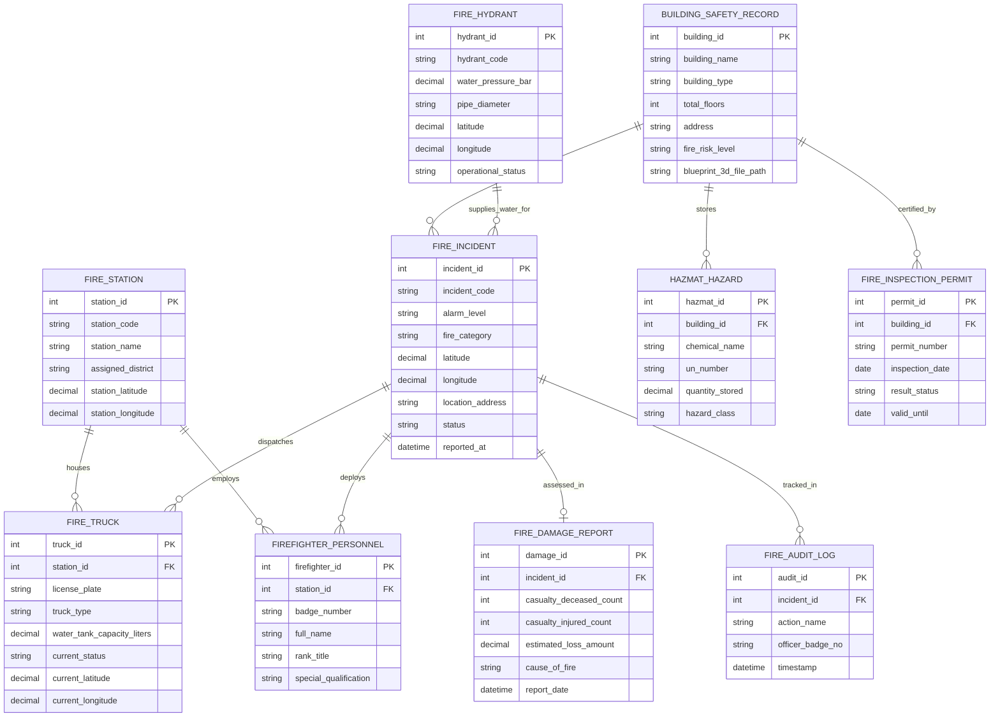

# Conceptual ERD — Fire Department Management System

## Mermaid Code

## Entity Description Table | Bảng mô tả Entity

| # | Entity Name | Vietnamese Name | Description | Key Attributes | Main Relationships |
|---|-------------|-----------------|-------------|----------------|-------------------|
| 1 | FIRE_INCIDENT | Sự cố Cháy nổ | Thông tin hồ sơ vụ cháy (vị trí, cấp báo động, địa chỉ, trạng thái) | incident_id, incident_code, alarm_level, fire_category, status | Dispatches FIRE_TRUCK, location of BUILDING_SAFETY_RECORD |
| 2 | FIRE_STATION | Đội / Đồn PCCC | Thông tin đơn vị Cảnh sát PCCC cơ sở phụ trách địa bàn | station_id, station_code, station_name, assigned_district | Houses FIRE_TRUCK, employs FIREFIGHTER_PERSONNEL |
| 3 | FIRE_TRUCK | Xe Chữa cháy & Cứu hộ | Thông tin xe chữa cháy, xe thang, xe bơm và vị trí GPS thời gian thực | truck_id, license_plate, truck_type, current_status, current_latitude | Belongs to FIRE_STATION, dispatched in FIRE_INCIDENT |
| 4 | FIREFIGHTER_PERSONNEL | Chiến sĩ Cảnh sát PCCC | Thông tin cán bộ chiến sĩ thuộc lực lượng PCCC & CNCH | firefighter_id, badge_number, full_name, rank_title | Belongs to FIRE_STATION, deployed in FIRE_INCIDENT |
| 5 | FIRE_HYDRANT | Trụ nước Chữa cháy | Thông tin vị trí GIS, áp lực nước bar và trạng thái của trụ nước đô thị | hydrant_id, hydrant_code, water_pressure_bar, operational_status | Supplies water for FIRE_INCIDENT |
| 6 | BUILDING_SAFETY_RECORD | Hồ sơ An toàn Tòa nhà | Thông tin kết cấu, loại hình tòa nhà và bản vẽ kiến trúc 3D PCCC | building_id, building_name, building_type, fire_risk_level | Location of FIRE_INCIDENT, stores HAZMAT_HAZARD |
| 7 | HAZMAT_HAZARD | Hóa chất Nguy hiểm (Hazmat) | Danh mục hóa chất dễ cháy nổ, độc hại lưu trữ tại công trình | hazmat_id, chemical_name, un_number, hazard_class | Belongs to BUILDING_SAFETY_RECORD |
| 8 | FIRE_INSPECTION_PERMIT | Giấy phép An toàn PCCC | Kết quả kiểm tra định kỳ và Giấy chứng nhận đủ điều kiện PCCC | permit_id, permit_number, inspection_date, result_status | Certified by BUILDING_SAFETY_RECORD |
| 9 | FIRE_DAMAGE_REPORT | Báo cáo Thiệt hại Cháy | Thống kê thiệt hại về người, tài sản và kết luận nguyên nhân vụ cháy | damage_id, casualty_deceased_count, estimated_loss_amount, cause_of_fire | Belongs to FIRE_INCIDENT |
| 10 | FIRE_AUDIT_LOG | Nhật ký Kiểm toán PCCC | Lưu lịch sử tiếp nhận 114, xuất xe và thời gian phản hồi SLA dập lửa | audit_id, action_name, officer_badge_no, timestamp | Belongs to FIRE_INCIDENT |

## Relationship Description | Mô tả Quan hệ

| # | From Entity | Cardinality | To Entity | Relationship Label | Business Explanation |
|---|-------------|-------------|-----------|-------------------|----------------------|
| 1 | FIRE_STATION | one-to-many | FIRE_TRUCK | houses | Mot đội PCCC quản lý nhiều xe chữa cháy, xe thang, xe bơm |
| 2 | FIRE_STATION | one-to-many | FIREFIGHTER_PERSONNEL | employs | Một đội PCCC bao gồm nhiều cán bộ chiến sĩ cảnh sát PCCC |
| 3 | FIRE_INCIDENT | one-to-many | FIRE_TRUCK | dispatches | Một vụ cháy được điều động nhiều xe chữa cháy từ các đội |
| 4 | FIRE_INCIDENT | one-to-many | FIREFIGHTER_PERSONNEL | deploys | Một vụ cháy huy động nhiều chiến sĩ tham gia dập lửa cứu nạn |
| 5 | BUILDING_SAFETY_RECORD | one-to-many | FIRE_INCIDENT | location_of | Một tòa nhà có thể xảy ra các vụ việc cháy nổ trong lịch sử |
| 6 | BUILDING_SAFETY_RECORD | one-to-many | HAZMAT_HAZARD | stores | Một tòa nhà/nhà máy có thể lưu trữ nhiều loại hóa chất nguy hiểm |
| 7 | BUILDING_SAFETY_RECORD | one-to-many | FIRE_INSPECTION_PERMIT | certified_by | Một tòa nhà được cấp các Giấy chứng nhận kiểm tra an toàn PCCC định kỳ |
| 8 | FIRE_INCIDENT | one-to-one | FIRE_DAMAGE_REPORT | assessed_in | Một vụ cháy sau khi dập tắt được lập một báo cáo đánh giá thiệt hại |
| 9 | FIRE_HYDRANT | one-to-many | FIRE_INCIDENT | supplies_water_for | Một trụ nước chữa cháy có thể phục vụ cấp nước cho nhiều vụ cháy |
| 10 | FIRE_INCIDENT | one-to-many | FIRE_AUDIT_LOG | tracked_in | Mọi diễn biến xử lý vụ cháy được ghi nhật ký kiểm toán bất biến |
