# Swimlane Diagram — Fire Department Management System

## Mermaid Code

```mermaid
flowchart LR
    Start(["Start"])

    subgraph Lane1["Reporting Citizen"]
        A1["Dial 114 or Press SOS Fire App"]
        A2["Provide Fire Location & Scale"]
        A3["Follow Safety Evacuation Instructions"]
    end

    subgraph Lane2["Fire Command CAD System"]
        S1["Locate Caller GPS & Map Incident"]
        S2["Set Alarm Level & Select Stations"]
        S3["Locate Hydrants & Building 3D Blueprint"]
        S4["Calculate Fastest Traffic Route GPS"]
        S5["Log Incident Resolution & Damage Data"]
    end

    subgraph Lane3["Fire Dispatch Operator (114)"]
        O1["Answer Emergency 114 Call"]
        O2["Fire Alarm Dispatch Order"]
    end

    subgraph Lane4["Fire Engine Crew"]
        B1["Receive Alarm Order & Depart Station"]
        B2["Navigate to Scene via Truck GPS"]
        B3["Connect Hose to Hydrant & Extinguish"]
        B4["Submit On-scene Fire Status Report"]
    end

    Finish(["End"])

    Start --> A1 --> S1 --> O1 --> A2 --> O2 --> S2 --> S3 --> B1 --> S4 --> B2 --> B3 --> B4 --> S5 --> A3 --> Finish
```

## Flow Description | Mô tả luồng

| Lane | Actor | Role in Flow |
|------|-------|-------------|
| 1 | Reporting Citizen | Gọi 114 báo cháy hoặc bấm nút khẩn cấp trên ứng dụng di động, cung cấp vị trí địa chỉ và nhận hướng dẫn thoát nạn. |
| 2 | Fire Command CAD System | Định vị GPS cuộc gọi, tự động xác định cấp báo động, truy xuất bản đồ trụ nước và sơ đồ 3D tòa nhà, dẫn đường xe và ghi log. |
| 3 | Fire Dispatch Operator (114) | Nghe cuộc gọi 114, đánh giá sơ bộ quy mô đám cháy và bấm phát lệnh xuất xe chữa cháy khẩn cấp. |
| 4 | Fire Engine Crew | Nhận lệnh xuất xe, di chuyển theo lộ trình dẫn đường GPS, đấu nối vòi dập lửa từ trụ nước và gửi báo cáo diễn biến tại hiện trường. |
