# Action Tree — Fire Department Management System

## Mermaid Code

```mermaid
graph TD
    Root["Fire Department Management System"]

    Root --> M1["Fire Alarm Intake & CAD Dispatch"]
    Root --> M2["Hydrant & Building GIS Infrastructure"]
    Root --> M3["Fire Truck & Equipment Logistics"]
    Root --> M4["Fire Safety Inspection & Permits"]
    Root --> M5["Firefighter Safety & Telemetry"]
    Root --> M6["Analytics & Fire Prevention Audit"]

    M1 --> A11["Receive 114 Voice & App SOS Calls"]
    M1 --> A12["Locate Caller GPS & Triangulation"]
    M1 --> A13["Set Fire Alarm Severity Level"]
    M1 --> A14["Issue Multi-Station Alarm Orders"]

    M2 --> A21["Locate Fire Hydrants GIS Map"]
    M2 --> A22["Query Building 3D Blueprints"]
    M2 --> A23["Query Hazmat Chemical Storage"]
    M2 --> A24["Check Water Main Pressure Bar"]

    M3 --> A31["Track Fire Truck GPS Locations"]
    M3 --> A32["Calculate Real-time Optimal Routes"]
    M3 --> A33["Manage Station Equipment Inventory"]
    M3 --> A34["Schedule Vehicle Maintenance Logs"]

    M4 --> A41["Conduct Building Fire Safety Inspections"]
    M4 --> A42["Issue Fire Compliance Certificates"]
    M4 --> A43["Issue Fire Violation Remediation"]
    M4 --> A44["Audit Building Evacuation Plans"]

    M5 --> A51["Monitor Firefighter Oxygen Vitals"]
    M5 --> A52["Track In-Building Rescuer Locations"]
    M5 --> A53["Trigger PASS Distress Alarms"]
    M5 --> A54["Coordinate Ambulance 115 Casualty"]

    M6 --> A61["Audit 114 Call to Water Response SLA"]
    M6 --> A62["Compile Post-Fire Damage Reports"]
    M6 --> A63["Run Fire Rescue VR Simulations"]
    M6 --> A64["Export Ministry Police Statistics"]
```

## Module Description | Mô tả Module

| # | Module | Description | Actions |
|---|--------|-------------|---------|
| 1 | Fire Alarm Intake & CAD Dispatch | Tiếp nhận cuộc gọi báo cháy 114, định vị GPS cuộc gọi, phân cấp báo động và phát lệnh xuất xe chữa cháy | Receive 114 Voice & App SOS Calls, Locate Caller GPS & Triangulation, Set Fire Alarm Severity Level, Issue Multi-Station Alarm Orders |
| 2 | Hydrant & Building GIS Infrastructure | Định vị vị trí trụ nước chữa cháy đô thị trên bản đồ GIS, tra cứu bản vẽ 3D tòa nhà và kiểm tra danh mục hóa chất độc hại | Locate Fire Hydrants GIS Map, Query Building 3D Blueprints, Query Hazmat Chemical Storage, Check Water Main Pressure Bar |
| 3 | Fire Truck & Equipment Logistics | Giám sát lộ trình dẫn đường xe chữa cháy qua GPS, quản lý trang thiết bị bảo hộ, bình khí thở và bảo trì xe | Track Fire Truck GPS Locations, Calculate Real-time Optimal Routes, Manage Station Equipment Inventory, Schedule Vehicle Maintenance Logs |
| 4 | Fire Safety Inspection & Permits | Thực hiện kiểm tra an toàn PCCC tòa nhà định kỳ, cấp Giấy chứng nhận đủ điều kiện PCCC và xử lý vi phạm | Conduct Building Fire Safety Inspections, Issue Fire Compliance Certificates, Issue Fire Violation Remediation, Audit Building Evacuation Plans |
| 5 | Firefighter Safety & Telemetry | Giám sát sinh hiệu nhịp tim, oxy bình thở của chiến sĩ chữa cháy, phát cảnh báo nguy hiểm khẩn cấp và kết nối 115 | Monitor Firefighter Oxygen Vitals, Track In-Building Rescuer Locations, Trigger PASS Distress Alarms, Coordinate Ambulance 115 Casualty |
| 6 | Analytics & Fire Prevention Audit | Kiểm toán thời gian phản hồi ứng cứu SLA, lập báo cáo đánh giá thiệt hại vụ cháy và trích xuất báo cáo Bộ Công an | Audit 114 Call to Water Response SLA, Compile Post-Fire Damage Reports, Run Fire Rescue VR Simulations, Export Ministry Police Statistics |
