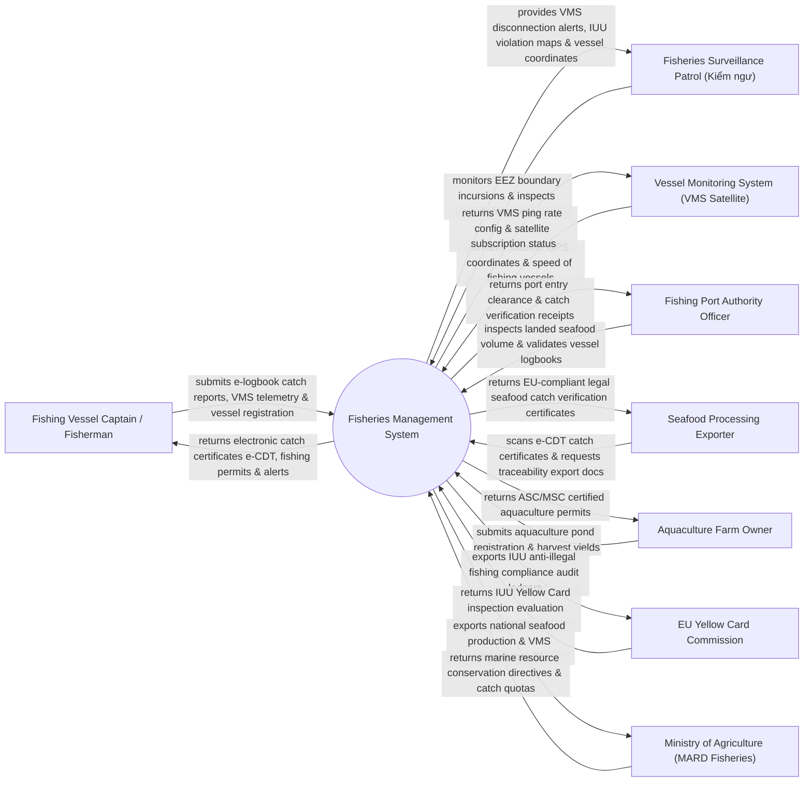

# Context Diagram — Fisheries Management System

## Mermaid Code

## Actor & Interaction Table | Bảng Actor & Tương tác

| # | Actor | Actor Type | Data Sent TO System | Data Received FROM System | Notes |
|---|-------|------------|---------------------|---------------------------|-------|
| 1 | Fishing Vessel Captain / Fisherman | Primary | E-logbook seafood catch entries, VMS GPS telemetry, vessel registration | Electronic catch certificates e-CDT, fishing licenses, EEZ boundary alerts | Thuyền trưởng và ngư dân vận hành tàu cá đánh bắt hải sản xa bờ |
| 2 | Fisheries Surveillance Patrol (Kiểm ngư) | Primary | IUU violation records, fishing gear inspection logs, boarding reports | VMS disconnection alerts, EEZ boundary breach heatmaps, vessel locations | Lực lượng Kiểm ngư Việt Nam tuần tra xử lý vi phạm trên biển |
| 3 | Vessel Monitoring System (VMS Satellite) | Supporting | Satellite GPS coordinates, vessel speed, direction heading | VMS ping frequency config, satellite data subscription status | Thiết bị giám sát hành trình tàu cá (VMS) truyền dữ liệu vệ tinh 24/7 |
| 4 | Fishing Port Authority Officer | Primary | Landed seafood weight logs, species verification, port entry clearance | Port entry clearance certificates, catch verification receipts | Ban Quản lý Cảng cá kiểm soát tàu cập cảng bốc dỡ hải sản |
| 5 | Seafood Processing Exporter | Supporting | Processing lot codes, export destination country, e-CDT query | EU-compliant legal seafood catch verification certificates (Catch Certificate) | Các doanh nghiệp chế biến và xuất khẩu thủy hải sản sang EU/Mỹ |
| 6 | Aquaculture Farm Owner | Supporting | Aquaculture pond coordinates, species stocked, harvest yields | ASC/MSC certified sustainable aquaculture permits | Hộ nuôi trồng thủy sản (Tôm, Cá tra) vùng ven biển |
| 7 | EU Yellow Card Commission | Regulatory | IUU compliance evaluation results, Yellow Card audit queries | Immutable IUU anti-illegal fishing compliance audit ledgers | Ủy ban Châu Âu (EC) kiểm tra gỡ thẻ vàng IUU đối với hải sản Việt Nam |
| 8 | Ministry of Agriculture (MARD Fisheries) | Regulatory | Marine resource conservation directives, annual total allowable catch quotas | National seafood production BI dashboards, VMS compliance stats | Bộ NN&PTNT (Cục Thủy sản) quản lý ngành thủy sản quốc gia |

## System Boundary Description | Mô tả Phạm vi Hệ thống

Hệ thống Fisheries Management System (Hệ thống Quản lý Thủy sản và Chống Khai thác IUU Quốc gia) chịu trách nhiệm tự động hóa quy trình quản lý khai thác thủy hải sản và gỡ Thẻ vàng IUU của Ủy ban Châu Âu (EC): Giám sát hành trình 100% tàu cá xa bờ qua thiết bị vệ tinh VMS (Vessel Monitoring System), tự động phát hiện tàu cá xâm phạm vùng biển nước ngoài hoặc mất kết nối VMS bằng thuật toán AI, cấp Nhật ký khai thác thủy sản điện tử (e-Logbook) và Giấy chứng nhận nguồn gốc thủy sản điện tử (e-CDT), kiểm soát tàu cập cảng bốc dỡ tại các cảng cá chỉ định, xác minh chuỗi truy xuất nguồn gốc hải sản xuất khẩu sang EU và quản lý nuôi trồng thủy sản bền vững. Tuy nhiên, hệ thống KHÔNG trực tiếp điều khiển tàu kiểm ngư đâm va trên biển và KHÔNG thay thế công tác bốc dỡ hải sản thủ công tại cảng.
