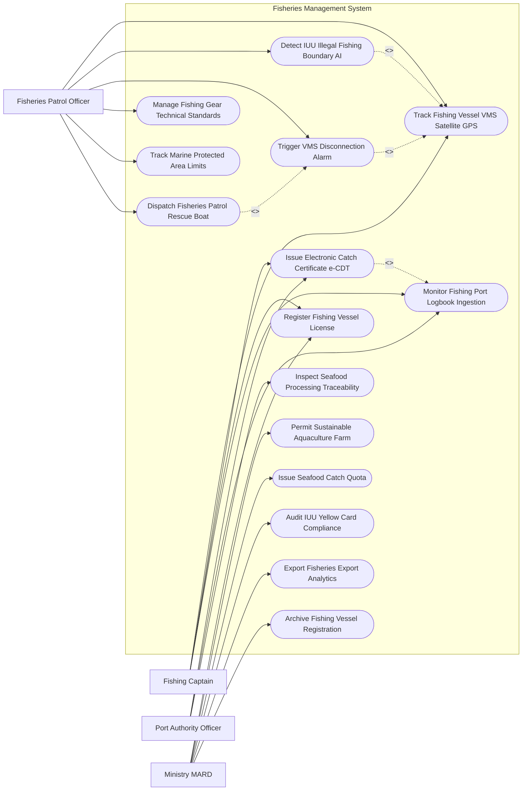

# Use Case Diagram — Fisheries Management System

## Mermaid Code

## Actor Table | Bảng Actor

| # | Actor | Actor Type | Role Description | Related Use Cases |
|---|-------|------------|------------------|-------------------|
| 1 | Fishing Captain | Primary | Thuyền trưởng tàu cá bật VMS, ghi nhật ký khai thác e-Logbook và xin cấp chứng nhận e-CDT | UC01, UC02, UC04, UC05 |
| 2 | Fisheries Patrol Officer | Primary | Cán bộ Kiểm ngư giám sát hành trình VMS, xử lý xâm phạm vùng biển nước ngoài và mất kết nối | UC01, UC03, UC09, UC11, UC12, UC13 |
| 3 | Port Authority Officer | Primary | Cán bộ Ban Quản lý Cảng cá kiểm soát tàu cập cảng, xác minh sản lượng và truy xuất nguồn gốc | UC02, UC05, UC06 |
| 4 | Ministry MARD | Regulatory | Cục Thủy sản (Bộ NN&PTNT) kiểm tra tuân thủ IUU chống thẻ vàng EC, cấp hạn ngạch và báo cáo | UC04, UC07, UC08, UC10, UC14, UC15 |

## Use Case Table | Bảng Use Case

| # | UC ID | Use Case Name | Primary Actor | Secondary Actor | Description | Priority |
|---|-------|---------------|---------------|-----------------|-------------|----------|
| 1 | UC01 | Track Fishing Vessel VMS Satellite GPS | Captain, Patrol | VMSSatellite | Giám sát vị trí GPS, tốc độ và hướng di chuyển của tàu cá xa bờ 24/7 qua vệ tinh | High |
| 2 | UC02 | Issue Electronic Catch Certificate e-CDT | Captain, Port | Exporter | Cấp Giấy xác nhận và Chứng nhận nguồn gốc thủy sản khai thác điện tử (e-CDT) | High |
| 3 | UC03 | Detect IUU Illegal Fishing Boundary AI | Patrol | AI Engine | Thuật toán AI cảnh báo tàu cá có nguy cơ xâm phạm ranh giới vùng biển nước ngoài | High |
| 4 | UC04 | Register Fishing Vessel License | Captain | MARDFish | Đăng ký, đăng kiểm tàu cá và cấp Giấy phép khai thác thủy sản theo ngạch chiều dài | High |
| 5 | UC05 | Monitor Fishing Port Logbook Ingestion | Captain, Port | - | Tiếp nhận và đối soát Nhật ký khai thác thủy sản điện tử (e-Logbook) khi tàu cập cảng | High |
| 6 | UC06 | Inspect Seafood Processing Traceability | Port | Exporter | Kiểm tra chuỗi truy xuất nguồn gốc hải sản nguyên liệu cung cấp cho nhà máy xuất khẩu | High |
| 7 | UC07 | Permit Sustainable Aquaculture Farm | MARDFish | FarmOwner | Đánh giá và cấp giấy chứng nhận cơ sở nuôi trồng thủy sản an toàn (ASC/VietGAP) | Medium |
| 8 | UC08 | Issue Seafood Catch Quota | MARDFish | Captain | Phân bổ hạn ngạch tổng sản lượng khai thác cho phép (TAC) cho từng tỉnh/tuyến biển | High |
| 9 | UC09 | Trigger VMS Disconnection Alarm | Patrol | System | Tự động bật báo động Đỏ khi tàu cá xa bờ bị mất kết nối thiết bị VMS quá 06 giờ | High |
| 10 | UC10 | Audit IUU Yellow Card Compliance | MARDFish | EUCommission | Kiểm toán tính minh bạch CSDL chống khai thác IUU phục vụ đoàn thanh tra EC gỡ thẻ vàng | High |
| 11 | UC11 | Manage Fishing Gear Technical Standards | Patrol | - | Kiểm tra kích thước mắt lưới, loại lưới kéo (gĩu) và cấm sử dụng chất nổ/xung điện | High |
| 12 | UC12 | Track Marine Protected Area Limits | Patrol | GIS Engine | Phân vùng và phát cảnh báo tàu cá đánh bắt trái phép trong Khu bảo tồn biển | High |
| 13 | UC13 | Dispatch Fisheries Patrol Rescue Boat | Patrol | CoastGuard | Điều động tàu Kiểm ngư/Cảnh sát biển cứu hộ tàu cá gặp nạn hoặc vi phạm trên biển | High |
| 14 | UC14 | Export Fisheries Export Analytics | MARDFish | Executive | Trích xuất báo cáo tổng sản lượng khai thác hải sản nộp Bộ trưởng Bộ NN&PTNT | Low |
| 15 | UC15 | Archive Fishing Vessel Registration | System | Archives | Đóng gói và lưu trữ vĩnh viễn hồ sơ đăng ký đăng kiểm tàu cá toàn quốc | Low |

## Use Case Specification | Đặc tả Use Case

---

### UC01 — Track Fishing Vessel VMS Satellite GPS

| Field | Detail |
|-------|--------|
| **UC ID** | UC01 |
| **Use Case Name** | Track Fishing Vessel VMS Satellite GPS |
| **Actor(s)** | Primary: Fishing Captain, Fisheries Patrol Officer / Secondary: VMS Satellite System |
| **Description** | Giám sát vị trí định vị GPS, tốc độ di chuyển và hướng đi của 100% tàu cá chiều dài $\ge 15m$ thời gian thực qua sóng vệ tinh. |
| **Precondition** | 1. Tàu cá được lắp đặt thiết bị giám sát hành trình VMS hợp chuẩn và còn hiệu lực cước vệ tinh. |
| **Main Flow** | 1. Thiết bị VMS trên tàu cá phát thông điệp GPS (Tọa độ Kinh độ, Vĩ độ, Tốc độ hải lý/giờ, Hướng di chuyển) về trạm vệ tinh.   2. Trạm vệ tinh chuyển tiếp dữ liệu về Trung tâm Dữ liệu Giám sát Tàu cá Quốc gia.   3. System tiếp nhận và vẽ đường đi (Track Log) của tàu cá trên bản đồ GIS vùng biển Việt Nam và Quốc tế.   4. System hiển thị biểu tượng tàu cá kèm thông tin: Số hiệu tàu (Ví dụ: BV-92888-TS), Họ tên thuyền trưởng, Chiều dài tàu, Nghề khai thác (Lưới kéo, Rê, Câu).   5. System tự động kiểm tra khoảng cách đến Ranh giới vùng biển cho phép khai thác (EEZ Boundary).   6. System kiểm tra tần suất phát tín hiệu (Tối thiểu 02 giờ/lần đối với tàu $\ge 24m$ và 06 giờ/lần đối với tàu $15-24m$).   7. PatrolOfficer mở bản đồ giám sát toàn quốc để theo dõi biến động các cụm tàu cá trên biển. |
| **Alternative Flow** | **AF1** — Tàu cá gửi tín hiệu báo nạn SOS qua VMS: Thuyền trưởng bấm nút khẩn cấp trên thiết bị VMS, System bật báo động Đỏ và chuyển sang Use Case Điều động cứu hộ (UC13). |
| **Exception Flow** | **EX1** — Tàu cá mất kết nối VMS $> 06$ giờ trên biển: System tự động chuyển sang Use Case Bật báo động mất kết nối VMS (UC09). |
| **Postcondition** | Hành trình tàu cá được giám sát liên tục 24/7, dữ liệu hành trình được lưu vết chống can thiệp. |
| **Business Rule** | **BR1**: 100% tàu cá có chiều dài từ 15 mét trở lên bắt buộc phải bật thiết bị VMS liên tục 24/24 giờ khi hoạt động trên biển. |

---

### UC02 — Issue Electronic Catch Certificate e-CDT

| Field | Detail |
|-------|--------|
| **UC ID** | UC02 |
| **Use Case Name** | Issue Electronic Catch Certificate e-CDT |
| **Actor(s)** | Primary: Fishing Captain, Port Authority Officer / Secondary: Seafood Processing Exporter |
| **Description** | Cấp Giấy xác nhận (SC) và Giấy chứng nhận nguồn gốc thủy sản khai thác điện tử (e-CDT) cho hải sản bốc dỡ tại cảng. |
| **Precondition** | 1. Tàu cá đã cập Cảng cá chỉ định, đã nộp Nhật ký khai thác e-Logbook (UC05) và có dữ liệu VMS hợp lệ (UC01). |
| **Main Flow** | 1. Captain lập Yêu cầu cấp Giấy xác nhận nguồn gốc hải sản (SC) trên ứng dụng di động e-CDT.   2. PortOfficer đến mạn tàu/cầu cảng kiểm tra thực tế bốc dỡ: Cân tổng khối lượng hải sản, phân loại loài (Cá ngừ, Cá thu, Mực) và đối soát với e-Logbook.   3. System tự động kiểm tra đối soát hành trình VMS: Xác nhận tàu cá KHÔNG vi phạm vùng biển nước ngoài (UC03) và KHÔNG mất kết nối VMS.   4. If Hợp lệ: PortOfficer ký số phê duyệt Giấy xác nhận nguyên liệu thủy sản khai thác (SC) điện tử.   5. When SeafoodExporter mua lại lô hải sản đó để chế biến xuất khẩu: Nộp đơn xin cấp Giấy chứng nhận thủy sản khai thác (CC).   6. System đóng gói hồ sơ gồm: Dữ liệu VMS, e-Logbook, Giấy SC và mã băm SHA-256.   7. Cơ quan Quản lý Thủy sản ký số phát hành Chứng nhận e-CDT điện tử gửi cho SeafoodExporter xuất khẩu sang EU/Mỹ. |
| **Alternative Flow** | **AF1** — Mua gom hải sản từ nhiều tàu cá: System hỗ trợ tính năng gom lô (Consolidation), tự động tổng hợp dữ liệu e-CDT của các tàu cá thành phần. |
| **Exception Flow** | **EX1** — Tàu cá vi phạm mất kết nối VMS hoặc nghi vấn khai thác IUU: System tự động KHÓA tính năng cấp e-CDT, phát thông báo từ chối cấp chứng nhận cho lô hải sản. |
| **Postcondition** | Lô hải sản xuất khẩu có đầy đủ chứng nhận e-CDT hợp pháp, đáp ứng 100% quy định chống khai thác IUU của Châu Âu. |
| **Business Rule** | **BR1**: Nghiêm cấm tuyệt đối việc cấp e-CDT cho các lô hải sản khai thác từ tàu cá vi phạm vùng biển nước ngoài hoặc mất kết nối VMS. |

---

### UC03 — Detect IUU Illegal Fishing Boundary AI

| Field | Detail |
|-------|--------|
| **UC ID** | UC03 |
| **Use Case Name** | Detect IUU Illegal Fishing Boundary AI |
| **Actor(s)** | Primary: Fisheries Patrol Officer / Secondary: AI Engine, VMS Satellite |
| **Description** | Thuật toán AI phân tích đường đi VMS phát hiện tàu cá vượt ranh giới đường phân định trên biển để đánh bắt trái phép (IUU). |
| **Precondition** | 1. Dữ liệu tọa độ GPS VMS tàu cá được truyền liên tục về trung tâm (UC01). |
| **Main Flow** | 1. AI Engine liên tục chạy thuật toán phân tích địa không gian (Geofencing Algorithm) so sánh vị trí tàu cá vs Ranh giới vùng biển Việt Nam (EEZ Boundary).   2. AI tính toán Khoảng cách và Vận tốc di chuyển của tàu cá hướng về đường ranh giới chống xâm phạm.   3. If Tàu cá di chuyển đến Vùng đệm ranh giới ($< 5\,hải\,lý$): System tự động gửi tin nhắn SMS/VMS cảnh báo tới thiết bị trên tàu: "Cảnh báo: Tàu BV-92888 đang tiến gần ranh giới vùng biển nước ngoài, yêu cầu quay đầu gấp!".   4. If Tàu cá cố tình vượt đường phân định sang vùng biển nước bạn: System lập tức bật Cảnh báo Đỏ "Tàu cá vi phạm vùng biển nước ngoài (IUU Breach)".   5. System ghi nhận tọa độ GPS vi phạm, chụp màn hình đường đi VMS và lập Hồ sơ vi phạm IUU điện tử.   6. System phát chuông báo động khẩn cấp tại Trung tâm Kiểm ngư và chuyển thông tin cho Tàu kiểm ngư gần nhất đến ngăn chặn (UC13).   7. System tự động tước quyền cấp Giấy chứng nhận e-CDT (UC02) của tàu cá vi phạm. |
| **Alternative Flow** | **AF1** — Tàu cá vi phạm đánh bắt trong Khu bảo tồn biển (MPA): AI phát hiện tàu cá thả lưới đánh bắt trong ranh giới bảo tồn rạn đầm san thực vật biển (UC12). |
| **Exception Flow** | **EX1** — Tàu cá trôi dạt sang vùng biển nước bạn do hỏng máy/bão lũ: Thuyền trưởng phát tín hiệu Sự cố kỹ thuật, System chuyển trạng thái sang "Hỗ trợ cứu hộ khẩn cấp". |
| **Postcondition** | Ngăn chặn kịp thời các vụ tàu cá xâm phạm vùng biển nước ngoài, bảo vệ uy tín ngành thủy sản Việt Nam. |
| **Business Rule** | **BR1**: Tàu cá vi phạm vùng biển nước ngoài sẽ bị đưa vào Danh sách Đen (Blacklist) và bị cấm xuất bến tối thiểu 06 tháng. |

---

### UC05 — Monitor Fishing Port Logbook Ingestion

| Field | Detail |
|-------|--------|
| **UC ID** | UC05 |
| **Use Case Name** | Monitor Fishing Port Logbook Ingestion |
| **Actor(s)** | Primary: Fishing Captain, Port Authority Officer / Secondary: None |
| **Description** | Tiếp nhận, kiểm tra và đối soát Nhật ký khai thác thủy sản điện tử (e-Logbook) của thuyền trưởng khi tàu cập cảng bốc dỡ hải sản. |
| **Precondition** | 1. Thuyền trưởng ghi chép nhật ký khai thác e-Logbook trên máy tính bảng trong suốt chuyến biển. |
| **Main Flow** | 1. Trước khi tàu cập cảng 01 giờ, Captain mở ứng dụng e-Logbook bấm "Gửi thông báo cập cảng" và truyền dữ liệu nhật ký chuyến biển.   2. System tiếp nhận tệp e-Logbook gồm: Vị trí thả lưới/mẻ lưới (GPS), thời gian thả/kéo lưới, các loài hải sản khai thác (Cá ngừ, mực, cá thu) và sản lượng ước tính ($kg$).   3. PortOfficer mở Phân hệ Kiểm soát Cảng cá, chọn số hiệu tàu cá vừa cập cảng.   4. System tự động đối soát tọa độ mẻ lưới trong e-Logbook vs Dữ liệu hành trình VMS thực tế (UC01): Xác nhận mẻ lưới được đánh bắt tại đúng tọa độ tàu cá hiện diện.   5. PortOfficer lên tàu cá thực hiện giám sát bốc dỡ: Cân thực tế sản lượng hải sản bốc lên cảng.   6. PortOfficer nhập sản lượng bốc dỡ thực tế vào hệ thống: System so sánh vs Sản lượng trong e-Logbook (Sai số cho phép $< 15\%$).   7. If Đối soát hợp lệ: PortOfficer bấm "Xác nhận Nhật ký khai thác hợp lệ", cấp Giấy xác nhận mẻ lưới cho thuyền trưởng để làm thủ tục cấp e-CDT (UC02). |
| **Alternative Flow** | **AF1** — Thuyền trưởng ghi nhật ký bằng sổ giấy: PortOfficer quét (scan) sổ nhật ký giấy, nhập dữ liệu sản lượng vào hệ thống thay cho thuyền trưởng. |
| **Exception Flow** | **EX1** — Tọa độ mẻ lưới trong nhật ký mâu thuẫn với dữ liệu VMS (Khai báo man dối mẻ lưới): PortOfficer lập biên bản vi phạm khai báo nhật ký sai sự thật, từ chối xác nhận cập cảng. |
| **Postcondition** | Nhật ký khai thác được xác thực chính xác, làm cơ sở minh bạch cho việc truy xuất nguồn gốc hải sản (UC06). |
| **Business Rule** | **BR1**: 100% tàu cá cập cảng chỉ định bắt buộc phải nộp Nhật ký khai thác thủy sản và chịu sự giám sát bốc dỡ của Cảng cá. |

---

### UC09 — Trigger VMS Disconnection Alarm

| Field | Detail |
|-------|--------|
| **UC ID** | UC09 |
| **Use Case Name** | Trigger VMS Disconnection Alarm |
| **Actor(s)** | Primary: Fisheries Patrol Officer / Secondary: Fishing Captain, VMS Satellite |
| **Description** | Tự động phát báo động Đỏ khi thiết bị VMS trên tàu cá xa bờ bị mất tín hiệu kết nối vệ tinh quá 06 giờ và gửi cảnh báo xử lý. |
| **Precondition** | 1. Tàu cá đang hoạt động trên biển và thuộc diện bắt buộc lắp VMS ($\ge 15m$). |
| **Main Flow** | 1. System chạy tiến trình giám sát kết nối tín hiệu (VMS Keep-Alive Daemon) định kỳ 15 phút/lần.   2. System phát hiện tàu cá BV-93999-TS không truyền dữ liệu GPS vệ tinh về trung tâm trong vòng 06 giờ liên tục.   3. System tự động kích hoạt Cảnh báo Đỏ "Tàu cá mất kết nối VMS quá 06 giờ".   4. System tự động gửi tin nhắn SMS/Email tới Thuyền trưởng, Chủ tàu và Trạm Kiểm ngư phụ trách vùng biển đó.   5. System hiển thị biểu tượng tàu cá màu Vàng nhấp nháy tại vị trí tọa độ cuối cùng nhận được tín hiệu (Last Known Position).   6. PatrolOfficer gọi điện qua điện thoại vệ tinh (Inmarsat/Iridium) yêu cầu thuyền trưởng kiểm tra thiết bị VMS và khôi phục kết nối.   7. If Mất kết nối quá 10 ngày không có lý do bất khả kháng: System tự động đưa tàu cá vào Danh sách vi phạm nghiêm trọng và chuyển thông tin cho lực lượng Kiểm ngư/Cảnh sát biển vây bắt (UC13). |
| **Alternative Flow** | **AF1** — Thiết bị VMS bị hỏng hóc kỹ thuật: Thuyền trưởng sử dụng thiết bị VMS dự phòng hoặc báo cáo vị trí 06 giờ/lần qua điện thoại vệ tinh về bờ. |
| **Exception Flow** | **EX1** — Tàu cá bị chìm/gặp sự cố bão lũ gây mất tín hiệu: System kết nối Trung tâm Cứu hộ Cứu nạn Hàng hải (MRCC) phát lệnh tìm kiếm cứu nạn khẩn cấp. |
| **Postcondition** | Hiện tượng cố tình ngắt kết nối VMS để đánh bắt lén lút bị phát hiện và xử lý nghiêm khắc. |
| **Business Rule** | **BR1**: Tàu cá mất kết nối VMS trên 06 giờ mà không báo cáo vị trí dự phòng sẽ bị phạt tiền và thu hồi giấy phép khai thác. |
