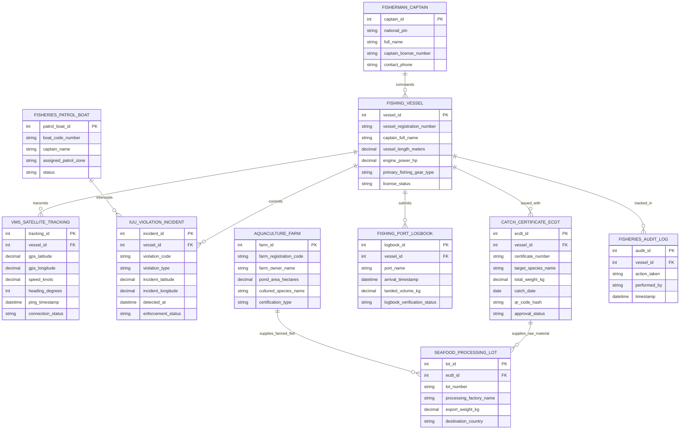

# Conceptual ERD — Fisheries Management System

## Mermaid Code

## Entity Description Table | Bảng mô tả Entity

| # | Entity Name | Vietnamese Name | Description | Key Attributes | Main Relationships |
|---|-------------|-----------------|-------------|----------------|-------------------|
| 1 | FISHING_VESSEL | Tàu cá Đánh bắt Hải sản | Thông tin đăng ký đăng kiểm tàu cá (số hiệu tàu, chiều dài, công suất máy, nghề khai thác) | vessel_id, vessel_registration_number, vessel_length_meters, primary_fishing_gear_type, license_status | Transmits VMS_TRACKING, issued with CATCH_CERTIFICATE_ECDT |
| 2 | VMS_SATELLITE_TRACKING | Nhật ký Hành trình VMS | Tọa độ GPS vệ tinh, tốc độ hải lý, hướng đi và trạng thái kết nối VMS thời gian thực | tracking_id, gps_latitude, gps_longitude, speed_knots, connection_status | Belongs to FISHING_VESSEL |
| 3 | IUU_VIOLATION_INCIDENT | Vụ việc Vi phạm Khai thác IUU | Hồ sơ vi phạm tàu cá xâm phạm vùng biển nước ngoài, mất kết nối VMS hoặc dùng lưới cấm | incident_id, violation_code, violation_type, incident_latitude, enforcement_status | Belongs to FISHING_VESSEL, intercepted by PATROL_BOAT |
| 4 | CATCH_CERTIFICATE_ECDT | Chứng nhận Nguồn gốc e-CDT | Giấy xác nhận và chứng nhận nguồn gốc thủy sản khai thác điện tử kèm mã QR | ecdt_id, certificate_number, target_species_name, total_weight_kg, qr_code_hash | Belongs to FISHING_VESSEL, supplies SEAFOOD_PROCESSING_LOT |
| 5 | FISHING_PORT_LOGBOOK | Nhật ký Cảng cá & e-Logbook | Nhật ký khai thác thủy sản nộp khi tàu cá cập cảng và xác nhận bốc dỡ | logbook_id, port_name, arrival_timestamp, landed_volume_kg, logbook_verification_status | Belongs to FISHING_VESSEL |
| 6 | AQUACULTURE_FARM | Cơ sở Nuôi trồng Thủy sản | Thông tin ao nuôi tôm/cá tra, diện tích mặt nước và chứng nhận VietGAP/ASC | farm_id, farm_registration_code, pond_area_hectares, cultured_species_name | Supplies SEAFOOD_PROCESSING_LOT |
| 7 | SEAFOOD_PROCESSING_LOT | Lô Hải sản Chế biến Xuất khẩu | Lô hàng hải sản chế biến tại nhà máy xuất khẩu sang thị trường Châu Âu/Mỹ | lot_id, lot_number, processing_factory_name, export_weight_kg, destination_country | Supplied by CATCH_CERTIFICATE_ECDT, AQUACULTURE_FARM |
| 8 | FISHERIES_PATROL_BOAT | Tàu Kiểm ngư Tuần tra | Thông tin tàu lực lượng Kiểm ngư thực hiện nhiệm vụ tuần tra chống vi phạm IUU | patrol_boat_id, boat_code_number, captain_name, assigned_patrol_zone | Intercepts IUU_VIOLATION_INCIDENT |
| 9 | FISHERMAN_CAPTAIN | Thuyền trưởng Tàu cá | Thông tin nhân thân, bằng thuyền trưởng và số điện thoại liên lạc của thuyền trưởng | captain_id, national_pin, full_name, captain_license_number | Commands FISHING_VESSEL |
| 10 | FISHERIES_AUDIT_LOG | Nhật ký Kiểm toán Thủy sản | Lưu vết toàn bộ lịch sử phát VMS, cảnh báo vượt ranh giới, cấp e-CDT và thanh tra EC | audit_id, action_taken, performed_by, timestamp | Belongs to FISHING_VESSEL |

## Relationship Description | Mô tả Quan hệ

| # | From Entity | Cardinality | To Entity | Relationship Label | Business Explanation |
|---|-------------|-------------|-----------|-------------------|----------------------|
| 1 | FISHERMAN_CAPTAIN | one-to-many | FISHING_VESSEL | commands | Một thuyền trưởng có thể chỉ huy vận động nhiều tàu cá khác nhau |
| 2 | FISHING_VESSEL | one-to-many | VMS_SATELLITE_TRACKING | transmits | Một tàu cá truyền hàng ngàn điểm tọa độ GPS VMS về trung tâm qua vệ tinh |
| 3 | FISHING_VESSEL | one-to-many | IUU_VIOLATION_INCIDENT | commits | Một tàu cá vi phạm có thể ghi nhận các sự cố vi phạm quy định khai thác IUU |
| 4 | FISHING_VESSEL | one-to-many | CATCH_CERTIFICATE_ECDT | issued_with | Một tàu cá hoàn thành chuyến biển được cấp các Giấy chứng nhận e-CDT |
| 5 | FISHING_VESSEL | one-to-many | FISHING_PORT_LOGBOOK | submits | Một tàu cá nộp nhật ký khai thác e-Logbook mỗi khi cập cảng bốc dỡ hải sản |
| 6 | CATCH_CERTIFICATE_ECDT | one-to-many | SEAFOOD_PROCESSING_LOT | supplies_raw_material | Một giấy chứng nhận e-CDT cung cấp nguyên liệu hải sản cho các lô chế biến |
| 7 | AQUACULTURE_FARM | one-to-many | SEAFOOD_PROCESSING_LOT | supplies_farmed_fish | Một cơ sở nuôi trồng thủy sản cung cấp cá/tôm thương phẩm cho nhà máy chế biến |
| 8 | FISHERIES_PATROL_BOAT | one-to-many | IUU_VIOLATION_INCIDENT | intercepts | Tàu kiểm ngư phát hiện và truy bắt xử lý nhiều vụ việc tàu cá vi phạm IUU |
| 9 | FISHING_VESSEL | one-to-many | FISHERIES_AUDIT_LOG | tracked_in | Mọi hoạt động trên tàu cá được ghi lại nhật ký kiểm toán bất biến chống khai thác IUU |
