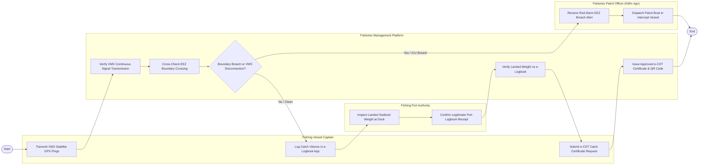

# Swimlane Diagram — Fisheries Management System

## Mermaid Code

## Flow Description | Mô tả luồng

| Lane | Actor | Role in Flow |
|------|-------|-------------|
| 1 | Fishing Vessel Captain | Bật thiết bị VMS định vị vệ tinh liên tục, ghi chép nhật ký khai thác e-Logbook và xin cấp chứng nhận e-CDT. |
| 2 | Fisheries Management Platform | Kiểm tra kết nối VMS thời gian thực, đối soát đường phân định vùng biển, đối chiếu sản lượng bốc dỡ và cấp chứng nhận e-CDT. |
| 3 | Fisheries Patrol Officer (Kiểm ngư) | Nhận báo động Đỏ khi tàu cá xâm phạm vùng biển nước ngoài hoặc ngắt VMS, điều động tàu kiểm ngư truy bắt. |
| 4 | Fishing Port Authority | Giám sát bốc dỡ hải sản thực tế tại cầu cảng cá và xác nhận tính hợp lệ của Nhật ký khai thác e-Logbook. |
