# Action Tree — Fisheries Management System

## Mermaid Code

```mermaid
graph TD
    Root["Fisheries Management System"]

    Root --> M1["VMS Satellite Tracking & Boundary Monitoring"]
    Root --> M2["IUU Illegal Fishing Detection & Anti-Yellow Card"]
    Root --> M3["Catch Certificate e-CDT & Traceability"]
    Root --> M4["Fishing Port Logbook & Vessel Registration"]
    Root --> M5["Sustainable Aquaculture & Marine Protected Areas"]
    Root --> M6["Fisheries BI & MARD Analytics"]

    M1 --> A11["Track Fishing Vessel VMS Satellite GPS"]
    M1 --> A12["Trigger VMS Disconnection Alarms"]
    M1 --> A13["Monitor Vessel Speed and Heading Degrees"]
    M1 --> A14["Manage VMS Hardware Registry"]

    M2 --> A21["Detect IUU Illegal Fishing Boundary AI"]
    M2 --> A22["Audit IUU Yellow Card EC Compliance"]
    M2 --> A23["Dispatch Fisheries Patrol Rescue Boats"]
    M2 --> A24["Manage Fishing Gear Technical Standards"]

    M3 --> A31["Issue Electronic Catch Certificates e-CDT"]
    M3 --> A32["Inspect Seafood Processing Traceability"]
    M3 --> A33["Verify Export Catch Certificates EU"]
    M3 --> A34["Generate Seafood Supply Chain QR Codes"]

    M4 --> A41["Register Fishing Vessel Licenses"]
    M4 --> A42["Monitor Fishing Port Logbook Ingestion"]
    M4 --> A43["Inspect Landed Seafood Weight Docks"]
    M4 --> A44["Verify Captain Qualifications"]

    M5 --> A51["Permit Sustainable Aquaculture Farms ASC"]
    M5 --> A52["Track Marine Protected Area Limits MPA"]
    M5 --> A53["Monitor Water Quality Aquaculture Ponds"]
    M5 --> A54["Issue Seafood Catch Quotas TAC"]

    M6 --> A61["Export Fisheries Export Analytics"]
    M6 --> A62["Calculate National Seafood Harvest Volume"]
    M6 --> A63["Log System Immutable Audit Trails"]
    M6 --> A64["Archive Fishing Vessel Registrations"]
```

## Module Description | Mô tả Module

| # | Module | Description | Actions |
|---|--------|-------------|---------|
| 1 | VMS Satellite Tracking & Boundary Monitoring | Giám sát hành trình tàu cá 24/7 qua định vị vệ tinh VMS, phát cảnh báo mất kết nối VMS và quản lý thiết bị phần cứng | Track Fishing Vessel VMS Satellite GPS, Trigger VMS Disconnection Alarms, Monitor Vessel Speed and Heading Degrees, Manage VMS Hardware Registry |
| 2 | IUU Illegal Fishing Detection & Anti-Yellow Card | Thuật toán AI phát hiện xâm phạm vùng biển nước ngoài chống thẻ vàng EU, điều động tàu kiểm ngư và kiểm tra lưới cấm | Detect IUU Illegal Fishing Boundary AI, Audit IUU Yellow Card EC Compliance, Dispatch Fisheries Patrol Rescue Boats, Manage Fishing Gear Technical Standards |
| 3 | Catch Certificate e-CDT & Traceability | Cấp chứng nhận nguồn gốc thủy sản khai thác điện tử (e-CDT), truy xuất nguồn gốc hải sản nguyên liệu xuất khẩu EU | Issue Electronic Catch Certificates e-CDT, Inspect Seafood Processing Traceability, Verify Export Catch Certificates EU, Generate Seafood Supply Chain QR Codes |
| 4 | Fishing Port Logbook & Vessel Registration | Đăng ký đăng kiểm tàu cá, tiếp nhận nhật ký khai thác e-Logbook tại cảng cá chỉ định và giám sát bốc dỡ hải sản | Register Fishing Vessel Licenses, Monitor Fishing Port Logbook Ingestion, Inspect Landed Seafood Weight Docks, Verify Captain Qualifications |
| 5 | Sustainable Aquaculture & Marine Protected Areas | Cấp phép cơ sở nuôi trồng thủy sản VietGAP/ASC, bảo vệ ranh giới Khu bảo tồn biển (MPA) và quản lý hạn ngạch TAC | Permit Sustainable Aquaculture Farms ASC, Track Marine Protected Area Limits MPA, Monitor Water Quality Aquaculture Ponds, Issue Seafood Catch Quotas TAC |
| 6 | Fisheries BI & MARD Analytics | Trích xuất báo cáo tổng sản lượng hải sản nộp Bộ NN&PTNT, kiểm toán bất biến chống IUU và lưu trữ dữ liệu tàu cá | Export Fisheries Export Analytics, Calculate National Seafood Harvest Volume, Log System Immutable Audit Trails, Archive Fishing Vessel Registrations |
