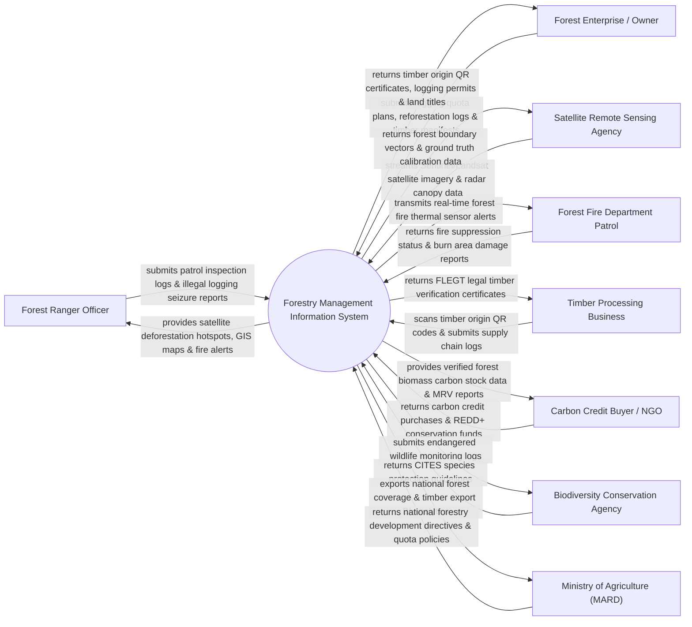

# Context Diagram — Forestry Management Information System

## Mermaid Code

## Actor & Interaction Table | Bảng Actor & Tương tác

| # | Actor | Actor Type | Data Sent TO System | Data Received FROM System | Notes |
|---|-------|------------|---------------------|---------------------------|-------|
| 1 | Forest Ranger Officer | Primary | Field patrol logs, illegal logging seizure reports, GPS coordinates | Satellite deforestation hotspots, GIS forest maps, fire alerts | Hạt Kiểm lâm và lực lượng bảo vệ rừng tại địa phương |
| 2 | Forest Enterprise / Owner | Primary | Logging quota plans, reforestation logs, timber harvesting manifests | Timber origin QR certificates, logging permits, forest land titles | Ban Quản lý Rừng phòng hộ, Công ty Lâm nghiệp, hộ trồng rừng |
| 3 | Satellite Remote Sensing Agency | Supporting | Sentinel/Landsat satellite imagery, radar canopy height data | Forest boundary vectors, ground truth calibration data | Trung tâm Vũ trụ / Cơ quan viễn thám không ảnh cung cấp ảnh vệ tinh |
| 4 | Forest Fire Department Patrol | Supporting | Fire suppression status, burn area damage assessments | Real-time thermal sensor alerts, forest fire danger level index | Đội Cảnh sát PCCC & Cứu nạn Cứu hộ rừng |
| 5 | Timber Processing Business | Supporting | Timber supply chain logs, sawed wood invoices | FLEGT legal timber verification certificates, origin QR codes | Các nhà máy chế biến gỗ và doanh nghiệp xuất khẩu gỗ |
| 6 | Carbon Credit Buyer / NGO | Supporting | Carbon credit purchase transactions, REDD+ funding | Verified forest biomass carbon stock data, MRV audit reports | Các quỹ môi trường quốc tế mua tín chỉ carbon rừng (REDD+) |
| 7 | Biodiversity Conservation Agency | Supporting | CITES species protection guidelines, fauna surveys | Endangered wildlife monitoring logs, biodiversity index | Cơ quan Bảo tồn Thiên nhiên & Đa dạng Sinh học |
| 8 | Ministry of Agriculture (MARD) | Regulatory | National forestry development directives, logging quota policies | National forest coverage statistics, timber export BI dashboards | Bộ Nông nghiệp & Phát triển Nông thôn (Cục Lâm nghiệp) |

## System Boundary Description | Mô tả Phạm vi Hệ thống

Hệ thống Forestry Management Information System (Hệ thống Thông tin Quản lý Lâm nghiệp Quốc gia / FMS System) chịu trách nhiệm tự động hóa quy trình quản lý và bảo vệ tài nguyên rừng toàn quốc: Giám sát diễn biến độ che phủ rừng bằng ảnh vệ tinh vĩ mô (Sentinel/Landsat), phát hiện sớm nạn phá rừng và cháy rừng thời gian thực bằng thuật toán AI phân tích điểm nhiệt (Hotspots), cấp mã QR truy xuất nguồn gốc gỗ hợp pháp (chuẩn FLEGT), kiểm kê trữ lượng carbon rừng phục vụ thị trường tín chỉ carbon (REDD+), quản lý tuần tra kiểm lâm và bảo tồn đa dạng sinh học rừng đặc dụng. Tuy nhiên, hệ thống KHÔNG trực tiếp dập tắt các đám cháy rừng ngoài thực địa và KHÔNG thay thế công tác tuần tra trực tiếp của kiểm lâm.
