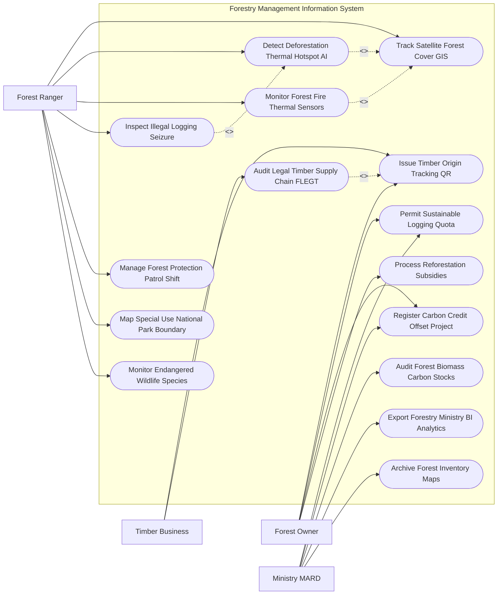

# Use Case Diagram — Forestry Management Information System

## Mermaid Code

## Actor Table | Bảng Actor

| # | Actor | Actor Type | Role Description | Related Use Cases |
|---|-------|------------|------------------|-------------------|
| 1 | Forest Owner | Primary | Chủ rừng, doanh nghiệp lâm nghiệp đăng ký hạn ngạch khai thác, nộp hồ sơ carbon và nhận trợ cấp | UC03, UC04, UC06, UC11 |
| 2 | Forest Ranger | Primary | Hạt kiểm lâm theo dõi vệ tinh, phát hiện cháy rừng, lập biên bản vi phạm và bảo vệ đa dạng sinh học | UC01, UC02, UC05, UC07, UC08, UC09, UC12 |
| 3 | Timber Business | Primary | Doanh nghiệp gỗ quét mã QR truy xuất nguồn gốc và xác minh chuỗi cung ứng gỗ hợp pháp FLEGT | UC03, UC13 |
| 4 | Ministry MARD | Regulatory | Bộ Nông nghiệp & PTNT phê duyệt hạn ngạch khai thác, kiểm kê carbon và phân tích báo cáo | UC04, UC06, UC10, UC14, UC15 |

## Use Case Table | Bảng Use Case

| # | UC ID | Use Case Name | Primary Actor | Secondary Actor | Description | Priority |
|---|-------|---------------|---------------|-----------------|-------------|----------|
| 1 | UC01 | Track Satellite Forest Cover GIS | Ranger | RemoteSensing | Giám sát trực tuyến sự thay đổi độ che phủ rừng trên bản đồ GIS từ ảnh vệ tinh | High |
| 2 | UC02 | Detect Deforestation Thermal Hotspot AI | Ranger | AI Engine | Thuật toán AI phân tích ảnh vệ tinh phát hiện các vết chặt phá rừng trái phép | High |
| 3 | UC03 | Issue Timber Origin Tracking QR | Owner, Business | - | Cấp mã QR truy xuất nguồn gốc lô gỗ khai thác từ rừng trồng hợp pháp | High |
| 4 | UC04 | Permit Sustainable Logging Quota | Owner | MARD | Thẩm định và cấp phép hạn ngạch khai thác gỗ rừng trồng phát triển bền vững | High |
| 5 | UC05 | Monitor Forest Fire Thermal Sensors | Ranger | FirePatrol | Phát hiện sớm nguy cơ cháy rừng từ cảm biến nhiệt độ và cảnh báo cấp dự báo cháy | High |
| 6 | UC06 | Register Carbon Credit Offset Project | Owner | CarbonBuyer | Đăng ký dự án tín chỉ carbon rừng (REDD+) và thương lượng bán tín chỉ carbon | High |
| 7 | UC07 | Inspect Illegal Logging Seizure | Ranger | Police | Lập biên bản tịch thu lâm sản vi phạm, tang vật và xe vận chuyển gỗ lậu | High |
| 8 | UC08 | Manage Forest Protection Patrol Shift | Ranger | - | Phân công ca trực tuần tra kiểm lâm đính kèm nhật ký định vị GPS thực địa | Medium |
| 9 | UC09 | Map Special Use National Park Boundary | Ranger | GIS Engine | Phân vùng ranh giới bảo vệ nghiêm ngặt đối với rừng đặc dụng và vườn quốc gia | High |
| 10 | UC10 | Audit Forest Biomass Carbon Stocks | MARD | Researcher | Kiểm kê sinh khối rừng và tính toán trữ lượng phát thải hấp thụ carbon ($CO_2$) | High |
| 11 | UC11 | Process Reforestation Subsidies | Owner | StateTreasury | Chi trả tiền dịch vụ môi trường rừng (DVMTR) và trợ cấp trồng lại rừng | Medium |
| 12 | UC12 | Monitor Endangered Wildlife Species | Ranger | CITES | Theo dõi và bảo vệ các loài động thực vật rừng nguy cấp, quý, hiếm | Medium |
| 13 | UC13 | Audit Legal Timber Supply Chain FLEGT | Business | Customs | Kiểm toán chuỗi cung ứng gỗ hợp pháp theo tiêu chuẩn Hiệp định FLEGT / VPA | High |
| 14 | UC14 | Export Forestry Ministry BI Analytics | MARD | Executive | Trích xuất báo cáo tỷ lệ che phủ rừng toàn quốc nộp Bộ trưởng Bộ NN&PTNT | Low |
| 15 | UC15 | Archive Forest Inventory Maps | System | Archives | Lưu trữ vĩnh viễn bản đồ kiểm kê rừng toàn quốc định kỳ 05 năm | Low |

## Use Case Specification | Đặc tả Use Case

---

### UC01 — Track Satellite Forest Cover GIS

| Field | Detail |
|-------|--------|
| **UC ID** | UC01 |
| **Use Case Name** | Track Satellite Forest Cover GIS |
| **Actor(s)** | Primary: Forest Ranger / Secondary: Satellite Remote Sensing Agency |
| **Description** | Giám sát và phân tích biến động độ che phủ rừng toàn quốc trên bản đồ GIS tương tác từ dữ liệu ảnh vệ tinh Sentinel-2 / Landsat 9. |
| **Precondition** | 1. Ảnh vệ tinh khu vực rừng được cập nhật định kỳ (5-7 ngày/lần). |
| **Main Flow** | 1. Ranger mở Phân hệ Bản đồ Giám sát Rừng GIS.   2. System tự động nạp lớp ảnh vệ tinh Sentinel-2 mới nhất và chồng phổ đa băng (Multispectral Bands).   3. System tự động tính Chỉ số Thực vật Nông nghiệp NDVI (Normalized Difference Vegetation Index).   4. System so sánh chỉ số NDVI của lô rừng giữa 2 thời điểm (Tháng này vs Tháng trước).   5. System phân loại trạng thái rừng: Rừng tự nhiên giàu, Rừng trung bình, Rừng nghèo, Rừng trồng, Đất trống đồi trọc.   6. System tự động tô màu biến động: Vùng rừng phát triển (Màu Xanh), Vùng suy giảm độ che phủ (Màu Đỏ).   7. Ranger chọn lô rừng biến động màu Đỏ để kích hoạt kiểm tra hiện trường (UC02). |
| **Alternative Flow** | **AF1** — Giám sát bằng Vệ tinh Radar SAR (Cloud-Penetrating Radar): Sử dụng sóng radar Sentinel-1 xuyên qua mây phủ mùa mưa để theo dõi tán rừng. |
| **Exception Flow** | **EX1** — Độ phủ mây $> 70\%$ làm mờ ảnh vệ tinh quang học: System phát cảnh báo "Ảnh bị mây phủ", tự động chuyển sang chế độ ảnh vệ tinh radar. |
| **Postcondition** | Sự thay đổi độ che phủ rừng được cập nhật chính xác, phát hiện sớm các vụ phá rừng. |
| **Business Rule** | **BR1**: Tần suất cập nhật biến động độ che phủ rừng trên hệ thống GIS toàn quốc tối thiểu 02 lần/tháng. |

---

### UC02 — Detect Deforestation Thermal Hotspot AI

| Field | Detail |
|-------|--------|
| **UC ID** | UC02 |
| **Use Case Name** | Detect Deforestation Thermal Hotspot AI |
| **Actor(s)** | Primary: Forest Ranger / Secondary: AI Engine |
| **Description** | Thuật toán AI tự động phân tích ảnh vệ tinh và ảnh chụp drone để phát hiện các vết chặt phá rừng, mở đường lâm sinh trái phép. |
| **Precondition** | 1. Dữ liệu ảnh vệ tinh độ phân giải cao ($10m$) đã được xử lý chuẩn hóa (UC01). |
| **Main Flow** | 1. AI Computer Vision Engine chạy thuật toán phân tích phát hiện thay đổi bề mặt tán rừng (Change Detection Algorithm).   2. AI phát hiện điểm bất thường: Tán cây bị mất đột ngột trên diện tích $> 500\,m^2$ trong thời gian ngắn.   3. System xác định tọa độ GPS chính xác (Kinh độ, Vĩ độ), Tiểu khu, Khoảnh, Lô rừng bị chặt phá.   4. System tự động tra cứu CSDL Giấy phép khai thác (UC04): If Lô rừng không có Giấy phép khai thác hợp lệ $\rightarrow$ Khởi tạo Cảnh báo "Phá rừng trái phép".   5. System phát thông báo cảnh báo Đỏ khẩn cấp kèm hình ảnh vệ tinh cắt đến thiết bị di động của Hạt Kiểm lâm địa bàn.   6. Ranger nhận tọa độ GPS, mở bản đồ chỉ đường và đến hiện trường lập biên bản vi phạm (UC07).   7. Ranger chụp ảnh hiện trường và cập nhật kết quả xác minh "Đã ngăn chặn phá rừng" lên hệ thống. |
| **Alternative Flow** | **AF1** — Phát hiện mở đường ủi trái phép trong rừng sâu: AI nhận diện các vạch đường màu nâu mới xuất hiện xuyên qua tán rừng tự nhiên. |
| **Exception Flow** | **EX1** — Khai thác rừng trồng hợp pháp bị AI cảnh báo nhầm: Ranger cập nhật mã Giấy phép khai thác, System giải tỏa cảnh báo. |
| **Postcondition** | Vụ việc phá rừng được phát hiện từ khi mới bắt đầu, ngăn chặn thiệt hại diện rộng. |
| **Business Rule** | **BR1**: Cảnh báo phát hiện phá rừng AI phải được truyền tới Kiểm lâm địa bàn trong vòng 04 giờ kể từ khi có ảnh vệ tinh. |

---

### UC03 — Issue Timber Origin Tracking QR

| Field | Detail |
|-------|--------|
| **UC ID** | UC03 |
| **Use Case Name** | Issue Timber Origin Tracking QR |
| **Actor(s)** | Primary: Forest Owner, Timber Processing Business / Secondary: Forest Ranger |
| **Description** | Cấp mã QR code truy xuất nguồn gốc gỗ khai thác từ rừng trồng hợp pháp, theo dõi hành trình gỗ từ rừng đến nhà máy và xuất khẩu. |
| **Precondition** | 1. Lô rừng trồng đã được duyệt Kế hoạch khai thác hợp pháp (UC04). |
| **Main Flow** | 1. ForestOwner mở Phân hệ Truy xuất Nguồn gốc Gỗ.   2. ForestOwner nhập thông tin lô gỗ khai thác: Mã lô rừng, Loài cây (Keo, Bạch đàn, Tếch), Khối lượng ($m^3$), Đường kính lóng gỗ.   3. Ranger kiểm tra hồ sơ lâm sản và ký số xác nhận Bảng kê lâm sản hợp pháp.   4. System tự động tạo Chuỗi mã QR Truy xuất Nguồn gốc Gỗ (Timber QR Code) cho từng cây gỗ hoặc lô gỗ.   5. ForestOwner in nhãn QR chống nước và dán lên lóng gỗ/xe chở gỗ.   6. When TimberBusiness mua gỗ: Dùng điện thoại quét mã QR để kiểm tra thông tin pháp lý (Tên chủ rừng, Vị trí lô rừng, Ngày cấp phép).   7. System tự động ghi nhận chuyển quyền sở hữu lô gỗ sang TimberBusiness trên Sổ chuỗi cung ứng gỗ (UC13). |
| **Alternative Flow** | **AF1** — Xuất khẩu sản phẩm gỗ chế biến: System tích hợp dữ liệu mã QR lóng gỗ thô để phát hành Chứng chỉ Gỗ hợp pháp FLEGT xuất khẩu sang EU. |
| **Exception Flow** | **EX1** — Quét mã QR bị giả mạo hoặc gỗ không có mã QR: System báo động Đỏ "Gỗ không rõ nguồn gốc/Gỗ lậu", yêu cầu Kiểm lâm tạm giữ lô gỗ (UC07). |
| **Postcondition** | Gỗ có hồ sơ nguồn gốc rõ ràng, đáp ứng 100% tiêu chuẩn chống mất rừng của EU (EUDR) và quốc tế. |
| **Business Rule** | **BR1**: 100% gỗ khai thác bán ra thị trường bắt buộc phải có Mã QR truy xuất nguồn gốc được Hạt Kiểm lâm xác nhận. |

---

### UC05 — Monitor Forest Fire Thermal Sensors

| Field | Detail |
|-------|--------|
| **UC ID** | UC05 |
| **Use Case Name** | Monitor Forest Fire Thermal Sensors |
| **Actor(s)** | Primary: Forest Ranger / Secondary: Forest Fire Department Patrol |
| **Description** | Theo dõi các cảm biến nhiệt độ, điểm nhiệt vệ tinh (MODIS/VIIRS) và độ ẩm không khí để phát hiện sớm và cảnh báo cháy rừng. |
| **Precondition** | 1. Trạm đo thời tiết lâm nghiệp và cảm biến điểm nhiệt vệ tinh hoạt động 24/7. |
| **Main Flow** | 1. System liên tục thu thập dữ liệu thời tiết: Nhiệt độ ($^\circ C$), Độ ẩm tương đối (%), Tốc độ gió, Số ngày không mưa.   2. System tự động tính Chỉ số Dự báo Cấp cháy rừng (Cấp I: Bình thường đến Cấp V: Cực kỳ nguy hiểm).   3. Cảm biến điểm nhiệt vệ tinh MODIS/VIIRS quét phát hiện điểm nhiệt bất thường ($Temperature > 300^\circ C$) trên thảm thực vật rừng.   4. System lập tức xác định tọa độ GPS đám cháy và vẽ Bán kính lan truyền cháy dựa trên hướng gió.   5. System phát Cảnh báo Báo động Cháy rừng cấp bách tới Hạt Kiểm lâm và Đội PCCC Rừng (FirePatrol).   6. FirePatrol điều động lực lượng dập lửa, mở ứng dụng xem bản đồ điểm cháy và nguồn nước chữa cháy gần nhất.   7. Sau khi dập tắt: Ranger cập nhật diện tích rừng bị cháy và nguyên nhân cháy vào hồ sơ vụ việc. |
| **Alternative Flow** | **AF1** — Đốt nương rẫy có kiểm soát của người dân: Người dân đăng ký lịch đốt nương, System ghi nhận điểm nhiệt hợp lệ không phát cảnh báo cháy. |
| **Exception Flow** | **EX1** — Cháy rừng bùng phát mạnh Cấp V lan sang rừng đặc dụng: System tự động kích hoạt Cảnh báo thảm họa thiên tai, gửi SMS tới toàn bộ người dân trong vùng ảnh hưởng. |
| **Postcondition** | Điểm cháy rừng được phát hiện ngay khi mới bùng phát, giảm thiểu tối đa thiệt hại tài nguyên rừng. |
| **Business Rule** | **BR1**: Thời gian phát hiện và cảnh báo điểm nhiệt cháy rừng từ vệ tinh không quá 30 phút kể từ khi bão vệ tinh quét qua. |

---

### UC06 — Register Carbon Credit Offset Project

| Field | Detail |
|-------|--------|
| **UC ID** | UC06 |
| **Use Case Name** | Register Carbon Credit Offset Project |
| **Actor(s)** | Primary: Forest Owner, Ministry MARD / Secondary: Carbon Credit Buyer |
| **Description** | Đăng ký và chứng nhận Dự án Tín chỉ Carbon Rừng (REDD+), kiểm kê trữ lượng carbon hấp thụ và giao dịch bán tín chỉ carbon. |
| **Precondition** | 1. Lô rừng có hồ sơ ranh giới hợp pháp và cam kết bảo vệ không khai thác trắng trong 30 năm. |
| **Main Flow** | 1. ForestOwner nộp Đơn đăng ký Dự án Tín chỉ Carbon Rừng trên Phân hệ Carbon Lâm nghiệp.   2. ForestOwner ranh giới diện tích rừng đăng ký (Héc-ta) và loại rừng (Rừng tự nhiên, Rừng ngập mặn, Rừng trồng lâu năm).   3. System sử dụng mô hình sinh khối (Biomass Allometric Equations) và dữ liệu vệ tinh tính toán Trữ lượng Carbon hấp thụ hàng năm ($tCO_2e/ha/năm$).   4. MARD và Đơn vị thẩm định độc lập (VRA) tiến hành đo đạc thực địa và ký Chứng nhận Trữ lượng Carbon Rừng (MRV Report).   5. System cấp Mã Tín chỉ Carbon Rừng (Forest Carbon Credit Serial ID) duy nhất cho dự án.   6. CarbonBuyer tìm kiếm dự án trên Cổng Giao dịch Carbon Lâm nghiệp Quốc gia và ký Hợp đồng mua bán tín chỉ carbon.   7. System ghi nhận giao dịch, chuyển khoản tiền bán tín chỉ carbon cho ForestOwner và trích 80% chi trả trực tiếp cho cộng đồng giữ rừng. |
| **Alternative Flow** | **AF1** — Dự án Rừng ngập mặn (Blue Carbon): System áp dụng hệ số hấp thụ carbon của hệ sinh thái rừng ngập mặn (Cao gấp 3-5 lần rừng trên đất liền). |
| **Exception Flow** | **EX1** — Rừng thuộc dự án carbon bị cháy hoặc mất rừng (UC02): System tự động khấu trừ số lượng tín chỉ carbon tương ứng với diện tích bị mất từ Quỹ dự phòng carbon. |
| **Postcondition** | Tạo nguồn tài chính bền vững từ bán tín chỉ carbon để trả cho người dân giữ rừng, thúc đẩy giảm phát thải nhà kính. |
| **Business Rule** | **BR1**: 100% các dự án tín chỉ carbon rừng bắt buộc phải tuân thủ quy trình Đo đạc, Báo cáo và Thẩm định (MRV) theo tiêu chuẩn LHQ. |
