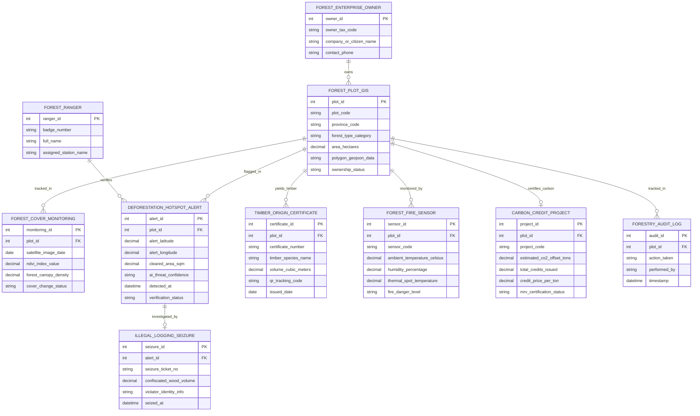

# Conceptual ERD — Forestry Management Information System

## Mermaid Code

## Entity Description Table | Bảng mô tả Entity

| # | Entity Name | Vietnamese Name | Description | Key Attributes | Main Relationships |
|---|-------------|-----------------|-------------|----------------|-------------------|
| 1 | FOREST_PLOT_GIS | Lô Rừng Ranh giới GIS | Chi tiết lô rừng (mã lô, tiểu khu, khoảnh, diện tích héc-ta, đa giác ranh giới GIS) | plot_id, plot_code, forest_type_category, area_hectares, polygon_geojson_data | Owned by OWNER, tracked in FOREST_COVER |
| 2 | FOREST_COVER_MONITORING | Giám sát Độ Che phủ Rừng | Bản ghi chỉ số NDVI và mật độ tán rừng trích xuất từ ảnh vệ tinh Sentinel/Landsat | monitoring_id, satellite_image_date, ndvi_index_value, cover_change_status | Belongs to FOREST_PLOT_GIS |
| 3 | DEFORESTATION_HOTSPOT_ALERT | Cảnh báo Phá rừng AI | Cảnh báo AI phát hiện vết chặt phá rừng trái phép kèm tọa độ GPS thực địa | alert_id, alert_latitude, alert_longitude, cleared_area_sqm, verification_status | Belongs to FOREST_PLOT_GIS, verified by RANGER |
| 4 | TIMBER_ORIGIN_CERTIFICATE | Chứng nhận Nguồn gốc Gỗ | Giấy chứng nhận và mã QR code truy xuất nguồn gốc gỗ khai thác rừng trồng | certificate_id, certificate_number, timber_species_name, qr_tracking_code | Yielded from FOREST_PLOT_GIS |
| 5 | FOREST_FIRE_SENSOR | Cảm biến Nhiệt Cháy rừng | Trạm đo nhiệt độ, độ ẩm thảm thực vật và phát hiện điểm nhiệt cháy rừng | sensor_id, sensor_code, ambient_temperature_celsius, fire_danger_level | Belongs to FOREST_PLOT_GIS |
| 6 | CARBON_CREDIT_PROJECT | Dự án Tín chỉ Carbon Rừng | Hồ sơ dự án tín chỉ carbon (REDD+), sản lượng hấp thụ $tCO_2e$ và giao dịch | project_id, project_code, estimated_co2_offset_tons, mrv_certification_status | Certifies FOREST_PLOT_GIS |
| 7 | ILLEGAL_LOGGING_SEIZURE | Biên bản Bắt giữ Gỗ lậu | Hồ sơ tịch thu lâm sản, phương tiện vi phạm và xử lý vi phạm phá rừng | seizure_id, seizure_ticket_no, confiscated_wood_volume, seized_at | Investigates DEFORESTATION_ALERT |
| 8 | FOREST_RANGER | Cán bộ Kiểm lâm | Thông tin cán bộ chiến sĩ kiểm lâm phụ trách quản lý địa bàn hạt kiểm lâm | ranger_id, badge_number, full_name, assigned_station_name | Verifies DEFORESTATION_ALERT |
| 9 | FOREST_ENTERPRISE_OWNER | Chủ Rừng / Doanh nghiệp | Thông tin cá nhân, hộ gia đình hoặc ban quản lý rừng sở hữu hợp pháp lô rừng | owner_id, owner_tax_code, company_or_citizen_name, contact_phone | Owns FOREST_PLOT_GIS |
| 10 | FORESTRY_AUDIT_LOG | Nhật ký Kiểm toán Lâm nghiệp | Lưu vết toàn bộ lịch sử phân tích ảnh vệ tinh, cấp mã QR, chi trả DVMTR và kiểm kê | audit_id, action_taken, performed_by, timestamp | Belongs to FOREST_PLOT_GIS |

## Relationship Description | Mô tả Quan hệ

| # | From Entity | Cardinality | To Entity | Relationship Label | Business Explanation |
|---|-------------|-------------|-----------|-------------------|----------------------|
| 1 | FOREST_ENTERPRISE_OWNER | one-to-many | FOREST_PLOT_GIS | owns | Một chủ rừng sở hữu và quản lý nhiều lô rừng phòng hộ/rừng sản xuất |
| 2 | FOREST_PLOT_GIS | one-to-many | FOREST_COVER_MONITORING | tracked_in | Một lô rừng được theo dõi biến động độ che phủ qua nhiều đợt ảnh vệ tinh |
| 3 | FOREST_PLOT_GIS | one-to-many | DEFORESTATION_HOTSPOT_ALERT | flagged_in | Một lô rừng có thể ghi nhận các cảnh báo đốm nhiệt phá rừng trái phép |
| 4 | FOREST_PLOT_GIS | one-to-many | TIMBER_ORIGIN_CERTIFICATE | yields_timber | Một lô rừng trồng hợp pháp cung cấp nguồn gỗ được cấp mã QR chứng nhận |
| 5 | FOREST_PLOT_GIS | one-to-many | FOREST_FIRE_SENSOR | monitored_by | Một lô rừng được giám sát bởi các trạm cảm biến nhiệt độ và điểm nhiệt vệ tinh |
| 6 | FOREST_PLOT_GIS | one-to-one | CARBON_CREDIT_PROJECT | certifies_carbon | Một diện tích rừng đủ điều kiện được chứng nhận một Dự án tín chỉ carbon |
| 7 | DEFORESTATION_HOTSPOT_ALERT | one-to-one | ILLEGAL_LOGGING_SEIZURE | investigated_by | Một cảnh báo phá rừng được điều tra và lập một Biên bản bắt giữ lâm sản lậu |
| 8 | FOREST_RANGER | one-to-many | DEFORESTATION_HOTSPOT_ALERT | verifies | Một cán bộ kiểm lâm đi xác minh thực địa nhiều cảnh báo phá rừng từ AI |
| 9 | FOREST_PLOT_GIS | one-to-many | FORESTRY_AUDIT_LOG | tracked_in | Mọi biến động trên lô rừng đều được ghi lại nhật ký kiểm toán bất biến |
