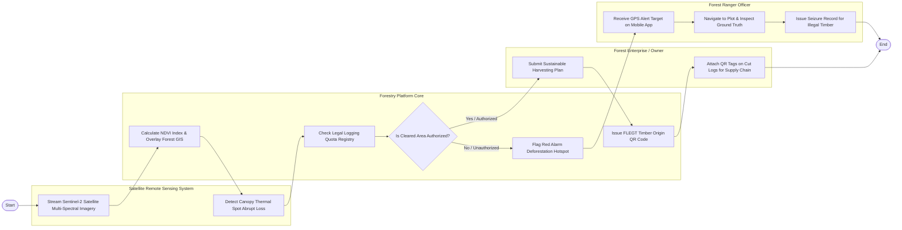

# Swimlane Diagram — Forestry Management Information System

## Mermaid Code

## Flow Description | Mô tả luồng

| Lane | Actor | Role in Flow |
|------|-------|-------------|
| 1 | Satellite Remote Sensing System | Truyền luồng dữ liệu ảnh vệ tinh Sentinel-2 đa phổ và tự động phát hiện sự mất mát đột ngột của tán rừng. |
| 2 | Forestry Platform Core | Tính toán chỉ số thực vật NDVI, đối soát CSDL cấp phép khai thác, cảnh báo phá rừng Đỏ và cấp mã QR truy xuất gỗ. |
| 3 | Forest Ranger Officer | Nhận vị trí GPS điểm phá rừng trên ứng dụng di động, đi xác minh thực địa và lập biên bản tịch thu gỗ lậu. |
| 4 | Forest Enterprise / Owner | Nộp Kế hoạch khai thác rừng trồng hợp pháp và dán nhãn mã QR code lên từng lóng gỗ trước khi xuất bán. |
