# Action Tree — Forestry Management Information System

## Mermaid Code

```mermaid
graph TD
    Root["Forestry Management Information System"]

    Root --> M1["Satellite Remote Sensing & Cover GIS"]
    Root --> M2["Deforestation AI & Forest Fire Early Warning"]
    Root --> M3["Timber Legal Origin & Supply Chain QR"]
    Root --> M4["Carbon Credit & Biomass Accounting"]
    Root --> M5["Wildlife & National Park Protection"]
    Root --> M6["MARD Forestry BI & Inventory Audit"]

    M1 --> A11["Track Satellite Forest Cover GIS"]
    M1 --> A12["Calculate NDVI Vegetation Index"]
    M1 --> A13["Map Special Use National Park Boundaries"]
    M1 --> A14["Overlay Forest Land Tenure Maps"]

    M2 --> A21["Detect Deforestation Thermal Hotspots AI"]
    M2 --> A22["Monitor Forest Fire Thermal Sensors"]
    M2 --> A23["Calculate Fire Danger Severity Index"]
    M2 --> A24["Inspect Illegal Logging Seizures"]

    M3 --> A31["Issue Timber Origin Tracking QR"]
    M3 --> A32["Permit Sustainable Logging Quotas"]
    M3 --> A33["Audit Legal Timber Supply Chain FLEGT"]
    M3 --> A34["Issue Forest Transport Certificates"]

    M4 --> A41["Register Carbon Credit Offset Projects"]
    M4 --> A42["Audit Forest Biomass Carbon Stocks"]
    M4 --> A43["Process Reforestation Subsidies DVMTR"]
    M4 --> A44["Generate REDD+ MRV Verification Reports"]

    M5 --> A51["Monitor Endangered Wildlife Species CITES"]
    M5 --> A52["Manage Forest Protection Patrol Shifts"]
    M5 --> A53["Track Biodiversity Index Ratings"]
    M5 --> A54["Dispatch Ranger Anti-Poaching Teams"]

    M6 --> A61["Export Forestry Ministry BI Analytics"]
    M6 --> A62["Calculate National Forest Cover Rate %"]
    M6 --> A63["Log System Immutable Audit Trails"]
    M6 --> A64["Archive National Forest Inventory Maps"]
```

## Module Description | Mô tả Module

| # | Module | Description | Actions |
|---|--------|-------------|---------|
| 1 | Satellite Remote Sensing & Cover GIS | Giám sát biến động độ che phủ rừng bằng ảnh vệ tinh Sentinel/Landsat, tính chỉ số NDVI và quản lý ranh giới GIS | Track Satellite Forest Cover GIS, Calculate NDVI Vegetation Index, Map Special Use National Park Boundaries, Overlay Forest Land Tenure Maps |
| 2 | Deforestation AI & Forest Fire Early Warning | Thuật toán AI phát hiện phá rừng trái phép, giám sát điểm nhiệt cháy rừng thời gian thực và lập biên bản bắt giữ gỗ lậu | Detect Deforestation Thermal Hotspots AI, Monitor Forest Fire Thermal Sensors, Calculate Fire Danger Severity Index, Inspect Illegal Logging Seizures |
| 3 | Timber Legal Origin & Supply Chain QR | Cấp mã QR truy xuất nguồn gốc gỗ rừng trồng, duyệt hạn ngạch khai thác bền vững và kiểm toán chuỗi cung ứng FLEGT | Issue Timber Origin Tracking QR, Permit Sustainable Logging Quotas, Audit Legal Timber Supply Chain FLEGT, Issue Forest Transport Certificates |
| 4 | Carbon Credit & Biomass Accounting | Đăng ký dự án tín chỉ carbon rừng (REDD+), kiểm kê trữ lượng $CO_2$ hấp thụ và chi trả tiền dịch vụ môi trường rừng | Register Carbon Credit Offset Projects, Audit Forest Biomass Carbon Stocks, Process Reforestation Subsidies DVMTR, Generate REDD+ MRV Verification Reports |
| 5 | Wildlife & National Park Protection | Theo dõi bảo tồn động thực vật nguy cấp CITES, phân công ca trực tuần tra kiểm lâm GPS và phòng chống săn bắt trái phép | Monitor Endangered Wildlife Species CITES, Manage Forest Protection Patrol Shifts, Track Biodiversity Index Ratings, Dispatch Ranger Anti-Poaching Teams |
| 6 | MARD Forestry BI & Inventory Audit | Trích xuất báo cáo tỷ lệ che phủ rừng toàn quốc nộp Bộ NN&PTNT, kiểm toán bất biến và lưu trữ bản đồ kiểm kê 5 năm | Export Forestry Ministry BI Analytics, Calculate National Forest Cover Rate %, Log System Immutable Audit Trails, Archive National Forest Inventory Maps |
