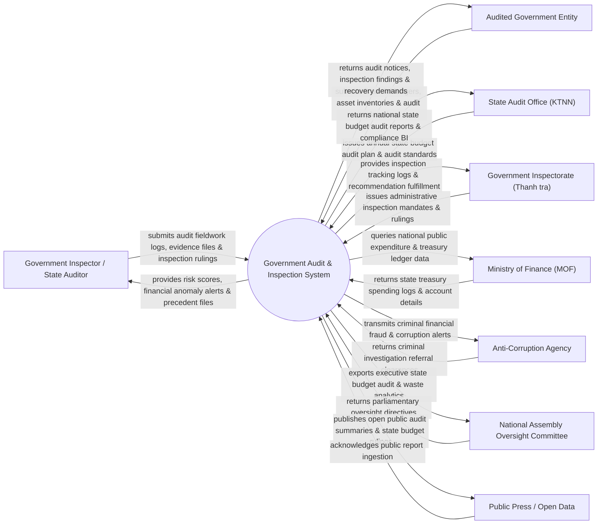

# Context Diagram — Government Audit & Inspection System

## Mermaid Code

## Actor & Interaction Table | Bảng Actor & Tương tác

| # | Actor | Actor Type | Data Sent TO System | Data Received FROM System | Notes |
|---|-------|------------|---------------------|---------------------------|-------|
| 1 | Government Inspector / State Auditor | Primary | Audit fieldwork logs, evidence attachments, inspection rulings | Financial risk scores, overspending anomaly alerts, precedent files | Kiểm toán viên Nhà nước / Thanh tra viên Chính phủ |
| 2 | Audited Government Entity | Primary | Financial ledgers, asset inventory data, explanation documents | Audit notices, inspection findings, financial recovery demands | Các Bộ/Ngành, UBND Tỉnh, Ban QLDA và Đơn vị nghiệp công lập |
| 3 | State Audit Office (KTNN) | Primary | Annual state budget audit plan, national audit standards | National state budget audit reports, compliance BI dashboards | Kiểm toán Nhà nước chỉ đạo công tác kiểm toán ngân sách |
| 4 | Government Inspectorate (Thanh tra) | Primary | Administrative inspection mandates, inspection conclusions | Inspection tracking logs, recommendation fulfillment stats | Thanh tra Chính phủ chỉ đạo công tác thanh tra công vụ |
| 5 | Ministry of Finance (MOF) | Supporting | State treasury spending logs, public asset accounts | National public expenditure queries, treasury ledger data | Bộ Tài chính cung cấp dữ liệu ngân sách và Kho bạc |
| 6 | Anti-Corruption Agency | Regulatory | Criminal investigation referral clearances, suspect lists | Criminal financial fraud alerts, illegal asset transfer logs | Cơ quan Thường trực Ban Chỉ đạo Trung ương về Phòng chống Tham nhũng |
| 7 | National Assembly Oversight Committee | Regulatory | Parliamentary oversight directives, audit inquiries | Executive state budget audit reports, waste reduction analytics | Ủy ban Tài chính Ngân sách của Quốc hội giám sát tối cao |
| 8 | Public Press / Open Data | Supporting | Public search query parameters | Published public audit summaries, state budget audit rulings | Báo chí truyền thông và công chúng theo dõi công khai kết quả kiểm toán |

## System Boundary Description | Mô tả Phạm vi Hệ thống

Hệ thống Government Audit & Inspection System (Hệ thống Quản lý Thanh tra và Kiểm toán Nhà nước) chịu trách nhiệm tự động hóa quy trình kiểm toán ngân sách nhà nước, kiểm toán dự án đầu tư công và thanh tra công vụ: Lập kế hoạch kiểm toán hàng năm, thu thập dữ liệu sổ sách kế toán điện tử từ Kho bạc và cơ quan được kiểm toán, sử dụng thuật toán AI phát hiện sai phạm chi tiêu/vượt dự toán, ban hành Kết luận thanh tra / Báo cáo kiểm toán có chữ ký số PKI, theo dõi đôn đốc việc thực hiện các kiến nghị kiểm toán (nộp lại ngân sách, xử lý cán bộ vi phạm) và công khai kết quả kiểm toán nộp Quốc hội. Tuy nhiên, hệ thống KHÔNG trực tiếp thực hiện tố tụng hình sự và KHÔNG thay thế việc khởi tố vụ án của Cơ quan Điều tra.
