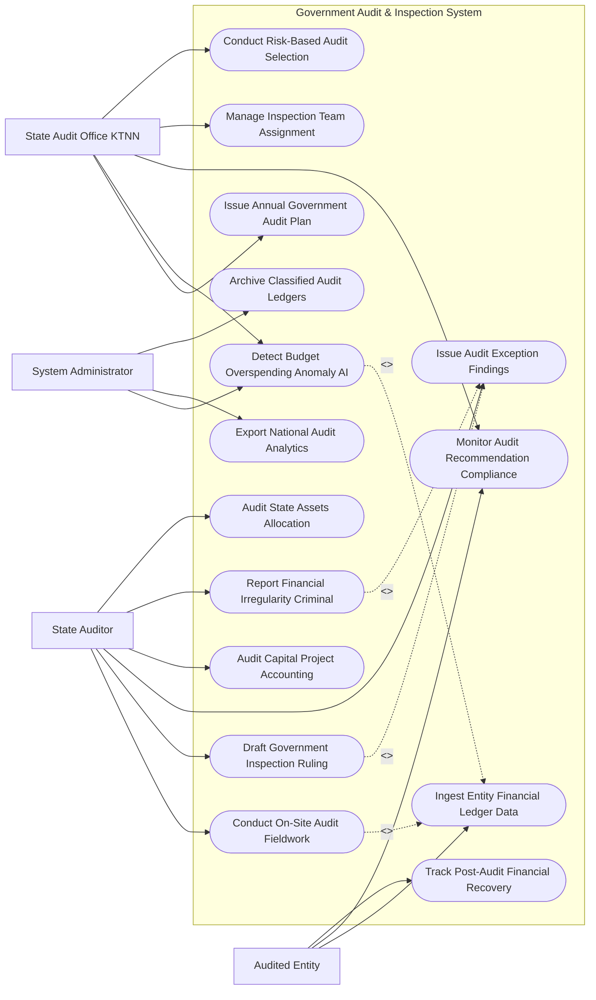

# Use Case Diagram — Government Audit & Inspection System

## Mermaid Code

## Actor Table | Bảng Actor

| # | Actor | Actor Type | Role Description | Related Use Cases |
|---|-------|------------|------------------|-------------------|
| 1 | Audited Entity | Primary | Đơn vị được kiểm toán cung cấp sổ sách kế toán, giải trình sai phạm và báo cáo kết quả thực hiện kiến nghị | UC03, UC06, UC07 |
| 2 | State Auditor | Primary | Kiểm toán viên / Thanh tra viên trực tiếp khảo sát thực địa, lập biên bản kiểm toán, dự thảo kết luận | UC02, UC05, UC08, UC10, UC11, UC13 |
| 3 | State Audit Office KTNN | Primary | Kiểm toán Nhà nước ban hành kế hoạch kiểm toán năm, phân công đoàn kiểm toán, giám sát kiến nghị | UC01, UC04, UC06, UC09, UC12 |
| 4 | System Administrator | System | Quản trị viên quản lý thuật toán AI quét bất thường chi tiêu, xuất báo cáo nộp Quốc hội và lưu trữ | UC04, UC14, UC15 |

## Use Case Table | Bảng Use Case

| # | UC ID | Use Case Name | Primary Actor | Secondary Actor | Description | Priority |
|---|-------|---------------|---------------|-----------------|-------------|----------|
| 1 | UC01 | Issue Annual Government Audit Plan | KTNN | Entity | Lập và công khai Kế hoạch kiểm toán ngân sách nhà nước và dự án đầu tư công hàng năm | High |
| 2 | UC02 | Conduct On-Site Audit Fieldwork | Auditor | Entity | Kiểm toán viên thực hiện kiểm tra sổ sách kế toán, chứng từ thu chi tại trụ sở đơn vị | High |
| 3 | UC03 | Ingest Entity Financial Ledger Data | Entity | StateTreasury | Tự động kết nối trích xuất dữ liệu sổ cái kế toán (General Ledger) và Kho bạc Nhà nước | High |
| 4 | UC04 | Detect Budget Overspending Anomaly AI | Admin, KTNN | AI Engine | Thuật toán AI phân tích phát hiện các khoản chi tiêu vượt dự toán, chi sai chế độ | High |
| 5 | UC05 | Draft Government Inspection Ruling | Auditor | KTNN | Biên soạn Dự thảo Báo cáo kiểm toán / Kết luận thanh tra có chữ ký số PKI | High |
| 6 | UC06 | Monitor Audit Recommendation Compliance | KTNN, Entity | NationalAssembly | Giám sát đôn đốc việc thực hiện 100% các kiến nghị sau kiểm toán của các đơn vị | High |
| 7 | UC07 | Track Post-Audit Financial Recovery | Entity | Treasury | Theo dõi số tiền đã nộp lại Ngân sách Nhà nước và giảm trừ dự toán theo kiến nghị | High |
| 8 | UC08 | Issue Audit Exception Findings | Auditor | Entity | Lập Biên bản xác nhận các hành vi sai phạm tài chính, lãng phí ngân sách | High |
| 9 | UC09 | Manage Inspection Team Assignment | KTNN | Auditor | Thành lập Đoàn kiểm toán, phân công Trưởng đoàn và kiểm soát xung đột lợi ích | High |
| 10 | UC10 | Audit Capital Project Accounting | Auditor | MOC | Kiểm toán quyết toán dự án hoàn thành, kiểm tra khối lượng nghiệm thu thi công công trình | High |
| 11 | UC11 | Report Financial Irregularity Criminal | Auditor | AntiCorruption | Chuyển hồ sơ sang Cơ quan Điều tra khi phát hiện hành vi có dấu hiệu tội phạm hình sự | High |
| 12 | UC12 | Conduct Risk-Based Audit Selection | KTNN | System | Phân tích rủi ro tài chính để chọn danh sách các Bộ/Tỉnh/Doanh nghiệp đưa vào kiểm toán | High |
| 13 | UC13 | Audit State Assets Allocation | Auditor | MOF | Kiểm toán việc quản lý, sử dụng trụ sở làm việc, ô tô công và tài sản công | Medium |
| 14 | UC14 | Export National Audit Analytics | Admin | NationalAssembly | Trích xuất báo cáo tổng hợp kết quả kiểm toán nộp Quốc hội và đăng công khai | Low |
| 15 | UC15 | Archive Classified Audit Ledgers | System | Archives | Đóng gói và lưu trữ vĩnh viễn hồ sơ kiểm toán nhà nước theo cấp độ bảo mật | Low |

## Use Case Specification | Đặc tả Use Case

---

### UC01 — Issue Annual Government Audit Plan

| Field | Detail |
|-------|--------|
| **UC ID** | UC01 |
| **Use Case Name** | Issue Annual Government Audit Plan |
| **Actor(s)** | Primary: State Audit Office (KTNN) / Secondary: Audited Entity |
| **Description** | Lập, thẩm định và ban hành Kế hoạch kiểm toán hàng năm của Kiểm toán Nhà nước đối với các Bộ, Ngành, Tỉnh và Doanh nghiệp nhà nước. |
| **Precondition** | 1. Tổng Kiểm toán Nhà nước phê duyệt định hướng nhiệm vụ kiểm toán năm. |
| **Main Flow** | 1. KTNN mở Phân hệ Lập Kế hoạch Kiểm toán Quốc gia.   2. System tự động chạy mô hình Đánh giá Rủi ro Tài chính (UC12) để đề xuất danh sách các đơn vị có rủi ro ngân sách cao.   3. KTNN nhập danh mục các cuộc kiểm toán trong năm: Kiểm toán Ngân sách Tỉnh/Thành phố, Kiểm toán Báo cáo tài chính Bộ, Kiểm toán Chuyên đề (Y tế, Giáo dục), Kiểm toán Dự án Đầu tư Công trọng điểm.   4. System tự động đối soát với Kế hoạch Thanh tra của Thanh tra Chính phủ để loại bỏ trùng lặp đối tượng (Tránh 1 đơn vị bị kiểm tra 2 lần/năm).   5. Tổng Kiểm toán Nhà nước ký số ban hành Quyết định phê duyệt Kế hoạch kiểm toán năm.   6. System tự động gửi Quyết định và Thông báo kiểm toán cho các Audited Entity trước 30 ngày.   7. System công khai Kế hoạch kiểm toán trên Cổng thông tin điện tử KTNN. |
| **Alternative Flow** | **AF1** — Điều chỉnh Kế hoạch kiểm toán đột xuất: KTNN ban hành Quyết định bổ sung cuộc kiểm toán đột xuất theo yêu cầu của Quốc hội hoặc Thủ tướng. |
| **Exception Flow** | **EX1** — Trùng lặp đối tượng kiểm toán với Thanh tra Chính phủ: System báo lỗi "Trùng lặp kế hoạch thanh tra", yêu cầu KTNN và Thanh tra Chính phủ họp liên ngành để xử lý. |
| **Postcondition** | Kế hoạch kiểm toán năm được ban hành công khai, minh bạch, làm căn cứ thành lập các Đoàn kiểm toán (UC09). |
| **Business Rule** | **BR1**: Kế hoạch kiểm toán hàng năm của KTNN phải được gửi cho đơn vị được kiểm toán trước khi tiến hành kiểm toán ít nhất 30 ngày. |

---

### UC04 — Detect Budget Overspending Anomaly AI

| Field | Detail |
|-------|--------|
| **UC ID** | UC04 |
| **Use Case Name** | Detect Budget Overspending Anomaly AI |
| **Actor(s)** | Primary: System Administrator, State Audit Office / Secondary: AI Engine |
| **Description** | Thuật toán AI phân tích dữ liệu sổ cái kế toán và Kho bạc để tự động phát hiện các khoản chi vượt dự toán, chi sai định mức, lãng phí. |
| **Precondition** | 1. Dữ liệu sổ cái kế toán (UC03) của đơn vị được kiểm toán đã được trích xuất vào hệ thống. |
| **Main Flow** | 1. AI Machine Learning Engine chạy các thuật toán phân tích chi tiêu công (Public Expenditure Anomaly Detection).   2. AI quét dữ liệu chứng từ thu chi so với Định mức chế độ chi tiêu nhà nước:   - Phát hiện chi vượt trần tiền tiếp khách, hội nghị, đi công tác nước ngoài.   - Phát hiện chia nhỏ hợp đồng mua sắm ($< 100\,triệu\,VND$) để chỉ định thầu lách luật.   - Phát hiện chi mua sắm ô tô công vượt giá trần quy định.   - Phát hiện chuyển tiền ngân sách sang các tài khoản tiền gửi ngân hàng thương mại trái phép.   3. If Phát hiện sai phạm ($Risk\_Score > 80\%$): AI bật cảnh báo Đỏ "Nghi vấn sai phạm chi tiêu ngân sách".   4. System lập Bảng tổng hợp các chứng từ nghi vấn đính kèm căn cứ pháp lý bị vi phạm.   5. Auditor sử dụng danh sách cảnh báo AI để làm trọng tâm kiểm tra sâu khi kiểm toán tại thực địa (UC02).   6. Auditor xác nhận sai phạm và lập Biên bản xác nhận số liệu kiểm toán (UC08). |
| **Alternative Flow** | **AF1** — Phân tích dữ liệu giá gói thầu đầu tư công: AI so sánh đơn giá vật liệu xây dựng trong dự toán vs Đơn giá thị trường để phát hiện khai khống giá. |
| **Exception Flow** | **EX1** — Đơn vị chi vượt dự toán do thực hiện nhiệm vụ khẩn cấp (Cứu trợ thiên tai): Auditor kiểm tra Quyết định bổ sung ngân sách khẩn cấp, bấm "Giải tỏa cảnh báo AI". |
| **Postcondition** | Rủi ro sai phạm ngân sách được phát hiện tự động, nâng cao hiệu quả và rút ngắn thời gian kiểm toán thực địa. |
| **Business Rule** | **BR1**: Các khoản chi sai chế độ, vượt định mức nhà nước quy định bắt buộc phải được bóc tách và đưa vào danh mục kiến nghị thu hồi nộp Ngân sách. |

---

### UC05 — Draft Government Inspection Ruling

| Field | Detail |
|-------|--------|
| **UC ID** | UC05 |
| **Use Case Name** | Draft Government Inspection Ruling |
| **Actor(s)** | Primary: State Auditor / Secondary: State Audit Office (KTNN) |
| **Description** | Trưởng đoàn kiểm toán biên soạn Dự thảo Báo cáo kiểm toán / Kết luận thanh tra, tổ chức bảo vệ kết quả và phát hành quyết định chính thức. |
| **Precondition** | 1. Đã kết thúc giai đoạn kiểm toán thực địa (UC02) và có các Biên bản xác nhận số liệu (UC08). |
| **Main Flow** | 1. Auditor mở Phân hệ Lập Báo cáo Kiểm toán / Kết luận Thanh tra.   2. System tự động gom toàn bộ các Biên bản xác nhận số liệu sai phạm (UC08) đã ký với đơn vị.   3. Auditor biên soạn nội dung Báo cáo: Đánh giá việc chấp hành luật pháp ngân sách, Kết quả kiểm toán thu/chi, Các sai phạm phát hiện, Nhóm Kiến nghị xử lý tài chính (Thu hồi nộp NSNN, giảm chi, giảm thanh toán), Nhóm Kiến nghị xử lý cán bộ vi phạm.   4. Auditor gửi Dự thảo Báo cáo kiểm toán cho đơn vị được kiểm toán để lấy ý kiến giải trình trong vòng 10 ngày.   5. Auditor tổng hợp ý kiến giải trình và tổ chức Cuộc họp bảo vệ kết quả kiểm toán trước Hội đồng Thẩm định KTNN.   6. Tổng Kiểm toán Nhà nước / Tổng Thanh tra Chính phủ ký số PKI ban hành Báo cáo kiểm toán chính thức.   7. System gửi Báo cáo kiểm toán chính thức cho Audited Entity và chuyển sang Phân hệ Theo dõi thực hiện kiến nghị (UC06). |
| **Alternative Flow** | **AF1** — Đơn vị không đồng ý với Kết luận kiểm toán: Đơn vị gửi văn bản khiếu nại, KTNN thành lập Đoàn kiểm tra lại để thẩm tra độc lập. |
| **Exception Flow** | **EX1** — Báo cáo kiểm toán có nội dung Bí mật Nhà nước (Kiểm toán Quốc phòng, An ninh): System khóa chế độ công khai, mã hóa tệp theo tiêu chuẩn Tuyệt mật. |
| **Postcondition** | Báo cáo kiểm toán có hiệu lực pháp lý bắt buộc thi hành, làm căn cứ thu hồi tiền cho Ngân sách Nhà nước (UC07). |
| **Business Rule** | **BR1**: Báo cáo kiểm toán chính thức phải được phát hành trong thời hạn không quá 45 ngày kể từ ngày kết thúc kiểm toán thực địa. |

---

### UC06 — Monitor Audit Recommendation Compliance

| Field | Detail |
|-------|--------|
| **UC ID** | UC06 |
| **Use Case Name** | Monitor Audit Recommendation Compliance |
| **Actor(s)** | Primary: State Audit Office (KTNN), Audited Entity / Secondary: National Assembly |
| **Description** | Theo dõi đôn đốc và kiểm tra việc thực hiện 100% các kiến nghị xử lý tài chính và xử lý cán bộ sau kiểm toán của các đơn vị. |
| **Precondition** | 1. Báo cáo kiểm toán / Kết luận thanh tra chính thức đã được phát hành (UC05). |
| **Main Flow** | 1. System tự động bóc tách các Kiến nghị trong Báo cáo kiểm toán thành các Dòng mục tiêu theo dõi (Recommendation Tracking Items):   - Số tiền phải nộp lại Ngân sách Nhà nước.   - Số tiền phải giảm thanh toán, giảm dự toán năm sau.   - Danh sách văn bản pháp luật cần sửa đổi, hủy bỏ.   - Danh sách cán bộ/tổ chức phải kiểm điểm, xử lý kỷ luật.   2. Audited Entity định kỳ hàng quý nộp Báo cáo kết quả thực hiện kiến nghị kiểm toán kèm Chứng từ nộp tiền Kho bạc (UC07).   3. System tự động cập nhật Tiến độ thực hiện (% Fulfillment Rate) của từng kiến nghị.   4. If Kiến nghị quá hạn chưa thực hiện: System tự động gửi Văn bản đôn đốc nộp tiền và gắn nhãn "Đơn vị chậm thực hiện kiến nghị kiểm toán".   5. KTNN tổ chức Đoàn kiểm tra thực hiện kiến nghị kiểm toán tại hiện trường đối với các đơn vị dây dưa không thực hiện.   6. System trích xuất Báo cáo tổng hợp tình hình thực hiện kiến nghị kiểm toán toàn quốc nộp Quốc hội (UC14). |
| **Alternative Flow** | **AF1** — Đơn vị xin gia hạn thời gian nộp lại tiền: KTNN xem xét hoàn cảnh bất khả kháng để gia hạn thêm tối đa 06 tháng. |
| **Exception Flow** | **EX1** — Đơn vị cố tình không thực hiện kiến nghị nộp lại tiền ngân sách: KTNN gửi văn bản đề nghị Bộ Tài chính/Kho bạc Nhà nước thực hiện Trích thu hồi tiền trực tiếp từ tài khoản ngân sách của đơn vị đó. |
| **Postcondition** | 100% các kiến nghị kiểm toán được theo dõi sát sao, đảm bảo tiền sai phạm được thu hồi triệt để về cho Ngân sách Nhà nước. |
| **Business Rule** | **BR1**: Tỷ lệ thực hiện kiến nghị xử lý tài chính của Kiểm toán Nhà nước bắt buộc phải được công khai hàng năm trước Quốc hội. |
