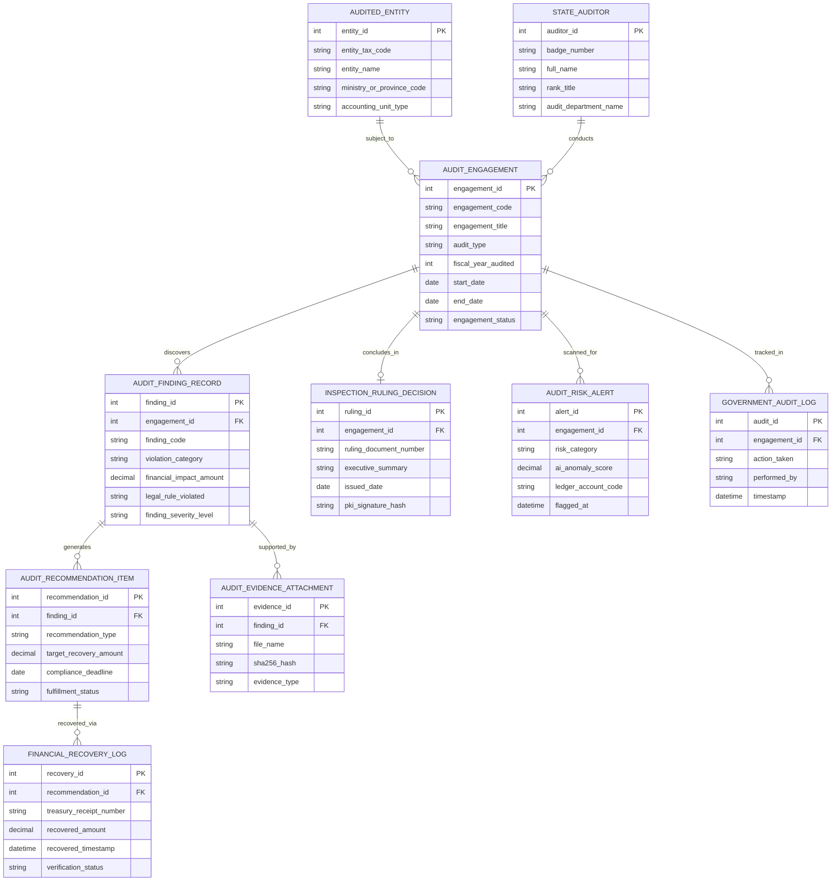

# Conceptual ERD — Government Audit & Inspection System

## Mermaid Code

## Entity Description Table | Bảng mô tả Entity

| # | Entity Name | Vietnamese Name | Description | Key Attributes | Main Relationships |
|---|-------------|-----------------|-------------|----------------|-------------------|
| 1 | AUDIT_ENGAGEMENT | Cuộc Kiểm toán / Thanh tra | Thông tin cuộc kiểm toán ngân sách, dự án hoặc thanh tra hành chính (mã, niên độ, thời gian) | engagement_id, engagement_code, engagement_title, fiscal_year_audited, engagement_status | Subject to AUDITED_ENTITY, discovers FINDING |
| 2 | AUDITED_ENTITY | Đơn vị Được Kiểm toán | Thông tin cơ quan nhà nước, UBND, Ban QLDA hoặc Doanh nghiệp nhà nước được kiểm toán | entity_id, entity_tax_code, entity_name, ministry_or_province_code | Subject to AUDIT_ENGAGEMENT |
| 3 | AUDIT_FINDING_RECORD | Biên bản Sai phạm Tài chính | Ghi nhận các hành vi vi phạm pháp luật ngân sách, chi sai chế độ, lãng phí tài sản công | finding_id, finding_code, violation_category, financial_impact_amount, finding_severity_level | Belongs to ENGAGEMENT, generates RECOMMENDATION |
| 4 | AUDIT_RECOMMENDATION_ITEM | Kiến nghị Xử lý Sau Kiểm toán | Các mục kiến nghị thu hồi nộp NSNN, giảm chi dự toán, sửa đổi văn bản hoặc xử lý cán bộ | recommendation_id, recommendation_type, target_recovery_amount, fulfillment_status | Belongs to AUDIT_FINDING_RECORD, recovered via LOG |
| 5 | INSPECTION_RULING_DECISION | Kết luận Thanh tra / Báo cáo KT | Quyết định kết luận kiểm toán chính thức có chữ ký số PKI của Tổng KTNN / Thanh tra | ruling_id, ruling_document_number, executive_summary, pki_signature_hash | Concludes AUDIT_ENGAGEMENT |
| 6 | FINANCIAL_RECOVERY_LOG | Nhật ký Thu hồi Tiền Ngân sách | Chứng từ xác nhận số tiền đơn vị đã nộp lại Kho bạc Nhà nước theo kiến nghị | recovery_id, treasury_receipt_number, recovered_amount, verification_status | Belongs to AUDIT_RECOMMENDATION_ITEM |
| 7 | AUDIT_RISK_ALERT | Cảnh báo AI Rủi ro Tài chính | Cảnh báo AI phát hiện chi vượt dự toán, chi sai định mức hoặc thông thầu | alert_id, risk_category, ai_anomaly_score, ledger_account_code | Scanned for AUDIT_ENGAGEMENT |
| 8 | STATE_AUDITOR | Kiểm toán viên / Thanh tra viên | Thông tin cán bộ kiểm toán viên nhà nước hoặc thanh tra viên tham gia cuộc kiểm toán | auditor_id, badge_number, full_name, audit_department_name | Conducts AUDIT_ENGAGEMENT |
| 9 | AUDIT_EVIDENCE_ATTACHMENT | Tệp Minh chứng Pháp lý | Các tệp hóa đơn, chứng từ chi, bản vẽ, ảnh chụp minh chứng cho sai phạm | evidence_id, file_name, sha256_hash, evidence_type | Supports AUDIT_FINDING_RECORD |
| 10 | GOVERNMENT_AUDIT_LOG | Nhật ký Kiểm toán Hệ thống | Lưu toàn bộ lịch sử nạp sổ cái, lập biên bản, ban hành kết luận và đôn đốc kiến nghị | audit_id, action_taken, performed_by, timestamp | Belongs to AUDIT_ENGAGEMENT |

## Relationship Description | Mô tả Quan hệ

| # | From Entity | Cardinality | To Entity | Relationship Label | Business Explanation |
|---|-------------|-------------|-----------|-------------------|----------------------|
| 1 | AUDITED_ENTITY | one-to-many | AUDIT_ENGAGEMENT | subject_to | Một cơ quan/đơn vị nhà nước chịu sự kiểm toán qua các cuộc kiểm toán định kỳ |
| 2 | AUDIT_ENGAGEMENT | one-to-many | AUDIT_FINDING_RECORD | discovers | Một cuộc kiểm toán phát hiện và lập nhiều Biên bản ghi nhận sai phạm tài chính |
| 3 | AUDIT_FINDING_RECORD | one-to-many | AUDIT_RECOMMENDATION_ITEM | generates | Một sai phạm tài chính phát sinh nhiều kiến nghị xử lý (thu hồi tiền, xử lý cán bộ) |
| 4 | AUDIT_ENGAGEMENT | one-to-one | INSPECTION_RULING_DECISION | concludes_in | Mỗi cuộc kiểm toán kết thúc bằng duy nhất một Quyết định kết luận / Báo cáo kiểm toán |
| 5 | AUDIT_RECOMMENDATION_ITEM | one-to-many | FINANCIAL_RECOVERY_LOG | recovered_via | Một kiến nghị thu hồi tiền được thực hiện qua nhiều đợt nộp tiền vào Kho bạc |
| 6 | AUDIT_FINDING_RECORD | one-to-many | AUDIT_EVIDENCE_ATTACHMENT | supported_by | Mỗi bản ghi sai phạm được chứng minh bởi các tệp tài liệu minh chứng pháp lý |
| 7 | STATE_AUDITOR | one-to-many | AUDIT_ENGAGEMENT | conducts | Một kiểm toán viên tham gia thực hiện kiểm toán trong nhiều cuộc kiểm toán |
| 8 | AUDIT_ENGAGEMENT | one-to-many | AUDIT_RISK_ALERT | scanned_for | Một cuộc kiểm toán được thuật toán AI quét phân tích các điểm rủi ro tài chính |
| 9 | AUDIT_ENGAGEMENT | one-to-many | GOVERNMENT_AUDIT_LOG | tracked_in | Mọi thao tác trên cuộc kiểm toán được ghi nhật ký kiểm toán bất biến minh bạch |
