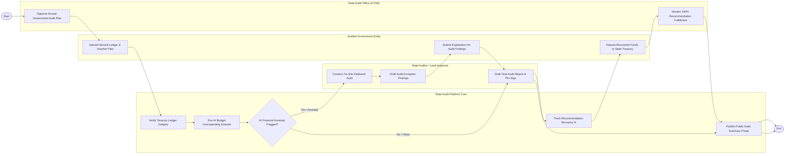

# Swimlane Diagram — Government Audit & Inspection System

## Mermaid Code

## Flow Description | Mô tả luồng

| Lane | Actor | Role in Flow |
|------|-------|-------------|
| 1 | Audited Government Entity | Tải lên dữ liệu sổ cái kế toán, nộp văn bản giải trình đối với các sai phạm và nộp lại tiền vi phạm vào Kho bạc. |
| 2 | State Audit Platform Core | Kiểm tra tính toàn vẹn dữ liệu Kho bạc, chạy AI quét chi vượt dự toán, theo dõi % thu hồi nộp NSNN và công khai báo cáo. |
| 3 | State Auditor / Lead Inspector | Khảo sát kiểm tra thực địa, lập Biên bản sai phạm tài chính, dự thảo Báo cáo kiểm toán và ký số PKI phát hành. |
| 4 | State Audit Office (KTNN) | Phê duyệt Kế hoạch kiểm toán ngân sách hàng năm và giám sát đôn đốc thực hiện 100% các kiến nghị sau kiểm toán. |
