# Action Tree — Government Audit & Inspection System

## Mermaid Code

```mermaid
graph TD
    Root["Government Audit & Inspection System"]

    Root --> M1["Audit Planning & Risk Assessment"]
    Root --> M2["Fieldwork Inspection & Evidence Gathering"]
    Root --> M3["Anomaly AI Detection & Asset Audit"]
    Root --> M4["Inspection Rulings & Post-Audit Recovery"]
    Root --> M5["Compliance Monitoring & Anti-Corruption"]
    Root --> M6["National Audit BI & Dossier Archival"]

    M1 --> A11["Issue Annual Government Audit Plans"]
    M1 --> A12["Conduct Risk-Based Audit Selection"]
    M1 --> A13["Manage Inspection Team Assignments"]
    M1 --> A14["De-conflict Inspectorate Audit Lists"]

    M2 --> A21["Conduct On-Site Audit Fieldwork"]
    M2 --> A22["Ingest Entity Financial Ledger Data"]
    M2 --> A23["Upload Audit Evidence Attachments"]
    M2 --> A24["Issue Audit Exception Findings"]

    M3 --> A31["Detect Budget Overspending Anomaly AI"]
    M3 --> A32["Audit Capital Project Accounting"]
    M3 --> A33["Audit State Assets Allocation"]
    M3 --> A34["Audit Split Procurement Bidding Contracts"]

    M4 --> A41["Draft Government Inspection Rulings"]
    M4 --> A42["Apply PKI Executive Digital Signature"]
    M4 --> A43["Track Post-Audit Financial Recovery"]
    M4 --> A44["Reconcile Treasury Deposit Receipts"]

    M5 --> A51["Monitor Audit Recommendation Compliance"]
    M5 --> A52["Report Financial Irregularity Criminal"]
    M5 --> A53["Issue Overdue Compliance Warnings"]
    M5 --> A54["Publish Public Audit Summaries"]

    M6 --> A61["Export National Audit Analytics BI"]
    M6 --> A62["Calculate Total State Budget Recovery"]
    M6 --> A63["Log System Immutable Audit Trails"]
    M6 --> A64["Archive Classified Audit Ledgers"]
```

## Module Description | Mô tả Module

| # | Module | Description | Actions |
|---|--------|-------------|---------|
| 1 | Audit Planning & Risk Assessment | Lập kế hoạch kiểm toán hàng năm, phân tích rủi ro tài chính chọn mẫu, thành lập đoàn kiểm toán và xử lý trùng lặp | Issue Annual Government Audit Plans, Conduct Risk-Based Audit Selection, Manage Inspection Team Assignments, De-conflict Inspectorate Audit Lists |
| 2 | Fieldwork Inspection & Evidence Gathering | Thực hiện kiểm toán tại trụ sở đơn vị, trích xuất dữ liệu sổ cái Kho bạc, đính kèm chứng từ minh chứng và lập biên bản sai phạm | Conduct On-Site Audit Fieldwork, Ingest Entity Financial Ledger Data, Upload Audit Evidence Attachments, Issue Audit Exception Findings |
| 3 | Anomaly AI Detection & Asset Audit | Thuật toán AI phát hiện chi vượt định mức/dự toán, kiểm toán quyết toán dự án đầu tư công và kiểm toán quản lý tài sản công | Detect Budget Overspending Anomaly AI, Audit Capital Project Accounting, Audit State Assets Allocation, Audit Split Procurement Bidding Contracts |
| 4 | Inspection Rulings & Post-Audit Recovery | Biên soạn Báo cáo kiểm toán/Kết luận thanh tra có chữ ký số PKI, theo dõi thu hồi tiền sai phạm và đối soát nộp Kho bạc | Draft Government Inspection Rulings, Apply PKI Executive Digital Signature, Track Post-Audit Financial Recovery, Reconcile Treasury Deposit Receipts |
| 5 | Compliance Monitoring & Anti-Corruption | Giám sát thực hiện 100% kiến nghị sau kiểm toán, chuyển cơ quan điều tra các vụ việc hình sự và công khai báo cáo | Monitor Audit Recommendation Compliance, Report Financial Irregularity Criminal, Issue Overdue Compliance Warnings, Publish Public Audit Summaries |
| 6 | National Audit BI & Dossier Archival | Trích xuất báo cáo tổng hợp kết quả kiểm toán nộp Quốc hội, tính toán tổng số tiền nộp lại NSNN và lưu trữ hồ sơ bảo mật | Export National Audit Analytics BI, Calculate Total State Budget Recovery, Log System Immutable Audit Trails, Archive Classified Audit Ledgers |
