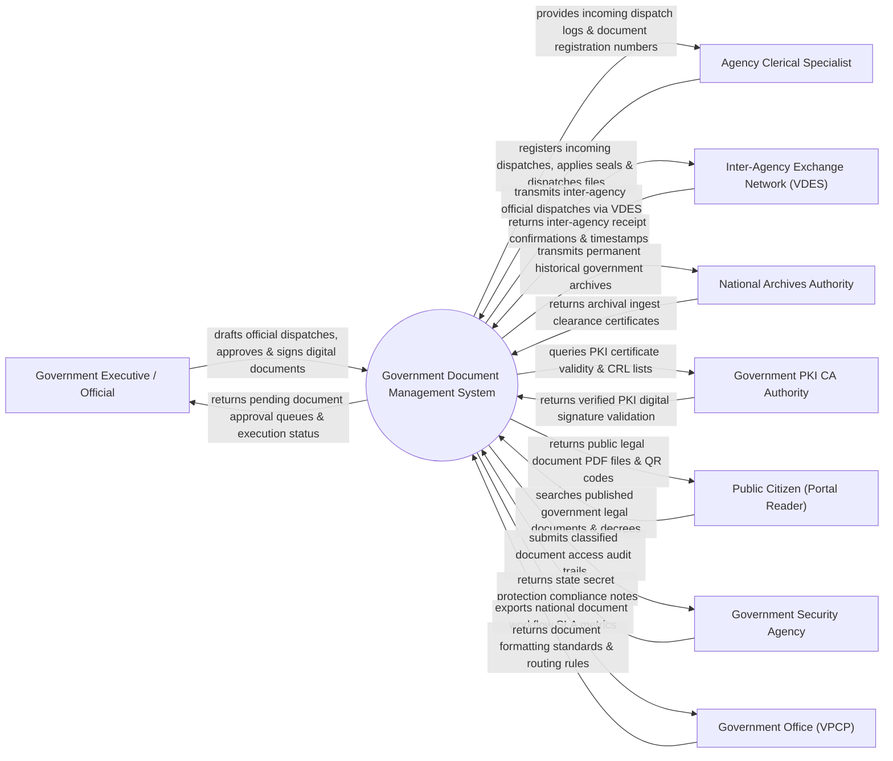

# Context Diagram — Government Document Management System

## Mermaid Code

## Actor & Interaction Table | Bảng Actor & Tương tác

| # | Actor | Actor Type | Data Sent TO System | Data Received FROM System | Notes |
|---|-------|------------|---------------------|---------------------------|-------|
| 1 | Government Executive / Official | Primary | Document drafts, approval decisions, PKI digital signatures, directives | Pending approval queues, document status, workflow alerts | Lãnh đạo và cán bộ công chức soạn thảo và ký duyệt văn bản |
| 2 | Agency Clerical Specialist | Primary | Incoming dispatch metadata, official seals, document numbers, distribution lists | Incoming dispatch logs, official document numbers, dispatch manifests | Cán bộ Văn thư cơ quan vào sổ văn bản đến và phát hành văn bản đi |
| 3 | Inter-Agency Exchange Network (VDES) | Supporting | Inter-agency dispatch payload, electronic receipt notifications | Encrypted document packages, dispatch tracking codes | Trục liên thông văn bản quốc gia (VDES) gửi nhận văn bản điện tử |
| 4 | National Archives Authority | Supporting | Archival metadata standards, retention period policies | Permanent digital archival packages, metadata manifests | Cục Văn thư và Lưu trữ Nhà nước tiếp nhận hồ sơ lưu trữ lịch sử |
| 5 | Government PKI CA Authority | Supporting | Digital certificate status, Certificate Revocation Lists (CRL) | PKI signature validation queries, timestamp verification | Ban Cơ yếu Chính phủ / Ban Quản lý Chữ ký số chuyên dùng |
| 6 | Public Citizen (Portal Reader) | Supporting | Public document search parameters, law query terms | Published government legal documents (Công báo), decrees | Công chúng tra cứu văn bản quy phạm pháp luật công khai |
| 7 | Government Security Agency | Regulatory | State secret classification rules (Tuyệt mật, Tối mật, Mật) | Classified document access audit trails, encryption logs | Cơ quan Bảo vệ Bí mật Nhà nước kiểm toán an toàn thông tin |
| 8 | Government Office (VPCP) | Regulatory | National document formatting standards, processing deadlines | National document workflow SLA metrics, directive execution rates | Văn phòng Chính phủ chỉ đạo công tác văn thư lưu trữ điện tử |

## System Boundary Description | Mô tả Phạm vi Hệ thống

Hệ thống Government Document Management System (Hệ thống Quản lý Văn bản và Điều hành Chính phủ / VOffice) chịu trách nhiệm tự động hóa quy trình quản lý văn bản đi, văn bản đến và hồ sơ công việc tại các cơ quan nhà nước: Soạn thảo văn bản, trình ký đa cấp, ký số chuyên dùng Chính phủ (PKI CA), đóng dấu tròn điện tử, phát hành văn bản qua Trục Liên thông Văn bản Quốc gia (VDES), theo dõi hạn xử lý công việc (SLA), phân loại độ bảo mật bí mật nhà nước và nộp lưu trữ lịch sử. Tuy nhiên, hệ thống KHÔNG trực tiếp thực hiện việc in ấn giấy ấn chỉ vật lý và KHÔNG thay thế cuộc họp chỉ đạo trực tiếp của lãnh đạo.
