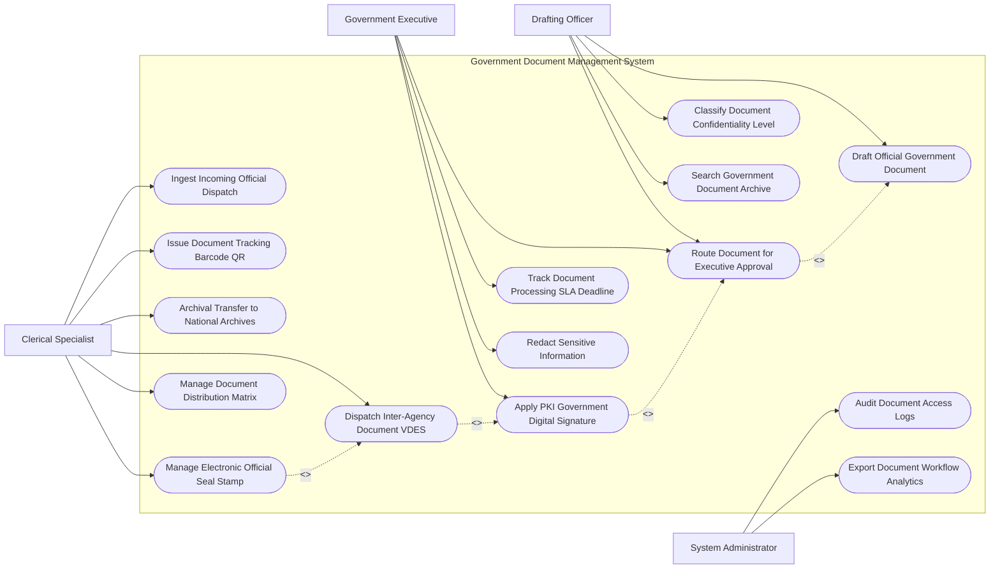

# Use Case Diagram — Government Document Management System

## Mermaid Code

## Actor Table | Bảng Actor

| # | Actor | Actor Type | Role Description | Related Use Cases |
|---|-------|------------|------------------|-------------------|
| 1 | Drafting Officer | Primary | Chuyên viên soạn thảo văn bản, xin ý kiến dự thảo và trình duyệt | UC01, UC03, UC06, UC11 |
| 2 | Government Executive | Primary | Lãnh đạo cơ quan xem xét, sửa đổi, phê duyệt và ký số chữ ký chuyên dùng PKI | UC02, UC03, UC07, UC12 |
| 3 | Clerical Specialist | Primary | Văn thư cơ quan cấp số văn bản, đóng dấu điện tử, gửi qua VDES và nộp lưu trữ | UC04, UC05, UC08, UC09, UC10, UC14 |
| 4 | System Administrator | System | Quản trị viên theo dõi nhật ký truy cập an ninh thông tin và xuất báo cáo SLA | UC13, UC15 |

## Use Case Table | Bảng Use Case

| # | UC ID | Use Case Name | Primary Actor | Secondary Actor | Description | Priority |
|---|-------|---------------|---------------|-----------------|-------------|----------|
| 1 | UC01 | Draft Official Government Document | Officer | - | Soạn thảo văn bản đi (Nghị định, Quyết định, Công văn) theo biểu mẫu chuẩn | High |
| 2 | UC02 | Apply PKI Government Digital Signature | Executive | PKI CA | Ký số chữ ký điện tử chuyên dùng Chính phủ bằng USB Token/SIM PKI | High |
| 3 | UC03 | Route Document for Executive Approval | Officer, Executive | - | Luân chuyển dự thảo văn bản xin ý kiến và trình ký đa cấp trong cơ quan | High |
| 4 | UC04 | Dispatch Inter-Agency Document VDES | Clerk | ExchangeNet | Phát hành và gửi văn bản điện tử sang các cơ quan khác qua Trục liên thông VDES | High |
| 5 | UC05 | Ingest Incoming Official Dispatch | Clerk | - | Tiếp nhận, cấp số văn bản đến và chuyển phân công xử lý cho các phòng ban | High |
| 6 | UC06 | Classify Document Confidentiality Level | Officer | SecurityAgency | Xác định độ mật của văn bản (Thường, Mật, Tối mật, Tuyệt mật) theo luật | High |
| 7 | UC07 | Track Document Processing SLA Deadline | Executive | - | Giám sát hạn xử lý công việc của từng cán bộ và phát cảnh báo trễ hạn | High |
| 8 | UC08 | Issue Document Tracking Barcode QR | Clerk | - | Tự động sinh mã vạch và mã QR theo dõi luồng xử lý văn bản | Medium |
| 9 | UC09 | Archival Transfer to National Archives | Clerk | NationalArchives | Đóng gói và nộp hồ sơ văn bản điện tử vào Lưu trữ lịch sử Nhà nước | Medium |
| 10 | UC10 | Manage Electronic Official Seal Stamp | Clerk | - | Quản lý và đóng con dấu tròn điện tử của cơ quan sau khi lãnh đạo ký số | High |
| 11 | UC11 | Search Government Document Archive | Officer | - | Tra cứu văn bản toàn văn (Full-text Search) theo từ khóa, số ký hiệu, ngày ban hành | High |
| 12 | UC12 | Redact Sensitive Information | Executive | SecurityAgency | Bóc tách/che mờ thông tin bí mật nhà nước trước khi công khai văn bản | Medium |
| 13 | UC13 | Audit Document Access Logs | Admin | SecurityAgency | Kiểm toán toàn bộ nhật ký xem, tải, chia sẻ văn bản để chống lộ bí mật | High |
| 14 | UC14 | Manage Document Distribution Matrix | Clerk | - | Cấu hình danh sách cơ quan nhận văn bản (Nơi nhận) theo cây đơn vị | Medium |
| 15 | UC15 | Export Document Workflow Analytics | Admin | GovernmentOffice | Trích xuất báo cáo tỷ lệ xử lý văn bản điện tử nộp Văn phòng Chính phủ | Low |

## Use Case Specification | Đặc tả Use Case

---

### UC01 — Draft Official Government Document

| Field | Detail |
|-------|--------|
| **UC ID** | UC01 |
| **Use Case Name** | Draft Official Government Document |
| **Actor(s)** | Primary: Drafting Officer / Secondary: None |
| **Description** | Chuyên viên thực hiện soạn thảo văn bản đi điện tử theo biểu mẫu thể thức văn bản chuẩn của Chính phủ (Nghị định 30/2020/NĐ-CP). |
| **Precondition** | 1. Chuyên viên có tài khoản được cấp quyền soạn thảo văn bản trên hệ thống. |
| **Main Flow** | 1. Officer chọn loại văn bản cần soạn thảo (Quyết định, Thông tư, Tờ trình, Công văn, Báo cáo).   2. System nạp biểu mẫu thể thức văn bản chuẩn (Mẫu căn lề, phông chữ Times New Roman, Quốc hiệu, Tiêu ngữ).   3. Officer nhập Trích yếu nội dung văn bản, biên soạn nội dung và tải lên các tệp phụ lục đính kèm.   4. Officer chọn Mã độ mật (Thường, Mật, Tối mật - UC06) và Mã độ khẩn (Thường, Khẩn, Thượng khẩn, Hỏa tốc).   5. Officer chọn Danh sách cơ quan nhận văn bản (Nơi nhận) từ Ma trận phân phối văn bản (UC14).   6. System ghi nhận phiên bản dự thảo v1.0 (UC03) và lưu tệp vào Kho dự thảo.   7. Officer bấm "Trình duyệt" để chuyển văn bản sang cấp Trưởng phòng xem xét. |
| **Alternative Flow** | **AF1** — Soạn thảo văn bản từ văn bản đến: Officer chọn "Soạn thảo văn bản trả lời", System tự động liên kết trích yếu và số ký hiệu của văn bản đến gốc. |
| **Exception Flow** | **EX1** — Tệp đính kèm vượt dung lượng quy định (> 100MB): System báo lỗi, yêu cầu nén tệp hoặc lưu trên kho dữ liệu chia sẻ liên kết. |
| **Postcondition** | Dự thảo văn bản được khởi tạo hợp lệ, sẵn sàng cho luồng trình ký đa cấp (UC03). |
| **Business Rule** | **BR1**: Thể thức và kỹ thuật trình bày văn bản hành chính bắt buộc tuân thủ 100% Nghị định 30/2020/NĐ-CP. |

---

### UC02 — Apply PKI Government Digital Signature

| Field | Detail |
|-------|--------|
| **UC ID** | UC02 |
| **Use Case Name** | Apply PKI Government Digital Signature |
| **Actor(s)** | Primary: Government Executive / Secondary: Government PKI CA |
| **Description** | Lãnh đạo cơ quan thực hiện ký số chữ ký điện tử chuyên dùng Chính phủ lên văn bản điện tử sau khi đã phê duyệt nội dung. |
| **Precondition** | 1. Văn bản đã được Trưởng phòng rà soát đạt tiêu chuẩn và trình lên Lãnh đạo cơ quan.   2. Lãnh đạo được cấp Chứng thư số chuyên dùng Chính phủ (USB Token hoặc SIM PKI). |
| **Main Flow** | 1. Executive mở danh sách "Văn bản chờ ký duyệt" trên máy tính hoặc máy tính bảng.   2. Executive kiểm tra nội dung dự thảo văn bản và các tệp đính kèm.   3. Executive chọn "Phê duyệt và Ký số".   4. Executive cắm USB Token (hoặc xác thực SmartCA trên SIM) và nhập Mã PIN chữ ký số.   5. System gửi yêu cầu xác thực chữ ký tới Hệ thống Chứng thực Chữ ký số Chuyên dùng Chính phủ (PKI CA).   6. PKI CA xác thực chứng thư số còn hiệu lực và trả về Chữ ký số điện tử chuẩn PAdES.   7. System vẽ hình ảnh chữ ký số (Hình chữ ký tay màu xanh kèm chức danh, họ tên) lên đúng vị trí thẩm quyền ký trên file PDF.   8. System tự động chuyển văn bản đã ký số sang Văn thư cơ quan để đóng dấu và phát hành (UC10, UC04). |
| **Alternative Flow** | **AF1** — Từ chối ký duyệt: Executive bấm "Trả lại dự thảo", nhập lý do yêu cầu chuyên viên chỉnh sửa lại nội dung. |
| **Exception Flow** | **EX1** — Mã PIN chữ ký số bị nhập sai quá 3 lần: System khóa tính năng ký số, yêu cầu liên hệ Ban Cơ yếu Chính phủ để mở khóa Token. |
| **Postcondition** | Văn bản điện tử có giá trị pháp lý chính thức, nội dung bị khóa chống chỉnh sửa (Integrity Protected). |
| **Business Rule** | **BR1**: Chữ ký số áp dụng cho văn bản hành chính nhà nước bắt buộc phải sử dụng chứng thư số do Ban Cơ yếu Chính phủ cấp. |

---

### UC04 — Dispatch Inter-Agency Document VDES

| Field | Detail |
|-------|--------|
| **UC ID** | UC04 |
| **Use Case Name** | Dispatch Inter-Agency Document VDES |
| **Actor(s)** | Primary: Clerical Specialist / Secondary: Inter-Agency Exchange Network (VDES) |
| **Description** | Văn thư đóng dấu điện tử và phát hành văn bản sang các cơ quan nhà nước khác qua Trục liên thông văn bản quốc gia. |
| **Precondition** | 1. Văn bản đã được Lãnh đạo ký số (UC02) và đã được đóng dấu tròn điện tử (UC10).   2. Văn thư đã cấp Số văn bản đi theo Sổ văn bản đi của cơ quan. |
| **Main Flow** | 1. Clerk mở danh sách "Văn bản đi chờ phát hành".   2. Clerk kiểm tra danh sách cơ quan nhận (Nơi nhận) trên văn bản.   3. Clerk bấm "Phát hành qua Trục liên thông Quốc gia (VDES)".   4. System đóng gói gói tin văn bản điện tử (Edoc Payload) gồm: File PDF đã ký số, tệp XML metadata và mã băm SHA-256.   5. System truyền gói tin qua API Trục liên thông Văn bản Quốc gia (VDES).   6. VDES chuyển tiếp văn bản tới Cổng văn bản đến của các cơ quan nhận.   7. VDES trả về Trạng thái gửi thành công (Delivered) kèm Mã định danh văn bản quốc gia (National Edoc ID).   8. System cập nhật trạng thái "Đã phát hành" vào Sổ văn bản đi. |
| **Alternative Flow** | **AF1** — Phát hành cho cơ quan chưa kết nối VDES: Clerk in bản giấy đã ký số, đóng dấu đỏ bản cứng và gửi qua đường Bưu điện. |
| **Exception Flow** | **EX1** — Mất kết nối Trục liên thông VDES: System lưu gói tin vào hàng chờ (Queue), tự động gửi lại khi kết nối khôi phục trong vòng 15 phút. |
| **Postcondition** | Văn bản đến được các cơ quan nhận tức thì, tiết kiệm thời gian và chi phí gửi bưu điện. |
| **Business Rule** | **BR1**: Thời gian gửi nhận văn bản điện tử giữa các cơ quan nhà nước qua Trục VDES không quá 10 phút kể từ khi phát hành. |

---

### UC05 — Ingest Incoming Official Dispatch

| Field | Detail |
|-------|--------|
| **UC ID** | UC05 |
| **Use Case Name** | Ingest Incoming Official Dispatch |
| **Actor(s)** | Primary: Clerical Specialist / Secondary: None |
| **Description** | Tiếp nhận văn bản đến từ Trục liên thông VDES hoặc văn bản giấy, cấp số văn bản đến và trình Lãnh đạo phân công xử lý. |
| **Precondition** | 1. Có văn bản điện tử mới gửi đến qua Trục VDES hoặc văn bản giấy gửi qua bưu điện. |
| **Main Flow** | 1. System tự động tiếp nhận gói tin văn bản điện tử đến từ VDES.   2. System kiểm tra tính hợp lệ của Chữ ký số cơ quan gửi: Xác nhận chữ ký số đúng và văn bản không bị thay đổi.   3. System tự động gửi Tín hiệu báo nhận (Ack Receipt) về Trục VDES cho cơ quan gửi.   4. Clerk mở danh sách "Văn bản đến chờ vào sổ".   5. Clerk xác nhận và bấm "Vào sổ văn bản đến": System tự động cấp Số văn bản đến và Ngày đến theo thứ tự tăng dần.   6. Clerk chọn Lãnh đạo cơ quan chủ trì xử lý và bấm "Trình văn bản đến".   7. System chuyển văn bản vào danh sách "Văn bản chờ chỉ đạo" của Lãnh đạo cơ quan (UC07). |
| **Alternative Flow** | **AF1** — Tiếp nhận văn bản giấy: Clerk quét (scan) văn bản giấy thành file PDF, dùng công nghệ OCR bóc tách số ký hiệu/trích yếu và vào sổ thủ công. |
| **Exception Flow** | **EX1** — Chữ ký số của văn bản đến bị lỗi/hết hạn: Clerk từ chối vào sổ, bấm "Trả lại văn bản trên VDES" kèm thông báo lý do chữ ký số không hợp lệ. |
| **Postcondition** | Văn bản đến được đăng ký chính thức vào Sổ văn bản đến, sẵn sàng cho luồng chỉ đạo xử lý. |
| **Business Rule** | **BR1**: Tất cả văn bản đến điện tử gửi qua VDES phải được vào sổ và trình Lãnh đạo trong ngày làm việc. |

---

### UC09 — Archival Transfer to National Archives

| Field | Detail |
|-------|--------|
| **UC ID** | UC09 |
| **Use Case Name** | Archival Transfer to National Archives |
| **Actor(s)** | Primary: Clerical Specialist / Secondary: National Archives Authority |
| **Description** | Đóng gói hồ sơ công việc và văn bản điện tử hết thời hạn bảo quản hiện hành nộp lưu trữ vào Cục Văn thư và Lưu trữ Nhà nước. |
| **Precondition** | 1. Hồ sơ công việc đã hoàn thành xử lý và đến thời hạn nộp lưu trữ lịch sử (sau 01 năm kể từ năm công việc kết thúc). |
| **Main Flow** | 1. Clerk mở Phân hệ Quản lý Hồ sơ Lưu trữ cơ quan.   2. Clerk lập Danh mục hồ sơ điện tử nộp lưu trữ lịch sử.   3. System kiểm tra tính đầy đủ của hồ sơ: Văn bản đến, Văn bản đi, Dự thảo, Biên bản họp, Chữ ký số pháp lý.   4. System đóng gói Gói nộp lưu trữ điện tử (SIP - Submission Information Package) theo tiêu chuẩn ISO 14721 (OAIS).   5. Clerk ký số xác thực Gói nộp lưu trữ.   6. System truyền Gói nộp lưu trữ qua giao diện API kết nối với Hệ thống Lưu trữ Lịch sử Nhà nước (National Archives).   7. National Archives thẩm định và gửi Chứng nhận tiếp nhận hồ sơ lưu trữ điện tử.   8. System cập nhật trạng thái hồ sơ thành "Đã nộp lưu trữ lịch sử - Khóa chỉnh sửa vĩnh viễn". |
| **Alternative Flow** | **AF1** — Trích xuất tài liệu lưu trữ phục vụ nghiên cứu: Cán bộ khai thác gửi yêu cầu đọc tài liệu lưu trữ, System cấp quyền truy cập đọc bản sao số trong thời hạn 07 ngày. |
| **Exception Flow** | **EX1** — Gói hồ sơ thiếu chữ ký số xác thực của văn bản chính: System báo lỗi kiểm toán lưu trữ, yêu cầu Clerk bổ sung đủ chứng từ trước khi nộp lại. |
| **Postcondition** | Di sản văn bản điện tử nhà nước được bảo tồn vĩnh viễn, phục vụ công tác tra cứu lịch sử quốc gia. |
| **Business Rule** | **BR1**: Hồ sơ lưu trữ điện tử nộp lưu trữ lịch sử bắt buộc phải được đóng gói đúng chuẩn định dạng PDF/A và XML theo quy định của Cục Văn thư Lưu trữ. |
