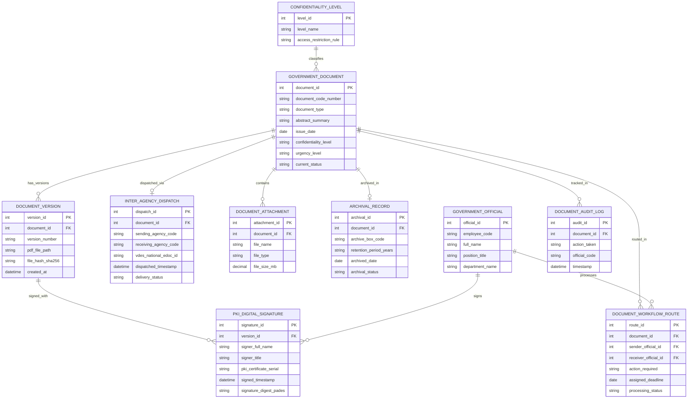

# Conceptual ERD — Government Document Management System

## Mermaid Code

## Entity Description Table | Bảng mô tả Entity

| # | Entity Name | Vietnamese Name | Description | Key Attributes | Main Relationships |
|---|-------------|-----------------|-------------|----------------|-------------------|
| 1 | GOVERNMENT_DOCUMENT | Văn bản Chính phủ | Thông tin thuộc tính cốt lõi của văn bản hành chính (số ký hiệu, loại văn bản, trích yếu) | document_id, document_code_number, document_type, confidentiality_level | Has versions DOCUMENT_VERSION, routed in WORKFLOW_ROUTE |
| 2 | DOCUMENT_VERSION | Phiên bản Tệp Văn bản | Các phiên bản tệp PDF văn bản qua từng vòng trình ký và mã băm SHA-256 | version_id, version_number, pdf_file_path, file_hash_sha256 | Belongs to GOVERNMENT_DOCUMENT, signed with PKI_DIGITAL_SIGNATURE |
| 3 | DOCUMENT_WORKFLOW_ROUTE | Luồng Luân chuyển Văn bản | Nhật ký luân chuyển trình xin ý kiến, trình ký và chỉ đạo xử lý văn bản | route_id, action_required, assigned_deadline, processing_status | Belongs to GOVERNMENT_DOCUMENT, GOVERNMENT_OFFICIAL |
| 4 | INTER_AGENCY_DISPATCH | Văn bản Liên thông (VDES) | Nhật ký phát hành văn bản đi/đến qua Trục liên thông văn bản quốc gia VDES | dispatch_id, sending_agency_code, receiving_agency_code, vdes_national_edoc_id | Belongs to GOVERNMENT_DOCUMENT |
| 5 | PKI_DIGITAL_SIGNATURE | Chữ ký số Chuyên dùng PKI | Chi tiết chữ ký số chuyên dùng Chính phủ PAdES của lãnh đạo ký duyệt | signature_id, signer_full_name, pki_certificate_serial, signature_digest_pades | Belongs to DOCUMENT_VERSION, signed by OFFICIAL |
| 6 | DOCUMENT_ATTACHMENT | Tệp Phụ lục Đính kèm | Các tệp tờ trình, bản vẽ, bảng số liệu phụ lục đính kèm văn bản chính | attachment_id, file_name, file_type, file_size_mb | Belongs to GOVERNMENT_DOCUMENT |
| 7 | ARCHIVAL_RECORD | Hồ sơ Nộp Lưu trữ | Hồ sơ đóng gói nộp lưu trữ lịch sử vào Cục Văn thư và Lưu trữ Nhà nước | archival_id, archive_box_code, retention_period_years, archival_status | Belongs to GOVERNMENT_DOCUMENT |
| 8 | CONFIDENTIALITY_LEVEL | Mức độ Bảo mật (Độ Mật) | Phân loại độ mật quốc gia: Thường, Mật, Tối mật, Tuyệt mật theo luật | level_id, level_name, access_restriction_rule | Classifies GOVERNMENT_DOCUMENT |
| 9 | GOVERNMENT_OFFICIAL | Cán bộ Công chức | Thông tin lãnh đạo, chuyên viên và văn thư tham gia xử lý văn bản | official_id, employee_code, full_name, position_title | Processes WORKFLOW_ROUTE, signs DIGITAL_SIGNATURE |
| 10 | DOCUMENT_AUDIT_LOG | Nhật ký Kiểm toán Văn bản | Lưu vết toàn bộ thao tác xem, chỉnh sửa, ký số, tải về chống lộ bí mật | audit_id, action_taken, official_code, timestamp | Belongs to GOVERNMENT_DOCUMENT |

## Relationship Description | Mô tả Quan hệ

| # | From Entity | Cardinality | To Entity | Relationship Label | Business Explanation |
|---|-------------|-------------|-----------|-------------------|----------------------|
| 1 | GOVERNMENT_DOCUMENT | one-to-many | DOCUMENT_VERSION | has_versions | Một văn bản hành chính trải qua nhiều phiên bản tệp PDF trong quá trình soạn thảo |
| 2 | DOCUMENT_VERSION | one-to-many | PKI_DIGITAL_SIGNATURE | signed_with | Một phiên bản tệp văn bản có thể chứa nhiều chữ ký số PKI của các cấp lãnh đạo |
| 3 | GOVERNMENT_DOCUMENT | one-to-many | DOCUMENT_WORKFLOW_ROUTE | routed_in | Một văn bản được luân chuyển qua nhiều bước phân công xử lý cho các cán bộ |
| 4 | GOVERNMENT_DOCUMENT | one-to-one | INTER_AGENCY_DISPATCH | dispatched_via | Một văn bản đi liên thông được gửi qua duy nhất một bản ghi phát hành VDES |
| 5 | GOVERNMENT_DOCUMENT | one-to-many | DOCUMENT_ATTACHMENT | contains | Một văn bản hành chính có thể chứa nhiều tệp phụ lục báo cáo đính kèm |
| 6 | GOVERNMENT_DOCUMENT | one-to-one | ARCHIVAL_RECORD | archived_in | Một văn bản hết hạn hiện hành được đóng gói vào một hồ sơ lưu trữ lịch sử |
| 7 | GOVERNMENT_OFFICIAL | one-to-many | DOCUMENT_WORKFLOW_ROUTE | processes | Một cán bộ công chức tiếp nhận và xử lý nhiều lượt luân chuyển văn bản |
| 8 | GOVERNMENT_OFFICIAL | one-to-many | PKI_DIGITAL_SIGNATURE | signs | Một lãnh đạo cơ quan ký số chữ ký chuyên dùng PKI lên nhiều văn bản |
| 9 | GOVERNMENT_DOCUMENT | one-to-many | DOCUMENT_AUDIT_LOG | tracked_in | Mọi thao tác truy cập văn bản đều được ghi lại nhật ký kiểm toán bất biến |
| 10 | CONFIDENTIALITY_LEVEL | one-to-many | GOVERNMENT_DOCUMENT | classifies | Một mức độ mật (Thường/Mật/Tối mật) phân loại cho nhiều văn bản nhà nước |
